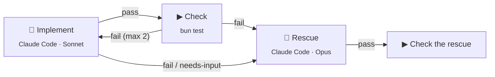

<div align="center">


# Night Shift

**Draw your agent pipeline as a flow. Night Shift runs it on your machine while you sleep.**<br>
You wake up to a stack of pull requests and a short list of decisions that need you.

[](LICENSE)
[](#status)
[](https://bun.sh)
[](https://www.typescriptlang.org)


[Quick start](#quick-start) · [How it works](#how-it-works) · [Starter flows](examples/starters/) · [Plan](docs/PLAN.md) · [Contributing](CONTRIBUTING.md)

</div>

<picture>
  <source media="(prefers-color-scheme: dark)" srcset="docs/assets/flow-editor-dark.png">
  
</picture>

## Why

If you work with coding agents, you probably run the same pipeline again and again: build, check, retry, rescue, open a pull request, review. Most of the time that pipeline is a script. Nobody can see it, and every change to it is a code change.

Night Shift turns the pipeline into a flow that you draw. The engine owns the order, the retries, the loop limits, and the stop time. Agents do the work. You step in only at a gate.

- **Local first.** Every session, branch, and token stays on your own computers. Agents run with your own CLI logins.
- **The engine decides, the model advises.** A model never adds a node or changes the graph. Every loop has a maximum count.
- **Flows are files.** A flow is a JSON file in your repo (`.nightshift/flows/`). You can review it, diff it, and share it like code.
- **No built-in method.** Spec-driven, issue-driven, or one file at a time: each method is just another flow.

## How it works

A flow is a graph of steps. Each edge leaves a step on a named outcome. This is the [`implement-and-check`](examples/starters/.nightshift/flows/implement-and-check.json) starter:



Steps are nodes. Each node type does one job:

| Node | Does |
| --- | --- |
| **Agent** | Runs one coding-agent session with a prompt or a skill. Ends with an outcome and, if you ask, data that matches a JSON schema. |
| **Command** | Runs a shell command in the project, for example the tests. Template values arrive as environment variables, never as shell text. |
| **Tool** | Calls one tool of an MCP server with typed arguments. No model in the loop. |
| **Decision** | Picks one of its options. Who picks is up to you: a person (a **gate** in your inbox), a rule (a JSONata expression), or a model. |
| **Value** | Makes data that matches a JSON schema, from a rule or a model. |
| **Wait** | Waits for a duration, a time, a command that passes, or a signal from outside. |
| **Call** | Runs another flow, once or once per item in a list. The list can come from a planner's output, a command such as `gh`, or a glob of files. |

A flow declares inputs and outputs, like a function. Steps read earlier values through templates such as `{{verify.log_tail}}` or `{{planner.data.tasks}}`.

### Agents on your own logins

An Agent node names the coding agent it runs on. One flow can mix them.

| Agent | Status |
| --- | --- |
| Claude Code | Verified |
| OpenCode | Needs a 1.x build |
| Codex | Not yet verified |
| Grok Build | Not yet verified |
| pi | Through the Agent Client Protocol. Needs pi 0.81 or later. Runs local models through Ollama |
| GitHub Copilot, Gemini CLI, Cursor | Through the Agent Client Protocol, not yet verified |

A node can add MCP servers and CLI tools such as `gh`. Night Shift knows no issue tracker: GitHub, Linear, or Jira is a command or an MCP server in your flow.

### Runs that survive the night

- **Schedules** start a flow at a set time and stop it at a stop time, for example 22:00 to 07:00.
- **Run policy** handles fresh retries with the failure log, a rescue by a stronger model, network grace, and usage-limit waits that resume the same session.
- **Each run works in its own copy of your project**, so your checkout stays clean.
- **Gates** wait in a "Needs you" inbox. An unattended run never blocks on a question in the middle of a session.

## Quick start

You need macOS or Linux, [Bun](https://bun.sh) 1.3, git, and at least one coding-agent CLI that you have logged in to (for example `claude`).

```bash
git clone https://github.com/xiduzo/nightshift.git
cd nightshift
bun install
bun run db:push
bun run dev            # web UI and API with hot reload
```

Then open the web UI, add a project, and copy a [starter flow](examples/starters/) into it:

```bash
mkdir -p <your-project>/.nightshift/flows
cp examples/starters/.nightshift/flows/*.json <your-project>/.nightshift/flows/
```

Open a flow in the editor, change the prompts and the check to fit your project, and start a run.

| Command | Use it to |
| --- | --- |
| `bun run dev` | Work on Night Shift itself, with hot reload. Data stays in `.nightshift-dev/`. |
| `bun run night` | Run real nights from a stable build that does not reload. Data stays in the OS app data folder. |
| `bun run dev:desktop` | Start the desktop app. |
| `bun run build:desktop` | Build the desktop app in `apps/desktop/build/`. Releases are in [docs/releasing.md](docs/releasing.md). |

> [!TIP]
> Run nights with `bun run night` and develop in a separate git worktree. A code change then never reloads Night Shift in the middle of a night.

### Starter flows

| Flow | Does |
| --- | --- |
| `implement-and-check` | An agent builds a task, a command checks it, retries with the log, then a rescue on a stronger model. |
| `plan-and-build` | A planner splits a goal into tasks. Each task gets its own stacked branch, in dependency order. A reviewer ends it. |
| `review-pr` | An agent reviews a pull request. A gate asks you before the review is posted. |
| `per-file` | Applies one instruction to every file that matches a glob. |

Details are in [examples/starters/](examples/starters/).

### Run it on a server

`nightshift` is Night Shift in one file: the server, the web UI, and the database. It runs on Linux (x64, arm64) and macOS (arm64), with Docker and systemd recipes. Your laptop can pair with it over your LAN, Tailscale, a public server, or a tunnel. See [docs/deploy/](docs/deploy/).

## Status

Night Shift is **pre-alpha**. It is built in public, for its author first, and it changes fast. Expect breaking changes to the flow format and the database.

- [ ] One flow runs a full Epic overnight and replaces the script it grew from.
- [ ] Night Shift builds Night Shift: its own work runs through its own flows.
- [ ] One person runs Night Shift on several computers: a laptop and a server pair, and each step runs where you place it.

The concept, the decisions, and the delivery order are in [docs/PLAN.md](docs/PLAN.md).

## Documentation

| Document | What is in it |
| --- | --- |
| [docs/PLAN.md](docs/PLAN.md) | The concept, the settled decisions, the architecture, and the setup. |
| [docs/glossary.md](docs/glossary.md) | One name for one thing: flow, run, step, node, gate, and more. |
| [docs/steering/](docs/steering/) | The vision, and the technical, QA, and design rules every change follows. |
| [docs/deploy/](docs/deploy/) | Run Night Shift on a server and reach it from your other computers. |
| [docs/research/](docs/research/) | Spikes and design notes behind the bigger decisions. |

## Built with

[Bun](https://bun.sh) · [TanStack Start](https://tanstack.com/start) and [TanStack AI](https://tanstack.com/ai) · [React Flow](https://reactflow.dev) · [LangGraph](https://github.com/langchain-ai/langgraphjs) · [Hono](https://hono.dev) · [oRPC](https://orpc.unnoq.com) · [Drizzle](https://orm.drizzle.team) on libsql · [Better Auth](https://better-auth.com) · [shadcn/ui](https://ui.shadcn.com) · [Electrobun](https://electrobun.dev)

## Contributing

Issues and ideas are welcome. Read [CONTRIBUTING.md](CONTRIBUTING.md) before you open a pull request. To report a security problem, see [SECURITY.md](SECURITY.md).

## License

[Apache-2.0](LICENSE)
