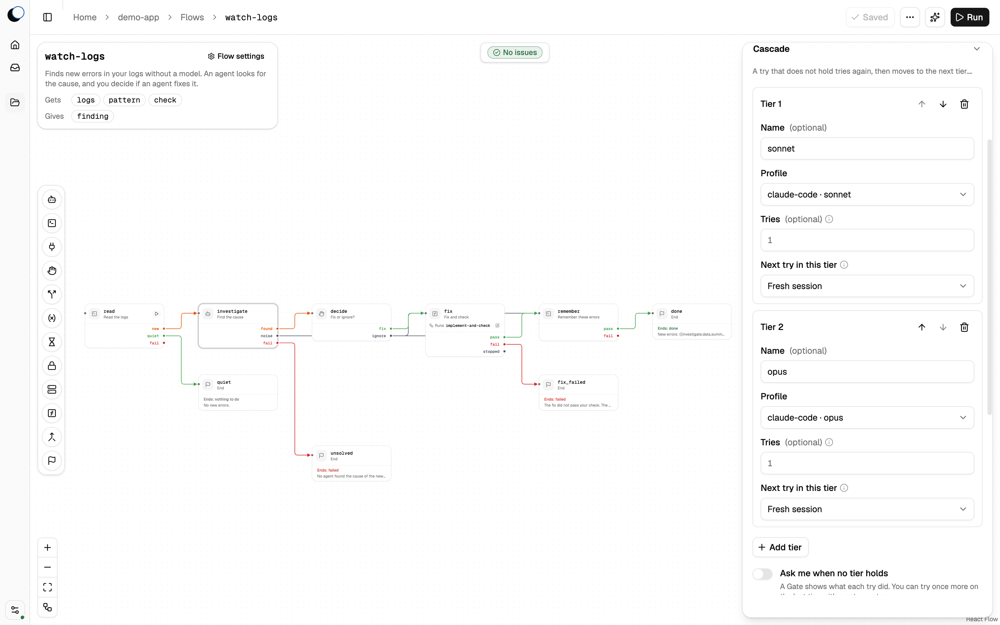
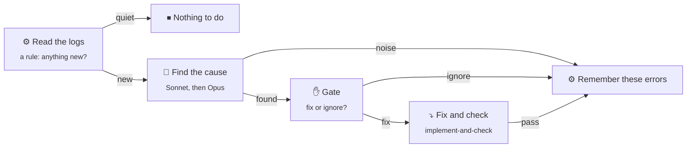

<div align="center">


# Night Shift

**Stop babysitting your agents.**<br>
Draw once how your AI agents and you work together. Night Shift runs it on your own computers, day and night, and asks you only what needs you.

[](LICENSE)
[](#status)
[](https://bun.sh)
[](https://www.typescriptlang.org)


[Quick start](#quick-start) · [How it works](#how-it-works) · [Flows to run](#flows-to-run) · [User guide](https://github.com/xiduzo/nightshift/wiki) · [Contributing](CONTRIBUTING.md)

</div>

<picture>
  <source media="(prefers-color-scheme: dark)" srcset="docs/assets/flow-editor-dark.png">
  
</picture>

## What Night Shift does

An AI agent, such as Claude Code or Codex, can research a market, watch a service, write a newsletter, or fix a bug. But you still start each agent, check its work, and choose what comes next.

Night Shift does that part for you. You draw a **flow**: the steps of a job, which agent does each step, and where you want to decide. Night Shift then runs the flow when you click **Run**, on a schedule, or when another tool calls it. It asks you only at the points that you marked.

Some examples:

- Each morning, read the news on a topic and write a short brief.
- Each night, check your logs. When there is a new error, find the cause and ask you before a fix.
- Find five candidates for a podcast host, let you pick one, and write a report on it.

Night Shift works like n8n or Zapier, but a step can be an agent that works for an hour.

- **Your computers, your logins.** Runs, files, and logins stay on your own computers. The agents use the subscriptions that you already pay for.
- **You stay in control.** An agent never adds a step or changes your flow. Every loop has a maximum. Each run shows what each step cost.

## Quick start

You need:

- A Mac with Apple silicon, or a Linux computer (x64).
- An account for Claude or ChatGPT. Night Shift installs the agent for you.

Then:

1. **Download the desktop app** from the [nightly release](https://github.com/xiduzo/nightshift/releases/tag/nightly).
2. **Open the app.** On macOS, the first start needs one extra step. Open **System Settings > Privacy & Security**, and choose **Open Anyway**.
3. **Follow Get started on Home.** It installs an agent, signs you in, and adds your first project.
4. **Run a starter flow.** Open `scout-and-pick`, and give it a topic that you care about. Night Shift asks you to pick a candidate, and an agent writes a report on it.

[Get started](https://github.com/xiduzo/nightshift/wiki/Get-started) in the user guide shows each step. Then [build your first flow](https://github.com/xiduzo/nightshift/wiki/Your-first-flow).

## How it works

| Word | Means |
| --- | --- |
| **Project** | A place for one body of work. It holds the flows, runs, and knowledge of that work. It can have a folder on your computer. |
| **Flow** | The steps of a job, drawn as boxes and arrows. |
| **Node** | One box in a flow: an agent, a shell command, a web request, a choice, a wait. |
| **Run** | One time that a flow runs, from start to end. |
| **Gate** | A question that waits for you in the inbox, such as "Send this email?". |
| **Schedule** | When a flow runs without you, for example each weekday at 22:00. |

[How Night Shift works](https://github.com/xiduzo/nightshift/wiki/How-Night-Shift-works) in the user guide tells more.

### Two ladders

In a flow, each job goes to the cheapest helper that does it well.

- **Work climbs.** A cheap agent tries first. When its try fails a check, a strong agent tries again with the failure. The last rung can be you.
- **Choices climb.** A rule makes the choices that it can. A small [decision model](https://github.com/xiduzo/nightshift/wiki/Flows-and-nodes#deciders) makes the next ones. It is fast and cheap, and it can only pick one of the options that you gave. A large model or you make the rest.

A Gate is where a ladder reaches you. It has two jobs. It catches what a ladder cannot do. And it asks for your approval before an act that you cannot undo, such as a sent email, a published post, or a merge.

This is the [`watch-logs`](https://github.com/xiduzo/nightshift/wiki/Flows-and-nodes#starter-flows) starter flow. A rule wakes an agent only for a new error, and a Gate asks you before Night Shift acts:



The same shape can watch a feed, a price, or a status page. [Flows and nodes](https://github.com/xiduzo/nightshift/wiki/Flows-and-nodes) in the user guide tells each node type.

## Flows to run

These flows come with Night Shift. When you add a project with a folder, you choose which of your agents runs each part.

<!-- checked:starters: every listed starter has one row. bun run docs:reference checks it. -->
| Flow | What it does |
| --- | --- |
| `implement-and-check` | Builds one task. A cheap agent tries, your check proves each try, and a strong agent rescues it. |
| `plan-and-build` | Splits a goal into tasks, then builds and checks each task. |
| `per-file` | Applies one instruction to each file that matches a pattern. |
| `watch-logs` | Reads your logs. Wakes an agent only for a new error, and asks you before a fix. |
| `scout-and-pick` | Finds candidates on a topic, lets you pick one, and writes it out as a report. |
| `draft-slides` | Turns notes into a slide deck, and revises it after your review. |
| `review-learnings` | Asks you which notes from your agents to keep. Agents read what you keep. |
<!-- /checked:starters -->

People share more flows in [community/](community/). These need an account or a tool beyond your agent:

<!-- checked:community: every community flow has one row. bun run docs:reference checks it. -->
| Flow | What it does |
| --- | --- |
| [`review-pr`](community/review-pr/) | Reviews a pull request, and posts the review when you agree. |
| [`figma-to-code`](community/figma-to-code/) | Reads a Figma frame, updates the matching components, and shows you the change. |
<!-- /checked:community -->

More flows wait on the [Ideas](https://github.com/xiduzo/nightshift/wiki/Ideas) page. Build one and [share it](community/README.md).

## Next to n8n and Zapier

Night Shift has no app catalog. A flow reaches an app through its CLI, an HTTP call, a webhook, or the agent's own tools. You can use n8n or Zapier together with Night Shift. They can start a flow with a [signed webhook](docs/deploy/triggers.md), and a Command step can send the result back.

## Other ways to run it

| Way | For |
| --- | --- |
| **The desktop app** | Your own computer. See [Quick start](#quick-start). It updates itself. |
| **The Docker image** | A Host on a server, which runs your schedules when your laptop sleeps: `ghcr.io/xiduzo/nightshift:nightly`. See [docs/deploy/](docs/deploy/). |
| **From source** | Work on Night Shift itself. You need macOS or Linux, [Bun](https://bun.sh) 1.3, and git. See [CONTRIBUTING.md](CONTRIBUTING.md). |

```bash
git clone https://github.com/xiduzo/nightshift.git
cd nightshift
bun install
bun run dev            # web UI on :3001, API on :3000
```

## Status

Night Shift is pre-alpha and built in public. It has run a real project every night since 2026-10-16. Expect breaking changes to the flow format and the database. The goals are in [VISION.md](docs/steering/VISION.md#strategic-goals).

## Usage data

A released build sends anonymous usage events to the Night Shift team. A run from source sends nothing. The events have no names, paths, prompts, or file contents. To stop them, use the switch in Settings, or set `NIGHTSHIFT_USAGE=off` or `DO_NOT_TRACK=1`. [docs/usage-data.md](docs/usage-data.md) lists every event.

## Documentation

| Document | What is in it |
| --- | --- |
| [User guide](https://github.com/xiduzo/nightshift/wiki) | Install Night Shift, build your first flow, schedule runs, and answer Gates. |
| [docs/deploy/](docs/deploy/) | Run a Host on a server, webhooks, local models, and monitoring. |
| [docs/PLAN.md](docs/PLAN.md) | The concept, the decisions, and the architecture. |
| [docs/glossary.md](docs/glossary.md) | One name for one thing. |
| [docs/adr/](docs/adr/) | The architecture decisions, one record each. |
| [docs/steering/](docs/steering/) | The vision, and the rules that every change follows. |

## Built with

[Bun](https://bun.sh) · [TanStack Start](https://tanstack.com/start) · [React Flow](https://reactflow.dev) · [LangGraph](https://github.com/langchain-ai/langgraphjs) · [Yjs](https://yjs.dev) · [Hono](https://hono.dev) · [oRPC](https://orpc.unnoq.com) · [Drizzle](https://orm.drizzle.team) · [Better Auth](https://better-auth.com) · [shadcn/ui](https://ui.shadcn.com) · [Electrobun](https://electrobun.dev) · [Expo](https://expo.dev)

## Contributing

Read [CONTRIBUTING.md](CONTRIBUTING.md) before you open a pull request. To report a security problem, see [SECURITY.md](SECURITY.md).

## License

[Apache-2.0](LICENSE)

The logo follows the phase of the moon. The moon icons are from [OpenMoji](https://openmoji.org), the open-source emoji and icon project, under [CC BY-SA 4.0](https://creativecommons.org/licenses/by-sa/4.0/).
