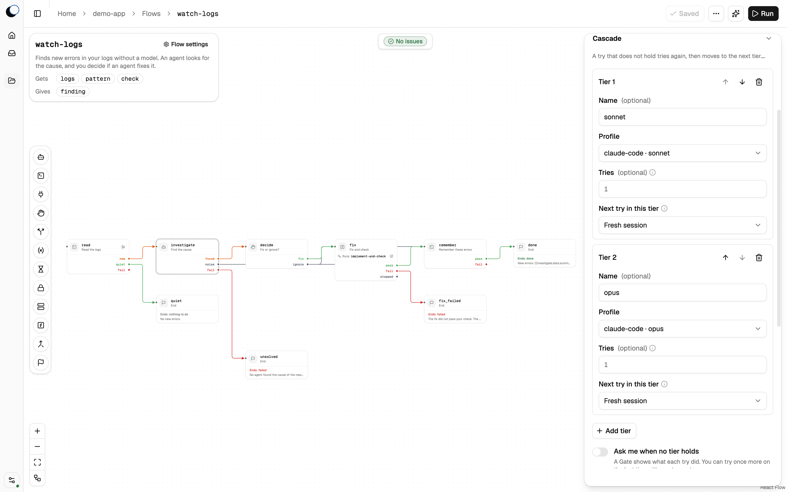
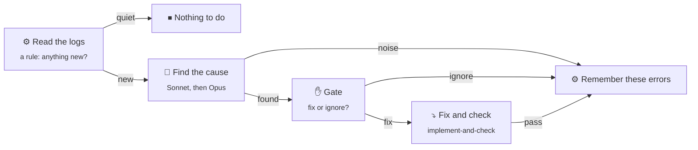

<div align="center">


# Night Shift

**Stop babysitting your agents.**<br>
Draw once how your agents and you work together. Night Shift runs it on your own machines, day and night, and asks you only what needs you.

A workflow builder like n8n or Zapier. A step can be an agent that works for an hour, and a choice can go to a small decision model.

[](LICENSE)
[](#status)
[](https://bun.sh)
[](https://www.typescriptlang.org)


[Quick start](#quick-start) · [Two ladders](#two-ladders) · [Flows to run](#flows-to-run) · [User guide](https://github.com/xiduzo/nightshift/wiki) · [Contributing](CONTRIBUTING.md)

</div>

<picture>
  <source media="(prefers-color-scheme: dark)" srcset="docs/assets/flow-editor-dark.png">
  
</picture>

## Why

Agents can research a market, watch a service, write a newsletter, or fix a bug. But you still start each one, check what it made, and choose what comes next. The agents do the work, and you work the shift.

Night Shift lets you engineer that work once. You draw a flow: which agent does which step, which check proves it, what it may cost, and which choices need you. Rules and decision models make the other choices. Night Shift runs the flow on a schedule, from a webhook, or when you click Run. You answer only at a Gate. A run can end with a report of what it produced, which waits for you on Home.

Every run shows what each step cost and how far each ladder climbed. So you tune a flow like any other system you build.

- **Your machines, your logins.** Runs, their files, and your logins stay on your own computers. Agents run on the subscriptions that you already pay for.
- **A project is a place for a body of work.** It holds the flows, schedules, knowledge, secrets, and runs of that work. Its folder is optional. Research or outreach often needs no folder.
- **The engine decides, the model advises.** A model never adds a step or changes the flow. Every loop has a maximum.
- **Flows stay out of your project.** Every save is a revision. You see who changed what, and you can restore an earlier one.

## Two ladders

In a flow, each job goes to the cheapest rung that does it well.

- **Work climbs.** A cheap agent tries first. When a try fails its check, a strong agent tries with the failure. The last rung can be you.
- **Choices climb.** A rule makes the choices it can. A small [decision model](https://github.com/xiduzo/nightshift/wiki/Flows-and-nodes#deciders), such as TypeSafe Jev, makes the next ones. It is fast and cheap, and it can only pick one of the options that you gave. A large model or you make the rest.

A Gate is where a ladder reaches you. It has two jobs. It is the fallback when a ladder runs out or a decision model is not sure. And it asks for your approval before an act that you cannot undo, such as a sent mail, a published post, or a merge.

This is the [`watch-logs`](https://github.com/xiduzo/nightshift/wiki/Flows-and-nodes#starter-flows) starter. It watches something, here your logs. A rule wakes an agent only for what is new, and a Gate asks you before Night Shift acts:



The same shape can watch a feed, a price, or a status page. A flow has fourteen node types, from an Agent session to a Web request and a Wait for a webhook. [Flows and nodes](https://github.com/xiduzo/nightshift/wiki/Flows-and-nodes) in the user guide tells each one.

## Flows to run

These flows come with Night Shift. When you add a project, you choose which of your agents runs each part.

<!-- checked:starters: every listed starter has one row. bun run docs:reference checks it. -->
| Flow | What it does |
| --- | --- |
| `implement-and-check` | Builds one task. A cheap agent tries, your check proves each try, and a strong agent rescues it. |
| `plan-and-build` | Splits a goal into tasks, then builds and checks each task. |
| `per-file` | Applies one instruction to each file that matches a pattern. |
| `watch-logs` | Reads your logs. Wakes an agent only for a new error, and asks you before a fix. |
| `scout-and-pick` | Finds candidates on a topic, lets you pick one, and writes it out as a report. |
| `draft-slides` | Turns notes into a slide deck, and revises it after your review. |
| `review-learnings` | Asks you which notes from your agents to keep. Agents read what you keep. |
<!-- /checked:starters -->

People share more flows in [community/](community/). These need an account or a tool beyond your agent:

<!-- checked:community: every community flow has one row. bun run docs:reference checks it. -->
| Flow | What it does |
| --- | --- |
| [`review-pr`](community/review-pr/) | Reviews a pull request, and posts the review when you agree. |
| [`figma-to-code`](community/figma-to-code/) | Reads a Figma frame, updates the matching components, and shows you the change. |
<!-- /checked:community -->

More flows wait on the [Ideas](https://github.com/xiduzo/nightshift/wiki/Ideas) page. Build one and [share it](community/README.md).

## Next to n8n and Zapier

Night Shift has no app catalog. A flow reaches an app through its CLI, an HTTP call, a webhook, or the agent's own tools. Use n8n or Zapier together with Night Shift. They can start a flow with a [signed webhook](docs/deploy/triggers.md), and a Command step can send the result back.

## Quick start

Night Shift is pre-alpha. Pick one way to run it:

| Way | For |
| --- | --- |
| **The desktop app** | Your own computer. Download it from the [nightly release](https://github.com/xiduzo/nightshift/releases/tag/nightly): macOS (Apple silicon) or Linux (x64). It updates itself. |
| **The Docker image** | A Host on a server: `ghcr.io/xiduzo/nightshift:nightly`. See [docs/deploy/](docs/deploy/). |
| **From source** | Work on Night Shift itself. You need macOS or Linux, [Bun](https://bun.sh) 1.3, and git. |

```bash
git clone https://github.com/xiduzo/nightshift.git
cd nightshift
bun install
bun run dev            # web UI on :3001, API on :3000
```

Then, in Night Shift:

1. **Add your agents.** No agent yet? On Home, **Get started** installs Claude Code or Codex and signs you in. The Agents page shows the agent CLIs that it finds on this computer, such as `claude`, `codex`, or `pi`. Add a profile for each one that you want.
2. **Add a project.** Choose its folder, copy a repository from GitHub, or choose **No folder**. A folder without git gets a **Set up git** button. For a project with a folder, keep "Add the starter flows" on, and choose which of your agents runs each part.
3. **Run a starter.** Open `scout-and-pick`, and start a run with a topic you care about. Night Shift asks you to pick one of the candidates that an agent finds. Another agent then writes a report on your pick into the project's knowledge.

[Get started](https://github.com/xiduzo/nightshift/wiki/Get-started) in the user guide tells the rest.

## Status

Night Shift is pre-alpha and built in public. It has run a real project every night since 2026-10-16. Expect breaking changes to the flow format and the database. The goals are in [VISION.md](docs/steering/VISION.md#strategic-goals).

## Usage data

A released build sends anonymous usage events to the Night Shift team. A run from source sends nothing. The events have no names, paths, prompts, or file contents. Turn usage off in Settings, or set `NIGHTSHIFT_USAGE=off` or `DO_NOT_TRACK=1`. [docs/usage-data.md](docs/usage-data.md) lists every event.

## Documentation

| Document | What is in it |
| --- | --- |
| [User guide](https://github.com/xiduzo/nightshift/wiki) | Install Night Shift, draw flows, schedule runs, and answer Gates. |
| [docs/deploy/](docs/deploy/) | Run a Host on a server, webhooks, local models, and monitoring. |
| [docs/PLAN.md](docs/PLAN.md) | The concept, the decisions, and the architecture. |
| [docs/glossary.md](docs/glossary.md) | One name for one thing. |
| [docs/adr/](docs/adr/) | The architecture decisions, one record each. |
| [docs/steering/](docs/steering/) | The vision, and the rules that every change follows. |

## Built with

[Bun](https://bun.sh) · [TanStack Start](https://tanstack.com/start) · [React Flow](https://reactflow.dev) · [LangGraph](https://github.com/langchain-ai/langgraphjs) · [Yjs](https://yjs.dev) · [Hono](https://hono.dev) · [oRPC](https://orpc.unnoq.com) · [Drizzle](https://orm.drizzle.team) · [Better Auth](https://better-auth.com) · [shadcn/ui](https://ui.shadcn.com) · [Electrobun](https://electrobun.dev) · [Expo](https://expo.dev)

## Contributing

Read [CONTRIBUTING.md](CONTRIBUTING.md) before you open a pull request. To report a security problem, see [SECURITY.md](SECURITY.md).

## License

[Apache-2.0](LICENSE)
