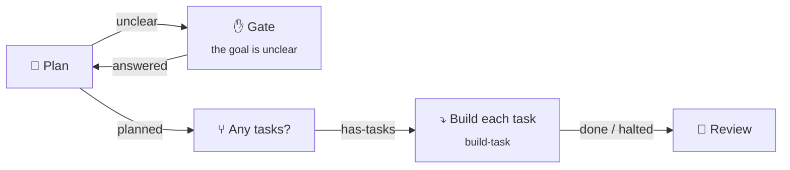

<div align="center">


# Night Shift

**Draw your agent pipeline as a flow. Night Shift runs it on your machine while you sleep.**<br>
You wake up to a stack of pull requests and a short list of decisions that need you. Answer them on your computer or on your phone.

[](LICENSE)
[](#status)
[](https://bun.sh)
[](https://www.typescriptlang.org)


[Quick start](#quick-start) · [How it works](#how-it-works) · [User guide](https://github.com/xiduzo/nightshift/wiki) · [Starter flows](https://github.com/xiduzo/nightshift/wiki/Flows-and-nodes#starter-flows) · [Plan](docs/PLAN.md) · [Contributing](CONTRIBUTING.md)

</div>

<picture>
  <source media="(prefers-color-scheme: dark)" srcset="docs/assets/flow-editor-dark.png">
  
</picture>

## Why

If you work with coding agents, you run the same pipeline again and again: build, check, retry, rescue, open a pull request, review. Most of the time that pipeline is a script. Nobody can see it, and every change to it is a code change.

Night Shift turns the pipeline into a flow that you draw. The engine owns the order, the retries, the loop limits, and the stop time. Agents do the work. You answer only at a gate.

- **Local first.** Every session, branch, and token stays on your own computers. Agents run with your own CLI logins.
- **The engine decides, the model advises.** During a run, a model never adds a node or changes the graph. Every loop has a maximum count.
- **Flows stay out of your repo.** Night Shift keeps your flows and schedules, so a team repo needs no Night Shift files. Every save is a revision. You see who changed what, and you can restore an earlier one ([ADR 2](docs/adr/0002-flows-are-night-shift-data.md)).
- **No built-in method.** Spec-driven, issue-driven, or one file at a time: each method is another flow.

## How it works

A flow is a graph of steps. Each edge leaves a step on a named outcome. This is the [`plan-and-build`](packages/flows/src/starters/flows/plan-and-build.json) starter:



A step can climb a **cascade**: it tries a cheap tier first, and moves up when a try does not hold. The [`implement-and-check`](packages/flows/src/starters/flows/implement-and-check.json) starter is one Agent with a cascade. Sonnet tries up to 3 times, then Opus. After each try, the check `bun test` runs. A try holds only when the check passes. Each try gets the failure of the try before. The last tier of a cascade can be you.

Steps are nodes. Each node type does one job:

<!-- checked:nodes: every node type has one row. bun run docs:reference checks it. -->
| Node | Does |
| --- | --- |
| **Agent** | Runs one coding-agent session with a prompt or a skill. Ends with an outcome and, if you ask, data that matches a JSON schema. |
| **Command** | Runs a shell command in the project, for example the tests. Template values arrive as environment variables, never as shell text. |
| **Tool** | Calls one tool of an MCP server with typed arguments. No model in the loop. |
| **Decision** | Picks one of its options. A person picks it (a **Gate**), a rule picks it (a **Branch**), or a model picks it. |
| **Value** | Makes data that matches a JSON schema, from a rule, a model, or a person (an **Ask**). |
| **Wait** | Waits for a duration, a time, a command that passes, or a signal, for example from a webhook. |
| **Subflow** | Runs another flow or a kit, once or once per item in a list. |
| **Join** | Waits for the branches that run at once, all of them or the first. |
| **Lease** | Lets one run at a time do the next steps, for example one deploy at a time. |
| **Service** | Starts a Docker Compose stack, a dev server, or a model server for the next steps, and stops it after. |
| **End** | Ends the run on purpose: done, nothing to do, or failed, with one line that says why. |
<!-- /checked:nodes -->

[Flows and nodes](https://github.com/xiduzo/nightshift/wiki/Flows-and-nodes) in the user guide tells each node in full, with the kits and the starter flows.

## What you get

- **[Build a flow with an agent.](https://github.com/xiduzo/nightshift/wiki/Flows-and-nodes#build-a-flow-with-an-agent)** Chat beside the canvas, a Suggest button on each field, and "Ask an agent why" when a run ends early.
- **[Agents on your own logins.](https://github.com/xiduzo/nightshift/wiki/Agents-and-profiles)** Claude Code, OpenCode, Codex, pi, and any agent that speaks the Agent Client Protocol. One flow can mix them.
- **[Runs that survive the night.](https://github.com/xiduzo/nightshift/wiki/Runs-and-schedules)** Schedules with a stop time, webhooks, a budget, usage-limit waits that continue the same session, and resume.
- **[Gates in your inbox.](https://github.com/xiduzo/nightshift/wiki/Gates-and-the-inbox)** A run never blocks on a question in the middle of a session. A Gate with a deadline picks for you.
- **[Knowledge.](https://github.com/xiduzo/nightshift/wiki/Knowledge)** The files your agents read besides the code: a wiki, web pages, Jira, Confluence. Agents propose what they learned, and you keep it.
- **[Your computers and a Host.](https://github.com/xiduzo/nightshift/wiki/Computers-and-Hosts)** Each step runs where you place it. A Host runs every schedule, and Spaces share projects with a team.
- **[Your phone.](https://github.com/xiduzo/nightshift/wiki/Phone-app)** Follow the night live, and answer Gates. Some Gates take an answer from the lock screen.
- **[A terminal or an agent.](https://github.com/xiduzo/nightshift/wiki/Terminal-and-MCP)** `nightshift flows` and `nightshift mcp` read and save flows, start runs, and answer Gates.

## Quick start

Night Shift is pre-alpha. Pick one way to run it:

| Way | For |
| --- | --- |
| **The desktop app** | Your own computer. Download it from the [nightly release](https://github.com/xiduzo/nightshift/releases/tag/nightly): macOS (Apple silicon) or Linux (x64). It updates itself. |
| **The Docker image** | A Host on a server: `ghcr.io/xiduzo/nightshift:nightly`. See [docs/deploy/](docs/deploy/). |
| **From source** | Work on Night Shift itself. See below. |

To run from source, you need macOS or Linux, [Bun](https://bun.sh) 1.3, git, and one coding-agent CLI that you are logged in to, such as `claude`.

```bash
git clone https://github.com/xiduzo/nightshift.git
cd nightshift
bun install
bun run dev            # web UI on :3001, API on :3000, with hot reload
```

Then, in the web UI at http://localhost:3001:

1. **Add a project.** Choose its folder, or copy a repository from GitHub. Leave "Add the starter flows" checked.
2. **Add your agents.** The Agents page shows the agent CLIs and tools that it finds on this computer. Add a profile for each one you want.
3. **Run a starter.** Open `implement-and-check`, set the check to your project's test command, and start a run with a small task.

[Get started](https://github.com/xiduzo/nightshift/wiki/Get-started) in the user guide has the macOS first-open step, `bun run night` for real nights, and where Night Shift keeps its data.

## Usage data

A released build of Night Shift (the desktop app and the Docker image) sends anonymous usage events to the Night Shift team. A run from source sends nothing. The events are a closed list, with no names, paths, prompts, or code. Turn usage off in Settings, or set `NIGHTSHIFT_USAGE=off` or `DO_NOT_TRACK=1`. [docs/usage-data.md](docs/usage-data.md) lists every event and field ([ADR 11](docs/adr/0011-night-shift-sends-anonymous-usage-by-default.md)).

## Status

Night Shift is **pre-alpha**. It is built in public, for its author first, and it changes fast. Expect breaking changes to the flow format and the database.

Night Shift has run a real project every night since 2026-10-16. On 2026-10-25 a flow ran a full Epic overnight to its end.

- [x] One flow runs a full Epic overnight and replaces the script it grew from.
- [ ] Night Shift builds Night Shift: its own work runs through its own flows.
- [ ] One person runs Night Shift on several computers: a laptop and a server pair, and each step runs where you place it.

The concept, the decisions, and the delivery order are in [docs/PLAN.md](docs/PLAN.md).

## Documentation

The [user guide](https://github.com/xiduzo/nightshift/wiki) is the GitHub wiki. Its pages live in [docs/wiki/](docs/wiki/), and a workflow publishes them. The repository holds the docs for people who build or run Night Shift:

| Document | What is in it |
| --- | --- |
| [docs/PLAN.md](docs/PLAN.md) | The concept, the settled decisions, the architecture, and the setup. |
| [docs/knowledge.md](docs/knowledge.md) | How the knowledge syncs, how search works, and the kits that fill it. |
| [docs/glossary.md](docs/glossary.md) | One name for one thing: flow, run, step, node, gate, and more. |
| [docs/usage-data.md](docs/usage-data.md) | Every usage event a released build sends, and how to turn it off. |
| [docs/steering/](docs/steering/) | The vision, and the technical, QA, and design rules every change follows. |
| [docs/adr/](docs/adr/) | The architecture decisions, one record each. |
| [docs/deploy/](docs/deploy/) | Run Night Shift on a server and reach it from your other computers. |
| [docs/deploy/triggers.md](docs/deploy/triggers.md) | Start a flow from GitHub Actions, n8n, Zapier or a script, with a signed webhook. |
| [docs/deploy/services.md](docs/deploy/services.md) | Start a Docker Compose stack or a dev server for the steps of a run, and let Night Shift stop it. |
| [docs/deploy/local-models.md](docs/deploy/local-models.md) | Let a Decision or a Value use a model on your own server. |
| [docs/deploy/monitoring.md](docs/deploy/monitoring.md) | Send the traces and metrics of your runs to your own OpenTelemetry tool. |
| [docs/releasing.md](docs/releasing.md) | Release the desktop app and the Docker image. |
| [docs/research/](docs/research/) | Spikes and design notes behind the bigger decisions. |

## Built with

[Bun](https://bun.sh) · [TanStack Start](https://tanstack.com/start) and [TanStack AI](https://tanstack.com/ai) · [React Flow](https://reactflow.dev) with [ELK](https://eclipse.dev/elk/) · [LangGraph](https://github.com/langchain-ai/langgraphjs) and [LangChain.js](https://js.langchain.com) · [Yjs](https://yjs.dev) and [Hocuspocus](https://tiptap.dev/docs/hocuspocus) · [Hono](https://hono.dev) · [oRPC](https://orpc.unnoq.com) · [Drizzle](https://orm.drizzle.team) on libsql · [Better Auth](https://better-auth.com) · [JSONata](https://jsonata.org) · [Model Context Protocol](https://modelcontextprotocol.io) · [Agent Client Protocol](https://agentclientprotocol.com) · [Ollama](https://ollama.com) · [OpenTelemetry](https://opentelemetry.io) · [shadcn/ui](https://ui.shadcn.com) · [Electrobun](https://electrobun.dev) · [Expo](https://expo.dev) and [React Native Reusables](https://reactnativereusables.com)

## Contributing

Issues and ideas are welcome. Read [CONTRIBUTING.md](CONTRIBUTING.md) before you open a pull request. To report a security problem, see [SECURITY.md](SECURITY.md).

## License

[Apache-2.0](LICENSE)
