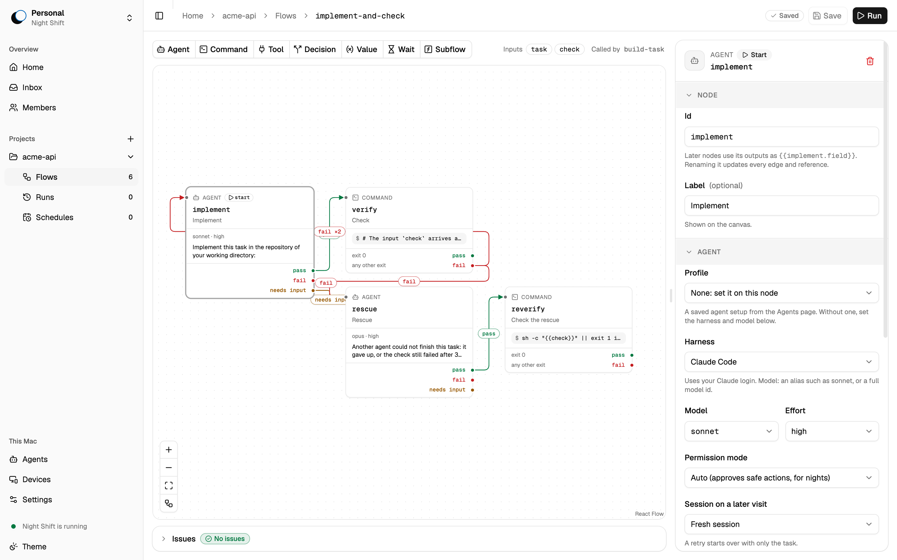
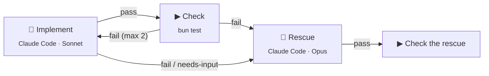

<div align="center">


# Night Shift

**Draw your agent pipeline as a flow. Night Shift runs it on your machine while you sleep.**<br>
You wake up to a stack of pull requests and a short list of decisions that need you. Answer them on your computer or on your phone.

[](LICENSE)
[](#status)
[](https://bun.sh)
[](https://www.typescriptlang.org)


[Quick start](#quick-start) · [How it works](#how-it-works) · [Your computers](#your-computers-a-host-and-your-phone) · [Starter flows](packages/flows/src/starters/) · [Plan](docs/PLAN.md) · [Contributing](CONTRIBUTING.md)

</div>

<picture>
  <source media="(prefers-color-scheme: dark)" srcset="docs/assets/flow-editor-dark.png">
  
</picture>

## Why

If you work with coding agents, you run the same pipeline again and again: build, check, retry, rescue, open a pull request, review. Most of the time that pipeline is a script. Nobody can see it, and every change to it is a code change.

Night Shift turns the pipeline into a flow that you draw. The engine owns the order, the retries, the loop limits, and the stop time. Agents do the work. You answer only at a gate.

- **Local first.** Every session, branch, and token stays on your own computers. Agents run with your own CLI logins.
- **The engine decides, the model advises.** A model never adds a node or changes the graph. Every loop has a maximum count.
- **Flows stay out of your repo.** Night Shift keeps your flows and schedules, so a team repo needs no Night Shift files. Every save is a revision. You see who changed what, and you can restore an earlier one ([ADR 2](docs/adr/0002-flows-are-night-shift-data.md)).
- **No built-in method.** Spec-driven, issue-driven, or one file at a time: each method is another flow.

## How it works

A flow is a graph of steps. Each edge leaves a step on a named outcome. This is the [`implement-and-check`](packages/flows/src/starters/flows/implement-and-check.json) starter:



Steps are nodes. Each node type does one job:

| Node | Does |
| --- | --- |
| **Agent** | Runs one coding-agent session with a prompt or a skill. Ends with an outcome and, if you ask, data that matches a JSON schema. It can ask you a question and continue with your answer. |
| **Command** | Runs a shell command in the project, for example the tests. Template values arrive as environment variables, never as shell text. JSON it writes to `$NS_OUTPUT` is its data, and can pick its outcome. `$NS_KNOWLEDGE` is the project's [knowledge](docs/knowledge.md) folder. |
| **Tool** | Calls one tool of an MCP server with typed arguments. No model in the loop. |
| **Decision** | Picks one of its options. You choose who picks: a person (a **Gate** in your inbox, with an optional deadline), a rule (a **Branch**, a JSONata expression), or a model. |
| **Value** | Makes data that matches a JSON schema, from a rule or a model. |
| **Wait** | Waits for a duration, a time, a command that passes, or a signal, for example from a webhook. |
| **Subflow** | Runs another flow or a **kit**, once or once per item in a list. The list can come from a planner's output or a command such as `gh`. |
| **Join** | Waits for the branches that run at once, all of them or the first. |
| **End** | Ends the run on purpose: done, nothing to do, or failed, with one line that says why. |

A flow declares inputs and outputs, like a function. Steps read earlier values through templates such as `{{verify.log_tail}}` or `{{planner.data.tasks}}`. Two or more edges on one outcome run their branches at once. A variable can keep its value from one run to the next.

A large flow stays readable. Put related nodes in a **Section**, a box on the canvas that you zoom into. A Section can hold other Sections. Choose Lay out, and Night Shift arranges the nodes for you. The editor has undo, redo, copy, and paste.

### Build a flow with an agent

You do not have to draw every node yourself. An agent helps you in the editor, on your own logins:

- **Chat beside the canvas.** Tell the agent what the flow must do. It proposes the changes, and the canvas marks each node and edge that it adds, removes, or changes. You keep the proposal or drop it.
- **Suggest on each field.** A prompt, the outcomes, a rule, a command, or the output fields: one click gives a suggestion that fits the flow.
- **Ask why.** When a run does not finish, the run page asks an agent why, and the agent reads the run for you.

You choose the agent that answers. An agent in a terminal gets the same help through `nightshift mcp` (see [Drive Night Shift from a terminal or an agent](#drive-night-shift-from-a-terminal-or-an-agent)).

### Agents on your own logins

An Agent node names the coding agent it runs on. One flow can mix them.

| Agent | Status |
| --- | --- |
| Claude Code | Verified |
| OpenCode | Needs a 1.x build |
| Codex | Not yet verified |
| Grok Build | Not yet verified |
| pi | Through the Agent Client Protocol. Needs pi 0.81 or later. Runs local models through Ollama |
| Any other agent that speaks the Agent Client Protocol | Add it as a custom agent with its command, for example `goose acp` |
| GitHub Copilot, Gemini CLI, Cursor | Through the Agent Client Protocol, not yet verified |

A node can add connections (MCP servers) and CLI tools such as `gh`. Each CLI tool runs with its own login, so one program can run as two accounts, for example `gh` and `gh-work`. Profiles hold an agent's setup, or the model of a Decision, under one name. You make them on the Agents page of each computer. A profile belongs to that computer, and a node names the profile and its computer, for example "builder on LE2316" ([ADR 3](docs/adr/0003-a-profile-belongs-to-one-device.md)).

Night Shift knows no issue tracker: GitHub, Linear, or Jira is a command in your flow. Kits are small flows that ship with Night Shift, on `git`, `gh` and `acli`: create a branch, open a draft pull request, wait for CI, finish the pull request, move a Jira work item. A Subflow runs one as `kit:github/publish-draft-pr`.

### Runs that survive the night

- **Schedules** start a flow at a set time and stop it at a stop time, for example 22:00 to 07:00. A schedule can also start when a webhook arrives, for example when a pull request opens, or wake a Wait when CI is done. A schedule names the computer where its run runs. When you have a Host, the Host starts every schedule.
- **A computer that goes offline does not end the run.** A step on that computer waits for it until the stop time, and Night Shift tells you.
- **Run policy** handles fresh retries with the failure log, a rescue by a stronger model, network grace, and usage-limit waits that resume the same session.
- **Each run works in its own copy of your project**, so your checkout stays clean.
- **Gates** wait in a "Needs you" inbox. An unattended run never blocks on a question in the middle of a session. A Gate with a deadline picks an option for you when nobody answers in time.

## Quick start

You need macOS or Linux, [Bun](https://bun.sh) 1.3, git, and at least one coding-agent CLI that you have logged in to (for example `claude`).

```bash
git clone https://github.com/xiduzo/nightshift.git
cd nightshift
bun install
bun run dev            # web UI on :3001, API on :3000, with hot reload
```

You need no `.env` file to start. Outside production, Night Shift makes its own auth secret once and says so in its log.

Then, in the web UI at http://localhost:3001:

1. **Add a project.** Choose its folder, or copy a repository from GitHub. Leave "Add the starter flows" checked: the seven [starter flows](packages/flows/src/starters/) arrive in the project. Night Shift keeps the flows and writes nothing into your repository.
2. **Add your agents.** The Agents page shows the agent CLIs and tools that Night Shift finds on this computer (`claude`, `codex`, `opencode`, `pi`, `gh`, `acli`). Choose Add profile or Add tool for each one you want.
3. **Run a starter.** Open `implement-and-check`, set the check to your project's test command, and start a run with a small task.

| Command | Use it to |
| --- | --- |
| `bun run dev` | Work on Night Shift itself, with hot reload. Data stays in `.nightshift-dev/`. |
| `bun run night` | Run real nights from a stable build that does not reload. Data stays in the OS app data folder. |
| `bun run dev:desktop` | Start the desktop app. |
| `bun run build:desktop` | Build the desktop app in `apps/desktop/build/`. Releases are in [docs/releasing.md](docs/releasing.md). |

> [!TIP]
> Run nights with `bun run night` and develop in a separate git worktree. A code change then never reloads Night Shift in the middle of a night.

### Starter flows

| Flow | Does |
| --- | --- |
| `implement-and-check` | An agent builds a task, a command checks it, retries with the log, then a rescue on a stronger model. |
| `plan-and-build` | A planner splits a goal into tasks. Each task gets its own stacked branch, in dependency order. A reviewer ends it. |
| `build-task` | Builds one task of `plan-and-build`. |
| `review-pr` | An agent reviews a pull request. A gate asks you before the agent posts the review. |
| `per-file` | Applies one instruction to every file that matches a glob. |
| `edit-file` | Edits one file of `per-file`. |

Night Shift saves all seven into a project when you add it. A flow that calls another flow needs that flow in the project too. See [packages/flows/src/starters/](packages/flows/src/starters/).

### Drive Night Shift from a terminal or an agent

A person or an agent in a terminal reads and saves flows through `nightshift`, never as files. Night Shift must run on this computer. Night Shift checks each save and keeps it as a new revision of the flow.

```bash
nightshift flows list                        # name, steps, errors, description
nightshift flows get fix-issue > fix.json    # the flow as JSON
nightshift flows save fix-issue fix.json     # or from stdin; prints its problems
nightshift flows export fix-issue --out ./   # a file to import elsewhere
nightshift flows import fix-issue.json       # a new flow; a taken name gets a suffix
nightshift flows revisions fix-issue         # who saved what, newest first
```

The commands use the project of the current folder. `--project <id, name or folder>` picks another one.

`nightshift mcp` gives an agent (Claude Code, Codex, an orchestrator) the same flows, the runs of a night, and a project's knowledge as MCP tools. Add it to Claude Code with `claude mcp add nightshift -- nightshift mcp`.

| Tool | What it does |
| --- | --- |
| `list_projects`, `list_flows`, `get_flow` | Read the projects and their flows. |
| `list_profiles`, `list_tools`, `list_skills` | Look up the names a node may use. |
| `check_flow`, `save_flow` | Check a flow, and save it when it has no errors. |
| `start_run` | Start a saved flow with its inputs. |
| `list_runs` | The newest runs: by status, and since a time. Each with its cost and pull request. |
| `get_run` | One run: its status, cost, pull request, steps, and why it failed. |
| `stop_run` | Stop a run now, or after the step that runs now. |
| `needs_me` | The Gates that wait for you, in every project, with the question and the options. |
| `answer_gate` | Answer a Gate with one of its options and a note. The run continues. |
| `get_digest` | What happened since a time: the runs that ended, and the Gates that wait. |
| `search_knowledge` | Search the project's knowledge by keyword, and by meaning when Ollama runs: the best files, each with its path, section and an excerpt. |
| `read_knowledge` | Read one file of the knowledge by its path. |

To start a flow from another tool, such as GitHub Actions, n8n or Zapier, send a webhook to a schedule. See [docs/deploy/triggers.md](docs/deploy/triggers.md).

## Your computers, a Host, and your phone

Night Shift runs on each of your computers. To join them, run one of them as a **Host**.

`nightshift` is Night Shift in one file: the server, the web UI, and the database. It runs on Linux (x64, arm64) and macOS (arm64), with Docker and systemd recipes. Your other computers reach the Host over your LAN, Tailscale, a public server, or a tunnel. See [docs/deploy/](docs/deploy/).

- **Pair a computer.** Run `nightshift join <host>` on the computer, or choose Settings → This computer → Join a Host. Allow the code on the Host. `nightshift leave` ends the pairing.
- **One Personal everywhere.** When a computer joins its home Host, its personal projects and flows move into your Personal there. You see the same Personal on all your computers and on your phone ([ADR 1](docs/adr/0001-one-personal-space-per-home-host.md)).
- **Spaces for a team.** A Space shares projects, runs, and gates with the people you invite. Each person gets a role: owner, admin, member, or viewer.
- **Offers.** You decide which of your agent profiles a Space can use. Each Offer sets the widest permission mode and how many sessions run at once.
- **Each step runs where you place it.** A node names a profile and its computer. Night Shift moves the work of the run between the computers for you.
- **The Host copies your GitHub projects.** It then runs work without one of your computers. A private repository needs `gh` and a `GH_TOKEN` on the Host.

The **phone app** connects to your Host. Start a flow with its inputs, follow a run live, and answer a gate. A push notification tells you when a gate waits for you or when a run ends.

## Status

Night Shift is **pre-alpha**. It is built in public, for its author first, and it changes fast. Expect breaking changes to the flow format and the database.

Night Shift has run a real project every night since 2026-10-16.

- [x] One flow runs a full Epic overnight and replaces the script it grew from.
- [ ] Night Shift builds Night Shift: its own work runs through its own flows.
- [ ] One person runs Night Shift on several computers: a laptop and a server pair, and each step runs where you place it.

The concept, the decisions, and the delivery order are in [docs/PLAN.md](docs/PLAN.md).

## Documentation

| Document | What is in it |
| --- | --- |
| [docs/PLAN.md](docs/PLAN.md) | The concept, the settled decisions, the architecture, and the setup. |
| [docs/knowledge.md](docs/knowledge.md) | What agents read besides the code, and the kits that fill it. |
| [docs/glossary.md](docs/glossary.md) | One name for one thing: flow, run, step, node, gate, and more. |
| [docs/steering/](docs/steering/) | The vision, and the technical, QA, and design rules every change follows. |
| [docs/adr/](docs/adr/) | The architecture decisions, one record each. |
| [docs/deploy/](docs/deploy/) | Run Night Shift on a server and reach it from your other computers. |
| [docs/deploy/triggers.md](docs/deploy/triggers.md) | Start a flow from GitHub Actions, n8n, Zapier or a script, with a signed webhook. |
| [docs/releasing.md](docs/releasing.md) | Release the desktop app and the phone app. |
| [docs/research/](docs/research/) | Spikes and design notes behind the bigger decisions. |

## Built with

[Bun](https://bun.sh) · [TanStack Start](https://tanstack.com/start) and [TanStack AI](https://tanstack.com/ai) · [React Flow](https://reactflow.dev) · [LangGraph](https://github.com/langchain-ai/langgraphjs) · [Yjs](https://yjs.dev) · [Hono](https://hono.dev) · [oRPC](https://orpc.unnoq.com) · [Drizzle](https://orm.drizzle.team) on libsql · [Better Auth](https://better-auth.com) · [shadcn/ui](https://ui.shadcn.com) · [Electrobun](https://electrobun.dev) · [Expo](https://expo.dev) and [React Native Reusables](https://reactnativereusables.com)

## Contributing

Issues and ideas are welcome. Read [CONTRIBUTING.md](CONTRIBUTING.md) before you open a pull request. To report a security problem, see [SECURITY.md](SECURITY.md).

## License

[Apache-2.0](LICENSE)
