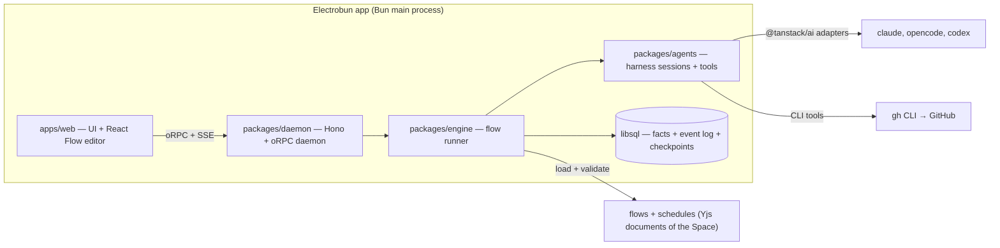

# Night Shift — Plan

> A personal workbench to draw agent flows and run them unattended.

This document records the concept, the decisions behind it, the architecture and the delivery order. The steering documents in `docs/steering/` hold the durable rules. This plan holds the route.

## 1. What Night Shift is

Night Shift is a workbench for one developer. You draw a flow in a graph editor. Each node is a step: an agent session with a prompt and/or a skill, a shell command, a decision, or a gate. The engine runs the flow on your machine, with your own CLI logins, while you sleep. In the morning you read a stack of pull requests and the open gates.

Night Shift replaces `night-shift.py`, the script in `rpgdotexe/tools/night-shift/`. The script hardcodes one pipeline: worker, check, retry, rescue, pull request, checkpoint. Night Shift turns that pipeline into a flow that you can see and change. The script keeps running the nights until a flow runs a full Epic.

Night Shift is for its author first. A team, a server mode and other methods come only after the personal tool works every night.

## 2. Decisions

Each row is a settled decision. Change a row only with a new ADR.

| Topic | Decision |
| --- | --- |
| Users | One developer: the author. Better Auth stays, and local mode creates one user and one session automatically. |
| The method | The flow is the method. No method packages and no `method.json`. A WTF night is one flow among others. |
| Flows | A directed graph that you edit in React Flow (`@xyflow/react`). A flow is Night Shift data, not a file in the repo: a Yjs document in the Space that keeps its Project, with a published zod schema. Every save is a Flow revision. People edit flows in the editor. Agents edit them through `nightshift mcp` and the `nightshift` CLI ([ADR 2](adr/0002-flows-are-night-shift-data.md)). Night Shift knows no method and no tracker. GitHub, WTF and the rpgdotexe night are flows, CLI tools and commands, never engine concepts. |
| Flow I/O | A flow declares **inputs** and **outputs**, like a function. Night Shift asks for the inputs of the top-level flow when a run starts. A Subflow node calls a flow once with bound inputs. With `each`, it calls the flow once per list element, bound to an input. The outputs come back to the caller. Version 1 files (with `params` and `input: "item"`) migrate on load. |
| Templates | `{{name.path}}` reads a value. `name` is a node id, an input, or `run`. Node ids and inputs share one namespace. A path reaches into JSON: `{{planner.data.tasks}}`, `{{item.parent.number}}`. A command gets every value as an environment variable, never as shell text. |
| Node types | Agent, Command, Tool, Decision, Value, Wait, Subflow. A Gate is a Decision that you decide. A Subflow with `each` runs once per list element. See section 3. |
| Edges | An edge leaves a node on a named outcome (`pass`, `fail`, an Agent's own outcome, or a Decision option). An edge back to an earlier node is a retry loop. Every loop has a maximum count. The engine refuses a flow with an unbounded loop. |
| Harnesses | Every Agent node runs as a harness session through a TanStack AI harness adapter: `@tanstack/ai-claude-code`, `@tanstack/ai-opencode`, `@tanstack/ai-codex`. The node names its harness, and a flow can mix them. Unattended Claude Code runs in `auto` permission mode. |
| Daemon | Nights run on a stable daemon (`bun run night`): a built server without hot reload. Development uses `bun run dev` in a separate git worktree. So code changes never reload a daemon that runs a night. |
| Skills | An Agent node names a skill that the harness already has (user, project, or plugin skills). No skill pack materialization. |
| Lists | A Subflow with `each` reads a list from a source: a JSON value (often another node's output), a command that prints JSON, or files that match a glob. An issue tracker is a command on its CLI (`gh`, `glab`, `acli`). Suggest command writes one for the project. An element is any JSON value. An object element may carry `id`, `title`, `dependsOn` and `done`. The rest is free. |
| Triggers | A run starts by hand, or from a schedule of the project. An example: every night at 22:00 with a stop time of 07:00. The Space keeps its schedules with its flows ([ADR 2](adr/0002-flows-are-night-shift-data.md)). A schedule that names no Device fires once, on the Host of its Space ([ADR 1](adr/0001-one-personal-space-per-home-host.md)). |
| GitHub | GitHub is a CLI tool (`gh`) and a list command that Suggest command writes (the sub-issues of an issue, the issues with a label). An Agent node that lists `gh` runs it with the user's login, or with the tool's own login. `gh-work` runs `gh` with its own token: several accounts of one program. A Command node or a list source runs it in the worktree. Nothing in the engine knows GitHub. |
| Tools | A flow reaches the outside world through the CLI and MCP, as equals. A Command node runs a CLI. A Tool node calls one tool of a Connection (an MCP server defined once on the daemon, secrets as `${NAME}`). It takes arguments from templates and gets a typed result, with no model in the loop. An Agent node gives the same Connections to its session. Nothing in the engine knows any service. |
| Decisions | A Decision node picks one of its options. A field of the node says who picks: you (a Gate, in the Needs-you inbox), a rule, or a model (the decider). A rule is a JSONata expression per option over the run's values, deterministic and free. The three sit behind one seam in the engine. The decider is a TanStack AI decision model through `decide()`. The default is TypeSafe Jev. The others are Jev on OpenRouter, OpenAI Decisions, Ollaya on this computer, and Ollama on this computer (any pulled chat model, no key). Each has its API key as a secret. Other deciders plug in behind the same interface. |
| Values | A Value node is the twin of a Decision. A Decision picks a label. A Value makes `data` that matches a JSON Schema. A field of the node says who makes it: a rule (a JSONata expression over the run's values, deterministic and free) or a model (the decider's chat model through TanStack AI `chat()` with the schema as `outputSchema`). Only deciders with a text adapter make values: Jev on OpenRouter, OpenAI Decisions and Ollama. TypeSafe and Ollaya only decide. The engine checks the data against the schema: `pass` with the data, `fail` with why. A value made by a person (a form in the Needs-you inbox) waits for a flow that needs typed answers. |
| Run policy | Ported from the script: a fresh session with a tight brief on retry, rescue by a stronger profile, blocked propagation, network grace, usage-limit waits that resume the same session, and a stop time. A wait that would end after the stop time does not start: the run stops at once, and a resume continues the step. Policy is engine code. A flow only sets its numbers. |
| Waits | A Wait node is the one way a flow sleeps or waits for the world: a duration, a time, a command that passes, or a signal (`runs.signal`, how another system reaches a run). It uses the engine's park-and-wake machinery (`docs/steering/langgraph-engine.md`, rule 8). It has no timer, table or poller of its own. `timeoutMinutes` bounds it (`timeout`). The stop time holds for its wakes as for a new step. Decided 2026-10-17 (`docs/research/foundational-nodes.md` §3.4). |
| Worktrees | The user's own clone. Worktrees live in a sibling directory. Garbage collection never deletes a dirty tree. |
| State model | Durable facts in libsql. Status is always derived. Every change appends to an event log that goes to the UI over SSE. The daemon keeps each run's log in memory (the run log) and writes through it. It keeps and publishes an event only after its insert returns. A run's control flow is a LangGraph thread. Its checkpoints (`lg_checkpoint`, `lg_write`) are the engine's bookkeeping, never the read model (`docs/steering/langgraph-engine.md`, 2026-10-16). |
| Session view | Structured transcript. "Take over" gives the user the resume command. |
| Shell | Electrobun. Bun is the main process, so the daemon runs in-process with no sidecar. |
| Platforms | macOS first. |
| License | Apache-2.0. Built in public. |

Dropped from the earlier plan: method packages and `method.json`, the OpenSpec method, server mode with remote runners, the NDJSON runner protocol, the stateless orchestrator as a separate concept (it is now a Decision node), and the project chat.

Jira is a kit on `acli`, not an engine concept.

## 3. Node types

| Node | Does | Outcomes |
| --- | --- | --- |
| Agent | Runs one harness session in the run's worktree. Holds a prompt and/or a skill, a harness, a model, an effort, a permission mode, tools, and time budgets. Ends with a Step Report: an outcome, a summary, and optional structured `data` that matches the node's output schema. | `pass`, `fail`, `needs-input`, or the node's own outcomes |
| Command | Runs one shell command in the worktree. Keeps the full log on disk and the tail in the outputs. With `output: "json"`, what it prints is `data` (`{{check.data.tests}}`). Output that is not JSON fails the step. | `pass` (exit 0), `fail` |
| Tool | Calls one tool of a Connection (an MCP server) with arguments from templates. One reference keeps its JSON value. Other text is read as the tool's input schema says. Ends with `data` (the tool's structured answer, else the JSON its text holds, else null) and `text`. | `pass`, `fail` (the tool reports an error, has no such tool, or does not answer) |
| Decision | Picks one of its options. You pick (a Gate), a rule picks (the first option whose `when` holds, else the default), or a model picks (reads the prompt, picks, and notes why). A Gate waits in the Needs-you inbox with a question. With `lockScreen: true`, a phone can answer it from the lock screen. | One edge per option |
| Value | Makes `data` that matches its output schema. A rule makes it (a JSONata expression over the run's values, `$filter(planner.data.tasks, function($t) { $t.size = "small" })`), or a model does (reads the prompt and answers in the shape of the schema). Later nodes read `data` or a path into it, and why it failed as `note`. | `pass`, `fail` |
| Wait | Sleeps until a duration passes, a time comes, a command exits 0, or a signal arrives (`runs.signal`). `any` waits for a signal and a command: the first that ends the wait wins. A time is a template that renders a date and time, or a time of day. A command runs again every `everyMinutes`. Keeps `waited_minutes`, a command's last `log_tail`, and `data`. `timeoutMinutes` ends it `timeout`. With `outcomes` (ADR 8), the command picks one through `$NS_OUTPUT`, or a signal picks the first one whose `when` rule holds. | Its own outcomes, `done`, `timeout` |
| Lease | Takes a named lease of the Space (ADR 7): one run at a time holds the name, also across Devices. The name is a template (`branch:{{pr.data.head}}`). It waits up to `waitMinutes` for a lease another run holds. The run holds it until it ends, or until it leaves the Section of `scope`. Night Shift lets go of it on every end, takes it back on a resume, and lets it expire after `ttlMinutes` (default 30) when the Device that walks the run is gone. `busy` names the run that holds it (`holder`, `holder_title`). | `held`, `busy` |
| Service | Starts a process in the background in the run's copy of the project (ADR 9): a Docker Compose stack, a dev server. It is `ready` when its check passes: a `command` that exits 0, or a `url` that answers 2xx, tried every `everySeconds` (default 2) up to `timeoutMinutes` (default 5). A ready command can write `data` (`{{stack.data.url}}`); `log_tail` is the end of the service's log as a later step reads it. Night Shift stops it when the run leaves its `scope` (the run, or a Section), with `stop` or by ending its process group, on every end of the run and after a restart. A resumed run inside the scope starts it again. Every step in the scope runs on its Device. | `ready`, `failed` |
| Subflow | Runs another flow with its inputs bound by templates. Without `each`, it runs once. Its outputs are the called flow's outputs plus `ended` (the label it ended on). With `each`, it runs once per element of a list (a JSON value, the JSON a command prints, or files that match a glob). The element is bound to one of its inputs (`as`, default `item`). It reads the list again before each element and orders by `dependsOn`. A failed element blocks the elements that depend on it. Each element can work on its own branch, stacked on the last one that finished. Its outputs hold the results of every element. | `pass` (finished), `fail`. With `each`: `done`, `halted`. Both: `stopped` (the stop time came). With an edge on `stopped`, the nodes after it run past the stop time, and then the run finishes. |

A **cascade** (ADR 6) is a field of an Agent, a Decision or a Value by a model, and a Subflow, not a node. It is a list of tiers, cheap first. The engine walks it inside the node, one step per try: a try that does not hold tries again in its tier, up to `tries`, then the next tier. An Agent's try holds when the agent ends `pass` and its `check` command exits 0. A Decision's holds when the pick has at least the tier's `minConfidence`. A Value's holds when its data passes the tier's `accept` rule. A Subflow's holds when the called flow ends `pass`. The last tier can be a person (a Gate). The step's outputs add `tier`, `tries`, and a Decision's `confidence`.

A node reads earlier values through templates, for example `{{check.log_tail}}`, `{{item.title}}`, or `{{epic}}`.

## 4. Architecture



### Packages

| Package | Owns |
| --- | --- |
| `packages/config` | The shared TypeScript configuration. No code. |
| `packages/db` | Drizzle schema on libsql. Durable facts and the event log. Full transcripts live on disk, indexed here. |
| `packages/flows` | The flow schema (zod) and the validator (unbounded loops, unknown names, missing outcomes). Each node type has one file in `src/nodes/` with its schema, its checks and its output fields. |
| `packages/ui` | Shared components and tokens. |
| `packages/auth` | Identity and access on Better Auth: login, two-factor, pairing, device keys, Spaces, members and roles. |
| `packages/agents` | Harness sessions through `@tanstack/ai` adapters, session resume, usage-limit waits, CLI tool permissions, the decider providers. |
| `packages/engine` | The run engine on LangGraph (`docs/steering/langgraph-engine.md`): a flow compiled to a graph, one thread per run, run policy, gates, worktrees, the item ordering of a Subflow with `each`. |
| `packages/devices` | This computer among other Devices and Hosts: Placement, Offers, the exchange of run history, the Links to Hosts and pairing, this computer as a Host, and the work relay. It implements the engine's `Peers` port. |
| `packages/api` | The oRPC procedures, one group per domain. The web app takes only its router type. |
| `packages/daemon` | The daemon: one boot sequence (`startDaemon`) for the dev entry, the command line and the desktop app. Hono, the oRPC handlers, Better Auth, the document sync relay, the database lease, health, signals, the hot-reload handover. |
| `apps/server` | The dev entry (`bun run dev`) and the `nightshift` command line. No logic. |
| `apps/desktop` | The Electrobun shell. Tray, window, updates and the watchdog. No logic. |
| `apps/web` | The UI. Flow editor, run view with live transcripts, Needs-you inbox, run history. |

The table lists the packages in the order of their layers, from the bottom. `docs/steering/STRUCTURE.md` holds the layer map and the rules for where code lives. When this table and that document disagree, that document wins.

## 5. Delivery

Status (2026-10-30): Slices 1 to 8 are built, and Night Shift has run a real project every night since 2026-10-16. Slices 5 to 8 and the LangGraph engine run real nights: Subflows with `each` over a command's list, Agent outcomes, schedules that start runs without a person, Waits on CI, and Gates. A flow ran an Epic overnight to its end on 2026-10-25, the condition to retire `night-shift.py`.

Not yet done for real:

- ~~A usage limit at night.~~ Done: on 2026-10-19 and 2026-10-25 a step hit the session limit at night, waited for the reset, and went on to `pass`.
- A Codex or OpenCode step. Every Agent step of a real run so far ran on Claude Code.
- A planner that feeds a Subflow with `each`. Every real Subflow with `each` reads its list from a command (`gh`).

Done (2026-10-16): LangGraph replaced the engine's hand-rolled walk, resume points and wait bookkeeping (`docs/steering/langgraph-engine.md`, after `docs/research/langgraph-spike.md`). A run is one LangGraph thread, checkpointed after every node in the daemon's database. Waits, Gates and parked steps are interrupts, so a resume lands at the same node at any depth. The `Engine` interface, the event log, the API and the web app did not change. The engine test suites pass on it. Every real night since 2026-10-18 ran on it.

### Slice 1 — One agent node, live

Pick a repo. Run one Agent node with a prompt on Claude Code in a fresh worktree. Watch the transcript stream into the UI. Stop it. Resume it.

Proves: the TanStack AI harness adapter inside the Bun daemon, worktrees, the event log, SSE, transcripts on disk.

### Slice 2 — The flow editor

Draw a flow in React Flow with Agent and Command nodes and `pass`/`fail` edges. Save it. Run it: worker → check → back to worker on `fail`, at most three times.

Proves: the flow schema, the validator, the graph walk, retry loops, template variables.

### Slice 3 — Decisions, gates, GitHub

Add Decision and Gate nodes and the GitHub tools. A flow reads an issue, builds it, opens a pull request, and asks a Decision node whether to continue.

Proves: structured decisions, the Needs-you inbox, the GitHub tools inside a harness session.

### Slice 4 — The night as a flow

Add the For Each node and the full run policy. Rebuild the rpgdotexe night as a flow: Traces blockers first, worker, gate check, retry, rescue, pull request on the stack, Feature checkpoint. Run one Feature unattended. Retire `night-shift.py` when a flow runs a full Epic.

Proves: parity with the script.

### Slice 5 — Safe nights, flows as functions

The first nights showed two things: the dev server reloads under a running night, and the flows were built around one method. Slice 5 makes nights safe and flows generic. All of it is built in a separate git worktree while a night runs.

- `bun run night`: the built server and web app, no hot reload.
- Flow format version 2: `inputs` and `outputs` on every flow, templates with JSON paths, inputs and node ids in one namespace. `params` and `input: "item"` migrate on load. Run snapshots of version 1 migrate when read.
- The Subflow node.
- For Each over any list: `json` (a template that renders a JSON array, for example `{{planner.data.tasks}}`), `command`, `files` (a glob). A fourth source, `github` (sub-issues), went on 2026-10-16. It is now a `command` recipe on `gh`, and old files migrate on load. Elements are free-form JSON with optional `id`, `title`, `dependsOn`, `done`. `as` names the input. `branch` is `per-item` or `shared`. Engine facts per element move to `run`: `{{run.branch}}`, `{{run.base_branch}}`, `{{run.index}}`.
- Start from a branch: the start dialog takes a base ref, so a night can continue on an open stack.
- The rpgdotexe flows move to version 2.
- 2026-10-17, flow format version 4: the Subflow and For Each nodes became one node, `call` (shown as Subflow), with `each` optional (`docs/research/foundational-nodes.md` §3.1). A Command node takes `output: "json"` (§3.5). Version 3 files migrate on load.

Proves: any flow can call any flow, and a list can come from anywhere.

Status: built, and in real nights since 2026-10-18: a Subflow with `each` runs a flow per Feature and per Trace of an Epic. On 2026-10-17 the rpgdotexe flows were rebuilt on format version 4, with the seven node types and three Agent Profiles (`examples/rpgdotexe/README.md`). Decisions by rule, Values by rule over Subflow results, a Wait on CI, and JSON output from Commands replace the files and the shell checks that the script passed between steps.

### Slice 6 — Agents that answer in shape

- Agent outcomes: an Agent node may declare its own outcomes (`approved`, `changes-requested`, …) instead of `pass`/`fail`/`needs-input`.
- Agent output schema: an Agent node may declare a JSON schema for `data` in its Step Report. The engine validates it, and the step fails on a mismatch. `{{planner.data.tasks}}` feeds a Subflow with `each`.
- Generic items in the UI: id, title, a link when the element has `url`, and the raw JSON.
- A starter flow library in `packages/flows/src/starters/` (it was `examples/starters/`). Night Shift saves it into a project when you add the project. The starters: implement → check → retry. Plan → For Each task → review. Review a pull request. One agent per file of a glob.

Proves: a planner agent can decide what the night does.

Status: built. Agent outcomes run in real nights. The starters validate, but none has run against a real harness yet. No planner has fed a Subflow with `each` for real yet.

### Slice 7 — Triggers

- Schedules of a project: a flow, its inputs, a time of day or a cron line, and a stop time. The daemon starts the runs. The UI lists, adds, pauses and removes schedules, and shows the next start.

Proves: a night starts without a person.

Status: built. Tested with a fake clock: no double fires, no overlap with a run of the same schedule that still runs, catch-up within 15 minutes. Schedules start real nights since 2026-10-20. The Host of a Space fires its schedules.

### Slice 8 — More harnesses and tools

- OpenCode and Codex Agent nodes through `@tanstack/ai-opencode` and `@tanstack/ai-codex`.
- MCP servers per Agent node, next to the built-in tool sets.

Proves: a flow can mix harnesses.

Status: built.

- An Agent node runs on the harness it names. A flow that names a harness the daemon does not have refuses to start.
- MCP servers read `${NAME}` from the daemon's environment.
- "Take over" gives the resume command of the harness that ran the last session.
- The OpenCode harness is tested against a fake `opencode` that replays what a live OpenCode 1.19 server sent.
- The Codex harness is tested against a fake `codex` only.
- The engine is tested with fake harnesses under each name.

Real nights so far run on Claude Code only.

### Then

A flow library to share, server mode, Windows.

## 6. Setup

The repo started from a Better-T-Stack scaffold (TanStack Start, Hono, Bun, oRPC, libsql, Drizzle, Better Auth, Electrobun, Turborepo, Biome, Lefthook).

Daily commands:

```bash
bun install            # dependencies
bun run db:push        # apply the schema to the dev database
bun run dev            # web + server with hot reload
bun run dev:desktop    # the Electrobun shell with hot reload
bun run check          # Biome lint + format
bun run check-types    # TypeScript
bun run build          # everything, desktop last
bun run night          # the stable daemon for a night (see below)
bun run build:desktop  # the desktop app: apps/desktop/artifacts/*.dmg
```

**Desktop app (v0.1).** One app runs the daemon in its own Bun main process on port 3000. It shows the built web app in its window.

- When the window closes, the app stays in the menu bar (☾), so runs continue. Quit there releases the database lease.
- When a daemon already answers on port 3000 (`bun run night` or `bun run dev`), the app opens its window on that daemon and starts no daemon.
- The packaged app has no `.env` files. The bundle replaces varlock with `process.env` (`apps/desktop/src/bun/shims`). It takes PATH from the login shell and keeps its auth secret in the data folder (`auth-secret`).
- `PORT` moves the daemon, with a web build whose `VITE_SERVER_URL` matches.
- The build is not signed or notarized.

**Nights.** `bun run night` builds the web app. Then it serves the API server and the built web app on the usual ports (3000 and 3001). Set `PORT` and `WEB_PORT` to change them. The server runs from source with plain `bun`, without `--hot`. The web app is a production build behind `vite preview`. So no file change restarts a running night.

- It reads the same env as `bun run dev` (`apps/server/.env` and `apps/web/.env` through varlock). `process.env` wins.
- When `PORT` or `WEB_PORT` is set, `BETTER_AUTH_URL`, `VITE_SERVER_URL` and `CORS_ORIGIN` follow, unless they are set too.
- Develop in a separate git worktree (`git worktree add ../nightshift-dev`). Use `bun run dev` on other ports and `NIGHTSHIFT_SCHEDULER=off`.
- Never point two daemons at one database. The lease (below) refuses the second one.
- Between nights, pull the work into the night's clone.

**Data directory.** A daemon keeps these together in one folder on this computer, never in a project:

- its database (`nightshift.db`)
- its transcripts (`transcripts/<run>/<step>.ndjson`)
- its command logs (`logs/<run>/<step>.log`)
- the artifacts agents keep with `save_artifact` (`artifacts/<run>/`, with an `index.ndjson`)

Flows and schedules are Night Shift data too, in the flow documents ([ADR 2](adr/0002-flows-are-night-shift-data.md)). A project holds no Night Shift files.

- `bun run night` and the desktop app use the app data folder of the OS: `~/Library/Application Support/Night Shift` on macOS, `$XDG_DATA_HOME/nightshift` (else `~/.local/share/nightshift`) on Linux, `%APPDATA%\Night Shift` on Windows.
- `bun run dev` sets `NIGHTSHIFT_DEV=true` and uses `.nightshift-dev/` in its own checkout (gitignored). A dev daemon never opens the night's database, and two checkouts never share one. The `db:push`, `db:studio` and `db:migrate` scripts open the same dev database.
- `NIGHTSHIFT_DATA_DIR` sets the folder for either one. `DATABASE_URL` sets only the database, for example a libsql server. Otherwise, leave it unset.
- Night Shift never moves history from before for you: the checkout's `local.db`, `~/.nightshift/transcripts` and `~/.nightshift/logs`. The daemon names it at start. To copy it into the data directory:
  1. Stop the daemon.
  2. Run `bun run data:migrate` (add `--dev` for the dev folder). It copies and never moves. It refuses a data directory that already has data.
  3. Remove `DATABASE_URL` from `apps/server/.env`.

**Projects.** Add project checks the chosen folder before it adds it, in this order:

1. git on this computer
2. the folder at the top of a git repository
3. a first commit (each run's worktree starts from one)
4. a git name and email, when Night Shift must make that commit

Each failed step has a fix. A fix runs only after you confirm it.

- Install git opens Apple's installer on macOS (`xcode-select --install`). On other systems it shows the package manager command to run (`sudo apt-get install git`, `winget install --id Git.Git`). Night Shift never runs `sudo`.
- Use top folder replaces a subfolder with the repository's top folder.
- Set up git runs `git init` when needed, and writes a starter `.gitignore` when there is none. It sets the name and email in the repository's own config (never `--global`). It commits every file as "Initial commit".

A run refuses to start in a project that is not ready (`checkProjectFolder` in `packages/engine/src/projects/project-setup.ts`).

**Lease.** One daemon per database. A daemon takes the lease (the `daemon_lease` row) before it recovers interrupted work or starts the scheduler. It writes a heartbeat every 10 seconds. A second daemon on the same database refuses to start. It prints the holder's host, pid and start time, and exits with code 1.

The lease is free in three cases:

- its holder released it (a clean stop with Ctrl+C or SIGTERM)
- the holder's pid no longer runs on this machine
- its last heartbeat is older than 90 seconds

Every acquisition adds one to the epoch. A daemon whose machine slept keeps the lease when it wakes, unless another daemon took it in the meantime. In that case its next heartbeat fails. It logs `SELF-FENCE:` and exits with code 3, and writes nothing more. Nothing restarts it. Stop the other daemon first, then start this one again. The Settings page shows the lease under This daemon.

**Schedules.** The schedules of a project live in the Space that keeps it, next to its flows, not in a Clone ([ADR 2](adr/0002-flows-are-night-shift-data.md)). The UI lists, adds, pauses and removes them. Each schedule names a flow, its input values, a cron line in the daemon's local time (`0 22 * * 1-5`), an optional stop time (`07:00`) and a base ref.

- A schedule that names no Device fires on the Host of its Space, once ([ADR 1](adr/0001-one-personal-space-per-home-host.md)).
- A cron time that is more than 15 minutes late is skipped.
- A schedule does not start while its previous run still runs, waits or sleeps.
- A Space without a Host fires its schedules on its one Device. Keep the night's projects out of the dev database.

**Who walks.** In a Space that a Host keeps, the Host walks the runs, and each step runs where the person is ([ADR 1](adr/0001-one-personal-space-per-home-host.md), decisions 9 to 11).

- A run started on a Device goes to the Host, which walks it (`relay.startOnHost`). The Host starts it from its own copy of the flow documents. So the Device first waits until the Host has them, up to 10 s. Its steps without a placement run on that Device: the Run's Device is the Device that started it. A Device that is itself the Host walks the run.
- A run started on the phone or in a browser on the Host runs those steps on the Host. When the Host has no Clone of the project, they run on the Device of the project's latest run (`lastRunDevice`). Start run and New run choose that Device and say so. The person can choose another Device with a Clone.
- A Host that another Person runs belongs to its Host admin. It is the default only when the admin offers the starter a profile in the Space. Else one of the starter's own Devices with a Clone is the default.
- A Device that cannot reach its Host walks the runs that it starts itself. The exchange sends them to the Host when the link is back. A Device walks only those runs and the runs moved to it. A run that the Host walks waits for the Host.
- A step placed on a Device that is offline waits for it, up to the run's stop time. The person the run runs for gets "<flow> waits for <device>". A run also starts when its own Device is offline. Its worktree is made when that Device is back.
- Kept variables follow the run. A step's `StepEnded` names the kept variables it wrote (`kept`). Each Replica that takes the event saves them, unless it has a later write. The next run starts from the latest value, wherever it is walked.

**Settings.** The Settings page saves daemon-wide values in the database:

- the scheduler switch
- the run cap and the step cap
- the run policy defaults (a flow's own `policy` numbers win)
- the defaults for new Agent and Decision nodes
- desktop notifications

A setting that is not saved reads the environment (`NIGHTSHIFT_*` in `apps/server/.env`), then its default. The engine reads them when they apply, so a change needs no restart. One exception: `NIGHTSHIFT_SCHEDULER=off` turns the scheduler off, whatever the page says. So a dev daemon on a copy of the database never starts the night's schedules.

**Restarts.** A daemon that stops (a crash, a restart) leaves its running steps open. The next daemon ends them, and their runs, as `interrupted`. A few seconds after it starts, it resumes each of those runs itself, through the same path as the Resume button:

- The run's LangGraph thread runs again the node it left pending.
- An Agent step continues its own harness session (the node finds it in the event log). The prompt says that the daemon stopped mid-step. It tells the agent to check the worktree and the remote before it repeats anything.
- `RunResumed` records `by: "daemon"`, and the run view shows "Resumed by the daemon".

A run stays `interrupted`, with the reason in its end reason, in these cases:

- the scheduler is off (a dev daemon on a copy of the database never continues the night's runs)
- Settings → Run policy → Resume after a restart is off (`NIGHTSHIFT_RESUME_INTERRUPTED_RUNS=off`). A flow's `policy.resumeInterruptedRuns` wins.
- its stop time has passed
- its worktree is gone
- three daemon resumes in a row with no person in between (a crash loop)

A full run cap queues the resume until a run ends. This path never resumes runs a person stopped, failed runs, or runs an earlier daemon interrupted. Night Shift cannot check what the agent does outside the worktree (a CLI tool such as `gh`, `git push`, an MCP server's tools). The resume prompt asks the agent to look first.

**Harnesses.** An Agent node runs `claude`, `opencode` or `codex` on this machine, with your own login for each. The Agents page:

- adds and removes harnesses (the setting `harnesses`). All three are on by default. A removed one refuses runs that need it.
- checks each one (`--version`, its login status)
- sets its path
- lists its models: the adapter's own list (`CLAUDE_CODE_MODELS`, `OPENCODE_MODELS`, `CODEX_MODELS`), plus what `opencode models` prints for OpenCode

Each path comes from the `PATH`, unless you set it there or in `apps/server/.env` (the fallback):

```bash
NIGHTSHIFT_CLAUDE_BIN=/path/to/claude
NIGHTSHIFT_OPENCODE_BIN=/path/to/opencode   # must be a 1.x build (see section 7)
NIGHTSHIFT_CODEX_BIN=/path/to/codex
```

**Agent Profiles.** A profile is a harness, a model, an effort, a permission mode, tool sets and connections under one name. The database saves it (`agent_profile`), and you edit it on the Agents page. A Project has no profiles of its own ([ADR 3](adr/0003-a-profile-belongs-to-one-device.md)).

- A profile belongs to one Device. Its identity is the Device and the profile's id, and its name is a label.
- An Agent node names that pair in `profile` (the editor shows "builder on LE2316"). The node may set any of those fields itself. Its own value wins, and tool sets and connections add up.
- A node without a profile needs its own harness, model and permission mode.
- The run resolves its profiles into its copy of the flows when it starts. So a later edit reaches the next run, and a resumed run keeps what it started with.
- A flow that names a profile on a Device that the Space no longer has does not start. The editor marks the node and asks for another profile. Night Shift never takes another Device's profile with the same label.
- Flows reference the id, so a rename changes no flow.

**Connections.** You define an MCP server once on the Agents page (under Tools). Agent nodes name it (`"connections": ["linear"]`).

- A node may still define its own `mcpServers`. One of the same name wins over the connection.
- A flow that names a connection the daemon does not have refuses to start.
- `${NAME}` in env values and headers reads the macOS keychain first (service `nightshift`, saved on the Secrets page through `Bun.secrets`). Then it reads the daemon's environment.
- The database keeps only the names of saved secrets. A missing variable fails the step with its name. Values never go into the flow file, the database or the logs.
- "Test" connects to a server, lists its tools and disconnects.

A Command node reads secrets too. `"secrets": ["ZAC_USER", "ZAC_PASSWORD"]` gives the command each one as an environment variable of the same name.

- The node sends only the names. The Device that runs the step reads the values in the same order: its keychain, then its daemon's environment. So a step on another computer uses that computer's secrets.
- A secret the Device lacks errors the step before the command runs.
- The Device replaces each value with `•••` in the output before it leaves. So the transcript, the log file, `log_tail` and `data` never hold one. The Device also finds a value split over two chunks.
- The Secrets page lists the flows whose Command nodes name each secret.

**Run bundles.** "Export" on a run page downloads the run as one SQLite file, `<flow>-<run8>.nightshift.sqlite` (`GET /api/runs/:id/export`). The daemon keeps one database. A bundle is a copy of one run, made on demand. It uses the live schema's table and column names, and holds:

- a `bundle` table (`format_version` 1, `exported_at`, `run_id`, `schema` (the daemon's last migration), `missing_transcripts`, `redacted`)
- the `run` row with its flow and called flows, and the `project` row (name and path)
- the run's `step`, `agent_session` and `event` rows
- a `transcript` table (`step_id`, `line_no`, `seq`, `json`) with the lines of each step's transcript file. `missing_transcripts` lists a missing file.

Settings, connections and secrets stay out. The values of saved secrets, and of the variables the connections reference, become `•••` in transcripts, event payloads, prompts, the flow and the title. Other text is copied as is, so check a transcript before you share it. `openRunBundle` in `packages/engine` reads a bundle back: the same events give the same status, steps, outputs and cost.

## 7. Open items

- Our own TanStack AI tools reach a Claude Code session over MCP as `mcp__tanstack__<name>` (Slice 2, the `report_step` tool). Claude Code's plan mode denies them. So a plan-mode Claude Code node reports with a text line instead. OpenCode allows them in every mode. Codex is unverified.
- Session resume works through the adapter (Slice 1). The usage-limit reset time is parsed from the harness's raw messages, but no real usage limit has tested it yet.
- The desktop window loads the prerendered TanStack Start build from `views://mainview`. Routes with parameters (a run page) are not prerendered: a reload there may not find the page. Navigation inside the app works.
- The desktop app has no icon (`apps/desktop/icon.iconset`), no signing and no notarization yet. When a daemon holds the lease on another port, the app quits at start with only a log line.
- The decider runs Claude Code with no built-in tools (`--tools "" --strict-mcp-config`). `@tanstack/ai-claude-code` 0.9 cannot pass that next to several bridged tools. So we append the flags to the `claude` executable string, which the adapter splits on spaces. Check again on every adapter upgrade, and ask upstream for an option.
- An item cut short by a stop or a daemon death shows `failed` with a reason until the run resumes. After a daemon death, that resume comes on its own a few seconds later. The item then continues. Consider `stopped` and `interrupted` item states.
- `timeoutMinutes` on a Subflow node with `each` is not enforced. Every step inside the body keeps its own limit.
- Item branches are `nightshift/<run8>-<id>-<title>`: git cannot nest a branch under the run branch `nightshift/<run8>`.
- Usage-limit and network sleeps are tested with fakes only. The first real usage limit at night is the real test.
- `@tanstack/ai-opencode` 0.5 drives OpenCode 1.x servers only (verified with 1.19.2). OpenCode 2.x serves a different API. Point the OpenCode harness at a 1.x `opencode` until the adapter catches up. The harness works around four adapter quirks: an empty first tool input, the prompt echoed as text, a finish held until the next heartbeat, and abort teardown. Report them upstream.
- The Codex harness is tested against a fake `codex` only. The event shapes, `exec resume`, error wording and the TOML MCP overrides are unverified. In `workspace-write`, commits from a linked worktree may need the git common dir in `additionalDirectories`.
- The take-over commands for OpenCode (`opencode --session <id>`) and Codex (`codex resume <id>`) come from the CLI docs. Neither was run against a real session.
- Slices 5 to 8 have not run a real night. The first scheduled night, the first planner that feeds a Subflow with `each`, and the first OpenCode or Codex step are the real tests.
- Schedule catch-up looks only at the latest missed cron time. Earlier missed times are dropped without a log entry. So a daemon that was down for two nights starts at most one run.
- Every daemon runs the scheduler, a dev daemon too. A project added to both databases starts its schedules twice. Consider a switch to turn the scheduler off in development.
- An MCP `${NAME}` that the daemon lacks fails the step when it starts, not the run at its start. A night finds out at that node. The Agents page shows each variable as Keychain, Environment or Missing. A start check could refuse the run instead.
- Secrets use the macOS keychain through `Bun.secrets`. A packaged desktop build signs a different binary. Check that it can read items saved by the `bun` daemon.
- The lease fences on the heartbeat only. A daemon that lost the lease can still write for up to one heartbeat (10 s) before it exits. The stale check compares the heartbeat with this machine's clock. Two machines on one remote database need clocks that agree within the stale window.
- Runs are never deleted, and nothing removes old transcripts. A run bundle could be the archive before a run is deleted. Retention is not decided.
- A run bundle leaves out command logs (`logs/<runId>/<stepId>.log`). The command step's transcript holds its output. The UI cannot open a bundle yet. Only `openRunBundle` reads one.
- A run bundle masks secret values only if they are saved or a connection references them. A value from the environment that a node's own `mcpServers` reads goes in as is.
- Automatic resume after a restart is tested with fake harnesses and a fake clock only. A Decision step runs again from the start on resume.
- A guard can change in the few seconds before the daemon resumes a run (the scheduler switched off, the stop time came). Then the run stays `interrupted` with the plain end reason. Only the daemon's log says why.
- The run log trusts that its daemon is the only writer of the database. An event that anything else writes (a second daemon, a hand edit) does not show in the UI or the walk until the daemon restarts. The run log keeps the logs of open runs and of the latest ended runs, up to 20 000 events (about 14 MB), plus a small summary per run. A database of 50 000 events takes about 35 MB with every log in memory.
- `@tanstack/ai-sandbox` 0.5.23 writes its projection marker to a doubled path when the workspace has a fixed directory. We set `workspace.root: '.'` to avoid it. Report it upstream.
- A LangGraph checkpoint copies the whole run state after every node, node outputs included. The lists of a Subflow with `each` stay in the log. So a running run's checkpoints grow with it. A finished run is pruned to its latest checkpoint (`LibsqlSaver.pruneThread`, 2026-10-17). A stopped or failed run keeps its history until it finishes. A failed Subflow body leaves its namespace parked for good. The caller fails as before and never continues it. The first real night on the LangGraph engine (2026-10-16) is the real test.
