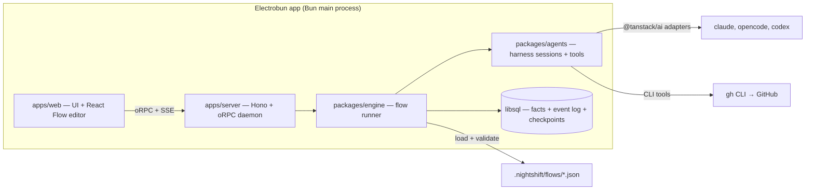

# Night Shift — Plan

> A personal workbench to draw agent flows and run them unattended.

This document records the concept, the decisions behind it, the architecture, and the delivery order. The steering documents in `docs/steering/` hold the durable rules. This plan holds the route.

## 1. What Night Shift is

Night Shift is a workbench for one developer. You draw a flow in a graph editor. Each node is a step: an agent session with a prompt and/or a skill, a shell command, a decision, or a gate. The engine runs the flow on your machine, with your own CLI logins, while you sleep. In the morning you read a stack of pull requests and the open gates.

Night Shift replaces `night-shift.py`, the script in `rpgdotexe/tools/night-shift/`. The script hardcodes one pipeline: worker, check, retry, rescue, pull request, checkpoint. Night Shift turns that pipeline into a flow that you can see and change. The script keeps running the nights until a flow runs a full Epic.

Night Shift is for its author first. A team, a server mode, and other methods come only after the personal tool works every night.

## 2. Decisions

Each row is a settled decision. Change a row only with a new ADR.

| Topic | Decision |
| --- | --- |
| Users | One developer: the author. Better Auth stays, and local mode auto-creates one user and one session. |
| The method | The flow is the method. No method packages and no `method.json`. A WTF night is one flow among others. |
| Flows | A directed graph that you edit in React Flow (`@xyflow/react`). Stored as a versioned JSON file in the repo: `.nightshift/flows/<name>.json`, with a published zod schema. Night Shift knows no method and no tracker: GitHub, WTF, and the rpgdotexe night are flows, CLI tools and commands, never engine concepts. |
| Flow I/O | A flow declares **inputs** and **outputs**, like a function. The inputs of the top-level flow are asked when a run starts. A Subflow node calls a flow once with bound inputs; a For Each node calls a flow once per list element, bound to an input. The outputs come back to the caller. Version 1 files (with `params` and `input: "item"`) migrate on load. |
| Templates | `{{name.path}}` reads a value: `name` is a node id, an input, or `run`. Node ids and inputs share one namespace. A path reaches into JSON: `{{planner.data.tasks}}`, `{{item.parent.number}}`. A command gets every value as an environment variable, never as shell text. |
| Node types | Agent, Command, Decision, Subflow, For Each, Value. A Gate is a Decision decided by you. See section 3. |
| Edges | An edge leaves a node on a named outcome (`pass`, `fail`, an Agent's own outcome, or a Decision option). An edge back to an earlier node is a retry loop. Every loop has a maximum count. The engine refuses a flow with an unbounded loop. |
| Harnesses | Every Agent node runs as a harness session through a TanStack AI harness adapter: `@tanstack/ai-claude-code`, `@tanstack/ai-opencode`, `@tanstack/ai-codex`. The node names its harness; a flow mixes them freely. Unattended Claude Code runs in `auto` permission mode. |
| Daemon | Nights run on a stable daemon (`bun run night`): a built server without hot reload. Development uses `bun run dev` in a separate git worktree, so code changes never reload a daemon that runs a night. |
| Skills | An Agent node names a skill that the harness already has (user, project, or plugin skills). No skill pack materialization. |
| Lists | A For Each reads a list from a source: a JSON value (often another node's output), a command that prints JSON, or files that match a glob. An issue tracker is a command on its CLI: the editor offers recipes for `gh`, `glab` and `acli`. An element is any JSON value. An object element may carry `id`, `title`, `dependsOn`, and `done`; the rest is free. |
| Triggers | A run starts by hand, or from a schedule stored in the project (`.nightshift/schedules.json`), for example every night at 22:00 with a stop time of 07:00. |
| GitHub | GitHub is a CLI tool (`gh`) and a command recipe (the sub-issues of an issue, the issues with a label). An Agent node that lists `gh` runs it with the user's login; a Command node or a list source runs it in the worktree. Nothing in the engine knows GitHub. |
| Decisions | A Decision node picks one of its options, and who picks is a field of the node: you (a Gate, in the Needs-you inbox), a rule (a JSONata expression per option over the run's values, deterministic and free), or a model (the decider). The three sit behind one seam in the engine. The decider is a TanStack AI decision model through `decide()`: TypeSafe Jev by default, or Jev on OpenRouter, OpenAI Decisions, or Ollaya on this computer, each with its API key as a secret. Other deciders plug in behind the same interface. |
| Values | A Value node is the twin of a Decision: a Decision picks a label, a Value makes `data` that matches a JSON Schema, and who makes it is a field of the node: a rule (a JSONata expression over the run's values, deterministic and free) or a model (the decider's chat model through TanStack AI `chat()` with the schema as `outputSchema`). Only deciders with a text adapter make values: Jev on OpenRouter and OpenAI Decisions; TypeSafe and Ollaya only decide. The data is checked against the schema in the engine: `pass` with the data, `fail` with why. A value made by a person (a form in the Needs-you inbox) waits for a flow that needs typed answers. |
| Run policy | Ported from the script: fresh session with a tight brief on retry, rescue by a stronger profile, blocked propagation, network grace, usage-limit waits that resume the same session, a stop time. Policy is engine code. A flow only sets its numbers. |
| Worktrees | The user's own clone. Worktrees live in a sibling directory. Garbage collection never deletes a dirty tree. |
| State model | Durable facts in libsql. Status is always derived. Every change appends to an event log that fans out to the UI over SSE. The daemon keeps each run's log in memory (the run log) and writes through it: an event is kept, and published, only after its insert returns. A run's control flow is a LangGraph thread; its checkpoints (`lg_checkpoint`, `lg_write`) are the engine's bookkeeping, never the read model (`docs/steering/langgraph-engine.md`, 2026-10-16). |
| Session view | Structured transcript. "Take over" hands the user the resume command. |
| Shell | Electrobun. Bun is the main process, so the daemon runs in-process with no sidecar. |
| Platforms | macOS first. |
| License | Apache-2.0. Built in public. |

Dropped from the earlier plan: method packages and `method.json`, the OpenSpec method, Jira, server mode with remote runners, the NDJSON runner protocol, the stateless orchestrator as a separate concept (it is now a Decision node), and the project chat.

## 3. Node types

| Node | Does | Outcomes |
| --- | --- | --- |
| Agent | Runs one harness session in the run's worktree. Holds a prompt and/or a skill, a harness, a model, an effort, a permission mode, tools, and time budgets. Ends with a Step Report: an outcome, a summary, and optional structured `data` that matches the node's output schema. | `pass`, `fail`, `needs-input`, or the node's own outcomes |
| Command | Runs one shell command in the worktree. Keeps the full log on disk and the tail in the outputs. | `pass` (exit 0), `fail` |
| Decision | Picks one of its options: you (a Gate: waits in the Needs-you inbox with a question), a rule (the first option whose `when` holds, else the default), or a model (reads the prompt, picks, and notes why). | One edge per option |
| Subflow | Runs another flow once, with its inputs bound by templates. Its outputs are the called flow's outputs plus `ended` (the label it ended on). | `pass` (finished), `fail` |
| For Each | Runs a flow once per element of a list (a JSON value, the JSON a command prints, or files that match a glob), bound to one of its inputs (`as`, default `item`). Reads the list again before each element. Orders by `dependsOn`; a failed element blocks the elements that depend on it. Each element can work on its own branch, stacked on the last one that finished. Its outputs hold the results of every element. | `done`, `halted` |
| Value | Makes `data` that matches its output schema: a rule (a JSONata expression over the run's values, `$filter(planner.data.tasks, function($t) { $t.size = "small" })`) or a model (reads the prompt and answers in the shape of the schema). Later nodes read `data` or a path into it, and why it failed as `note`. | `pass`, `fail` |

A node reads earlier values through templates, for example `{{check.log_tail}}`, `{{item.title}}`, or `{{epic}}`.

## 4. Architecture



### Packages

| Package | Owns |
| --- | --- |
| `apps/server` | The daemon. Hono, oRPC router, Better Auth, SSE fan-out of the event log, OS notifications. |
| `apps/web` | The UI. Flow editor, run view with live transcripts, Needs-you inbox, run history. |
| `apps/desktop` | The Electrobun shell. Tray and window. No logic. |
| `packages/db` | Drizzle schema on libsql. Durable facts and the event log. Full transcripts live on disk, indexed here. |
| `packages/api` | oRPC contracts shared by server and web. |
| `packages/flows` | The flow schema (zod), the loader, and the validator (unbounded loops, unknown skills, missing outcomes). |
| `packages/engine` | The run engine on LangGraph (`docs/steering/langgraph-engine.md`): a flow compiled to a graph, one thread per run, run policy, gates, worktrees, For Each ordering. |
| `packages/agents` | Harness sessions through `@tanstack/ai` adapters, session resume, usage-limit waits, CLI tool permissions, the decider providers. |
| `packages/ui` | Shared components and tokens. |

## 5. Delivery

Status (2026-10-16): Slices 1 to 8 are built. Slices 1 to 4 run real nights: the night runs as flows in `examples/rpgdotexe/`. Slices 5 to 8 are tested with fake harnesses, fake CLIs and a fake clock; no night has run on them yet. `night-shift.py` retires after a flow runs a full Epic.

Done (2026-10-16): the engine's hand-rolled walk, resume points and wait bookkeeping were replaced by LangGraph (`docs/steering/langgraph-engine.md`, after `docs/research/langgraph-spike.md`). A run is one LangGraph thread, checkpointed after every node in the daemon's database; waits, Gates and parked steps are interrupts, so a resume lands at the same node at any depth. The `Engine` interface, the event log, the API and the web app did not change; the engine test suites pass on it. No night has run on the new engine yet.

### Slice 1 — One agent node, live

Pick a repo. Run one Agent node with a prompt on Claude Code in a fresh worktree. Watch the transcript stream into the UI. Stop it. Resume it.

Proves: the TanStack AI harness adapter inside the Bun daemon, worktrees, the event log, SSE, transcripts on disk.

### Slice 2 — The flow editor

Draw a flow in React Flow with Agent and Command nodes and `pass`/`fail` edges. Save it to `.nightshift/flows/`. Run it: worker → check → back to worker on `fail`, at most three times.

Proves: the flow schema, the validator, the graph walk, retry loops, template variables.

### Slice 3 — Decisions, gates, GitHub

Add Decision and Gate nodes and the GitHub tools. A flow reads an issue, builds it, opens a pull request, and asks a Decision node whether to continue.

Proves: structured decisions, the Needs-you inbox, the GitHub tools inside a harness session.

### Slice 4 — The night as a flow

Add the For Each node and the full run policy. Rebuild the rpgdotexe night as a flow: Traces blockers first, worker, gate check, retry, rescue, pull request on the stack, Feature checkpoint. Run one Feature unattended. Retire `night-shift.py` when a flow runs a full Epic.

Proves: parity with the script.

### Slice 5 — Safe nights, flows as functions

The first nights showed two things: the dev server reloads under a running night, and the flows were built around one method. Slice 5 makes nights safe and flows generic. All of it is built in a separate git worktree while a night runs.

- `bun run night`: the built server and web app, no hot reload.
- Flow format version 2: `inputs` and `outputs` on every flow, templates with JSON paths, inputs and node ids in one namespace. `params` and `input: "item"` migrate on load; run snapshots of version 1 migrate when read.
- The Subflow node.
- For Each over any list: `json` (a template that renders a JSON array, for example `{{planner.data.tasks}}`), `command`, `files` (a glob). A fourth source, `github` (sub-issues), went on 2026-10-16: it is a `command` recipe on `gh` now, and old files migrate on load. Elements are free-form JSON with optional `id`, `title`, `dependsOn`, `done`. `as` names the input; `branch` is `per-item` or `shared`. Engine facts per element move to `run`: `{{run.branch}}`, `{{run.base_branch}}`, `{{run.index}}`.
- Start from a branch: the start dialog takes a base ref, so a night can continue on an open stack.
- The rpgdotexe flows move to version 2.

Proves: any flow can call any flow, and a list can come from anywhere.

Status: built. Tested with fakes; the rpgdotexe flows on version 2 pass the validator and the migration tests. Not yet run in a real night.

### Slice 6 — Agents that answer in shape

- Agent outcomes: an Agent node may declare its own outcomes (`approved`, `changes-requested`, …) instead of `pass`/`fail`/`needs-input`.
- Agent output schema: an Agent node may declare a JSON schema for `data` in its Step Report. The engine validates it; the step fails on a mismatch. `{{planner.data.tasks}}` feeds a For Each.
- Generic items in the UI: id, title, a link when the element has `url`, and the raw JSON.
- A starter flow library in `examples/starters/`: implement → check → retry; plan → For Each task → review; review a pull request; one agent per file of a glob.

Proves: a planner agent can decide what the night does.

Status: built. Tested with fakes. The starters validate; none has run against a real harness yet.

### Slice 7 — Triggers

- Schedules in `.nightshift/schedules.json`: a flow, its inputs, a time of day or a cron line, and a stop time. The daemon starts the runs. The UI lists, adds, pauses, and removes schedules, and shows the next start.

Proves: a night starts without a person.

Status: built. Tested with a fake clock: no double fires, no overlap with a run of the same schedule that still runs, catch-up within 15 minutes. Not yet used for a real night.

### Slice 8 — More harnesses and tools

- OpenCode and Codex Agent nodes through `@tanstack/ai-opencode` and `@tanstack/ai-codex`.
- MCP servers per Agent node, next to the built-in tool sets.

Proves: a flow can mix harnesses.

Status: built. An Agent node runs on the harness it names; a flow that names a harness the daemon does not have refuses to start. MCP servers read `${NAME}` from the daemon's environment. "Take over" gives the resume command of the harness that ran the last session. The OpenCode harness is tested against a fake `opencode` that replays what a live OpenCode 1.19 server sent. The Codex harness is tested against a fake `codex` only. The engine is tested with fake harnesses under each name.

### Then

A flow library to share, server mode, Windows.

## 6. Setup

The repo was scaffolded with Better-T-Stack (TanStack Start, Hono, Bun, oRPC, libsql, Drizzle, Better Auth, Electrobun, Turborepo, Biome, Lefthook).

Daily commands:

```bash
bun install            # dependencies
bun run db:push        # apply the schema to local.db
bun run dev            # web + server with hot reload
bun run dev:desktop    # the Electrobun shell with hot reload
bun run check          # Biome lint + format
bun run check-types    # TypeScript
bun run build          # everything, desktop last
bun run night          # the stable daemon for a night (see below)
```

Nights: `bun run night` builds the web app, then serves the API server and the built web app on the usual ports (3000 and 3001; set `PORT` and `WEB_PORT` to change them). The server runs from source with plain `bun`, without `--hot`, and the web app is a production build behind `vite preview`, so no file change restarts a running night. It reads the same env as `bun run dev` (`apps/server/.env` and `apps/web/.env` through varlock; `process.env` wins). When `PORT` or `WEB_PORT` is set, `BETTER_AUTH_URL`, `VITE_SERVER_URL` and `CORS_ORIGIN` follow, unless they are set too. Develop in a separate git worktree (`git worktree add ../nightshift-dev`) with `bun run dev` on other ports, its own `DATABASE_URL` and `NIGHTSHIFT_DATA_DIR`, and `NIGHTSHIFT_SCHEDULER=off`. Never point two daemons at one database: the lease (below) refuses the second one. Pull the work into the night's clone between nights.

Lease: one daemon per database. A daemon takes the lease (the `daemon_lease` row) before it recovers interrupted work or starts the scheduler, and writes a heartbeat every 10 seconds. A second daemon on the same database refuses to start: it prints the holder's host, pid and start time, and exits with code 1. The lease is free when its holder released it (a clean stop with Ctrl+C or SIGTERM), when the holder's pid no longer runs on this machine, or when its last heartbeat is older than 90 seconds. Every acquisition adds one to the epoch. A daemon whose machine slept keeps the lease on waking, unless another daemon took it in the meantime; then its next heartbeat fails, it logs `SELF-FENCE:` and exits with code 3 without writing anything more. Nothing restarts it: stop the other daemon first, then start this one again. The Settings page shows the lease under This daemon.

Schedules: `.nightshift/schedules.json` in a project's clone, next to the flows. The UI lists, adds, pauses and removes them; the file can also be edited by hand. Each schedule names a flow, its input values, a cron line in the daemon's local time (`0 22 * * 1-5`), an optional stop time (`07:00`) and base ref. The daemon reads the file again on every tick (30 s), so an edit needs no restart. A cron time that is more than 15 minutes late is skipped, and a schedule does not start while its previous run still runs, waits or sleeps. Every daemon starts the schedules of the projects in its own database: keep the night's projects out of the dev database.

Settings: the Settings page saves daemon-wide values in the database: the scheduler switch, the run cap, the step cap, the run policy defaults (a flow's own `policy` numbers win), the defaults for new Agent and Decision nodes, and desktop notifications. A setting that is not saved reads the environment (`NIGHTSHIFT_*` in `apps/server/.env`), then its default. The engine reads them when they apply, so a change needs no restart. One exception: `NIGHTSHIFT_SCHEDULER=off` turns the scheduler off whatever the page says, so a dev daemon on a copy of the database never starts the night's schedules.

Restarts: a daemon that stops (a crash, a restart) leaves its running steps open. The next daemon ends them, and their runs, as `interrupted`. A few seconds after it starts, it resumes each of those runs itself, through the same path as the Resume button: the run's LangGraph thread runs the node it left pending again, and an Agent step continues its own harness session (the node finds it in the event log), with a prompt that says the daemon stopped mid-step and to check the worktree and the remote before it repeats anything. `RunResumed` records `by: "daemon"`, and the run view shows "Resumed by the daemon". A run stays `interrupted`, with the reason in its end reason, when the scheduler is off (a dev daemon on a copy of the database never continues the night's runs), when Settings → Run policy → Resume after a restart is off (`NIGHTSHIFT_RESUME_INTERRUPTED_RUNS=off`; a flow's `policy.resumeInterruptedRuns` wins), when its stop time has passed, when its worktree is gone, or after three daemon resumes in a row with no person in between (a crash loop). A full run cap queues the resume until a run ends. Runs a person stopped, failed runs and runs an earlier daemon interrupted are never resumed this way. What the agent does outside the worktree (a CLI tool such as `gh`, `git push`, an MCP server's tools) cannot be checked; the resume prompt asks it to look first.

Harnesses: an Agent node runs `claude`, `opencode` or `codex` on this machine, with your own login for each. The Agents page adds and removes harnesses (the setting `harnesses`; all three by default, and a removed one refuses runs that need it), checks each one (`--version`, its login status), sets its path, and lists its models: the adapter's own list (`CLAUDE_CODE_MODELS`, `OPENCODE_MODELS`, `CODEX_MODELS`) plus, for OpenCode, what `opencode models` prints. Each path comes from the `PATH` unless set there or in `apps/server/.env` (the fallback):

```bash
NIGHTSHIFT_CLAUDE_BIN=/path/to/claude
NIGHTSHIFT_OPENCODE_BIN=/path/to/opencode   # must be a 1.x build (see section 7)
NIGHTSHIFT_CODEX_BIN=/path/to/codex
```

Agent Profiles: a harness, a model, an effort, a permission mode, tool sets and connections under one name, saved in the database (`agent_profile`) and edited on the Agents page. An Agent node names one in `"profile": "builder"` and may set any of those fields itself; its own value wins, and tool sets and connections add up. A node without a profile needs its own harness, model and permission mode. The run resolves its profiles into its copy of the flows when it starts, so a later edit reaches the next run and a resumed run keeps what it started with. A flow that names a profile the daemon does not have refuses to start, and the flow editor lists it as an issue. A profile that flows name keeps its name; deleting one leaves those flows refusing to start until they name another.

Connections: an MCP server is defined once on the Agents page (under Tools) and named by Agent nodes (`"connections": ["linear"]`). A node may still define its own `mcpServers`; one of the same name wins over the connection. A flow that names a connection the daemon does not have refuses to start. `${NAME}` in env values and headers reads the macOS keychain first (service `nightshift`, saved under Agents → Secrets through `Bun.secrets`), then the daemon's environment. The database keeps only the names of saved secrets. A missing variable fails the step with its name; values never go into the flow file, the database or the logs. "Test" connects to a server, lists its tools and disconnects.

Run bundles: "Export" on a run page downloads the run as one SQLite file, `<flow>-<run8>.nightshift.sqlite` (`GET /api/runs/:id/export`). The daemon keeps one database; a bundle is a copy of one run, made on demand. It holds a `bundle` table (`format_version` 1, `exported_at`, `run_id`, `schema` (the daemon's last migration), `missing_transcripts`, `redacted`), the `run` row with its flow and called flows, the `project` row (name and path), and the run's `step`, `agent_session` and `event` rows, with the live schema's table and column names. A `transcript` table (`step_id`, `line_no`, `seq`, `json`) holds the lines of each step's transcript file; a missing file is listed in `missing_transcripts`. Settings, connections and secrets stay out. The values of saved secrets and of the variables the connections reference become `•••` in transcripts, event payloads, prompts, the flow and the title; other text is copied as is, so check a transcript before you share it. `openRunBundle` in `packages/engine` reads a bundle back: the same events give the same status, steps, outputs and cost.

## 7. Open items

- Our own TanStack AI tools reach a Claude Code session over MCP as `mcp__tanstack__<name>` (Slice 2, the `report_step` tool). Claude Code's plan mode denies them, so a plan-mode Claude Code node reports with a text line instead. OpenCode allows them in every mode. Codex is unverified.
- Session resume works through the adapter (Slice 1). The usage-limit reset time is parsed from the harness's raw messages, but no real usage limit has tested it yet.
- Electrobun packaging needs a static web build of TanStack Start. Confirm before the first desktop build.
- The decider runs Claude Code with no built-in tools (`--tools "" --strict-mcp-config`). `@tanstack/ai-claude-code` 0.9 cannot pass that next to several bridged tools, so we append the flags to the `claude` executable string, which the adapter splits on spaces. Recheck on every adapter upgrade, and ask upstream for an option.
- An item cut short by a stop or a daemon death shows `failed` with a reason until the run resumes; after a daemon death that is a few seconds later, on its own. The item then continues. Consider `stopped` and `interrupted` item states.
- `timeoutMinutes` on a For Each node is not enforced. Every step inside the body keeps its own limit.
- Item branches are `nightshift/<run8>-<id>-<title>`: git cannot nest a branch under the run branch `nightshift/<run8>`.
- Usage-limit and network sleeps are tested with fakes only. The first real usage limit at night is the real test.
- `@tanstack/ai-opencode` 0.5 drives OpenCode 1.x servers only (verified with 1.19.2). OpenCode 2.x serves a different API. Point the OpenCode harness at a 1.x `opencode` until the adapter catches up. The harness works around four adapter quirks (empty first tool input, the prompt echoed as text, a finish held until the next heartbeat, abort teardown): report them upstream.
- The Codex harness is tested against a fake `codex` only: the event shapes, `exec resume`, error wording, and the TOML MCP overrides are unverified. In `workspace-write`, commits from a linked worktree may need the git common dir in `additionalDirectories`.
- The take-over commands for OpenCode (`opencode --session <id>`) and Codex (`codex resume <id>`) come from the CLI docs. Neither was run against a real session.
- Slices 5 to 8 have not run a real night. The first scheduled night, the first planner that feeds a For Each, and the first OpenCode or Codex step are the real tests.
- Schedule catch-up looks only at the latest missed cron time. Earlier missed times are dropped without a log entry, so a daemon that was down for two nights starts at most one run.
- Every daemon runs the scheduler, a dev daemon too. A project added to both databases starts its schedules twice. Consider a switch to turn the scheduler off in development.
- An MCP `${NAME}` that the daemon lacks fails the step when it starts, not the run at its start. A night finds out at that node. The Agents page shows each variable as Keychain, Environment or Missing; a start check could refuse the run instead.
- Secrets use the macOS keychain through `Bun.secrets`. A packaged desktop build signs a different binary: check that it can read items saved by the `bun` daemon.
- The lease fences on the heartbeat only. A daemon that lost the lease can still write for up to one heartbeat (10 s) before it exits. The stale check compares the heartbeat with this machine's clock: two machines on one remote database need clocks that agree within the stale window.
- Runs are never deleted, and nothing removes old transcripts. A run bundle could be the archive before a run is deleted; retention is not decided.
- A run bundle leaves out command logs (`logs/<runId>/<stepId>.log`); the command step's transcript holds its output. The UI cannot open a bundle yet; only `openRunBundle` reads one.
- A run bundle masks secret values only if they are saved or a connection references them. A value from the environment that a node's own `mcpServers` reads goes in as is.
- Automatic resume after a restart is tested with fake harnesses and a fake clock only. A Decision step runs again from the start on resume.
- When a guard changes during the few seconds before the daemon resumes a run (the scheduler switched off, the stop time came), the run stays `interrupted` with the plain end reason; only the daemon's log says why.
- The run log trusts that its daemon is the only writer of the database. An event that anything else writes (a second daemon, a hand edit) does not show in the UI or the walk until the daemon restarts. It keeps the logs of open runs and of the latest ended runs, up to 20 000 events (about 14 MB), plus a small summary per run. A database of 50 000 events takes about 35 MB with every log in memory.
- `@tanstack/ai-sandbox` 0.5.23 writes its projection marker to a doubled path when the workspace has a fixed directory. We set `workspace.root: '.'` to avoid it. Report it upstream.
- A LangGraph checkpoint copies the whole run state after every node (node outputs included; For Each lists stay in the log), so a running run's checkpoints grow with it. A finished run is pruned to its latest checkpoint (`LibsqlSaver.pruneThread`, 2026-10-17); a stopped or failed run keeps its history until it finishes. A failed Subflow or For Each body leaves its namespace parked for good; the caller fails as before and never continues it. The first real night on the LangGraph engine (2026-10-16) is the real test.
