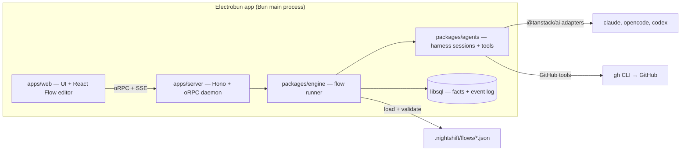

# Night Shift — Plan

> A personal workbench to draw agent flows and run them unattended.

This document records the concept, the decisions behind it, the architecture, and the delivery order. The steering documents in `docs/steering/` hold the durable rules. This plan holds the route.

## 1. What Night Shift is

Night Shift is a workbench for one developer. You draw a flow in a graph editor. Each node is a step: an agent session with a prompt and/or a skill, a shell command, a decision, or a gate. The engine runs the flow on your machine, with your own CLI logins, while you sleep. In the morning you read a stack of pull requests and the open gates.

Night Shift replaces `night-shift.py`, the script in `rpgdotexe/tools/night-shift/`. The script hardcodes one pipeline: worker, check, retry, rescue, pull request, checkpoint. Night Shift turns that pipeline into a flow that you can see and change. The script keeps running the nights until a flow runs a full Epic.

Night Shift is for its author first. A team, a server mode, and other methods come only after the personal tool works every night.

## 2. Decisions

Each row is a settled decision. Change a row only with a new ADR.

| Topic | Decision |
| --- | --- |
| Users | One developer: the author. Better Auth stays, and local mode auto-creates one user and one session. |
| The method | The flow is the method. No method packages and no `method.json`. A WTF night is one flow among others. |
| Flows | A directed graph that you edit in React Flow (`@xyflow/react`). Stored as a versioned JSON file in the repo: `.nightshift/flows/<name>.json`, with a published zod schema. Night Shift knows no method: GitHub, WTF, and the rpgdotexe night are flows and plugins, never engine concepts. |
| Flow I/O | A flow declares **inputs** and **outputs**, like a function. The inputs of the top-level flow are asked when a run starts. A Subflow node calls a flow once with bound inputs; a For Each node calls a flow once per list element, bound to an input. The outputs come back to the caller. Version 1 files (with `params` and `input: "item"`) migrate on load. |
| Templates | `{{name.path}}` reads a value: `name` is a node id, an input, or `run`. Node ids and inputs share one namespace. A path reaches into JSON: `{{planner.data.tasks}}`, `{{item.parent.number}}`. A command gets every value as an environment variable, never as shell text. |
| Node types | Agent, Command, Decision, Gate, Subflow, For Each. See section 3. |
| Edges | An edge leaves a node on a named outcome (`pass`, `fail`, an Agent's own outcome, a Decision label, or a Gate choice). An edge back to an earlier node is a retry loop. Every loop has a maximum count. The engine refuses a flow with an unbounded loop. |
| Harnesses | Every Agent node runs as a harness session through a TanStack AI harness adapter: `@tanstack/ai-claude-code`, `@tanstack/ai-opencode`, `@tanstack/ai-codex`. Unattended Claude Code runs in `auto` permission mode. |
| Daemon | Nights run on a stable daemon (`bun run night`): a built server without hot reload. Development uses `bun run dev` in a separate git worktree, so code changes never reload a daemon that runs a night. |
| Skills | An Agent node names a skill that the harness already has (user, project, or plugin skills). No skill pack materialization. |
| Lists | A For Each reads a list from a source: a JSON value (often another node's output), a command that prints JSON, files that match a glob, or a plugin such as GitHub sub-issues. An element is any JSON value. An object element may carry `id`, `title`, `dependsOn`, and `done`; the rest is free. |
| Triggers | A run starts by hand, or from a schedule stored in the project (`.nightshift/schedules.json`), for example every night at 22:00 with a stop time of 07:00. |
| GitHub | GitHub is a set of TanStack AI tools (read issue, write comment, set label, open pull request, link stack) on top of the `gh` CLI. Agent and Decision nodes can call them. The engine also calls them directly for fixed work. |
| Decisions | A Decision node returns one of its declared labels plus notes, validated against a schema. The decider is a provider behind an interface. The default provider is a small model through TanStack AI structured output. Other providers (for example an OpenRouter model) plug in behind the same interface. |
| Run policy | Ported from the script: fresh session with a tight brief on retry, rescue by a stronger profile, blocked propagation, network grace, usage-limit waits that resume the same session, a stop time. Policy is engine code. A flow only sets its numbers. |
| Worktrees | The user's own clone. Worktrees live in a sibling directory. Garbage collection never deletes a dirty tree. |
| State model | Durable facts in libsql. Status is always derived. Every change appends to an event log that fans out to the UI over SSE. |
| Session view | Structured transcript. "Take over" hands the user the resume command. |
| Shell | Electrobun. Bun is the main process, so the daemon runs in-process with no sidecar. |
| Platforms | macOS first. |
| License | Apache-2.0. Built in public. |

Dropped from the earlier plan: method packages and `method.json`, the OpenSpec method, Jira, server mode with remote runners, the NDJSON runner protocol, the stateless orchestrator as a separate concept (it is now a Decision node), and the project chat.

## 3. Node types

| Node | Does | Outcomes |
| --- | --- | --- |
| Agent | Runs one harness session in the run's worktree. Holds a prompt and/or a skill, a harness, a model, an effort, a permission mode, tools, and time budgets. Ends with a Step Report: an outcome, a summary, and optional structured `data` that matches the node's output schema. | `pass`, `fail`, `needs-input`, or the node's own outcomes |
| Command | Runs one shell command in the worktree. Keeps the full log on disk and the tail in the outputs. | `pass` (exit 0), `fail` |
| Decision | Reads earlier outputs and returns one declared label plus notes. | One edge per label |
| Gate | Waits for a person in the Needs-you inbox. Holds a question and the choices. | One edge per choice |
| Subflow | Runs another flow once, with its inputs bound by templates. Its outputs are the called flow's outputs plus `ended` (the label it ended on). | `pass` (finished), `fail` |
| For Each | Runs a flow once per element of a list, bound to one of its inputs (`as`, default `item`). Reads the list again before each element. Orders by `dependsOn`; a failed element blocks the elements that depend on it. Each element can work on its own branch, stacked on the last one that finished. Its outputs hold the results of every element. | `done`, `halted` |

A node reads earlier values through templates, for example `{{check.log_tail}}`, `{{item.title}}`, or `{{epic}}`.

## 4. Architecture



### Packages

| Package | Owns |
| --- | --- |
| `apps/server` | The daemon. Hono, oRPC router, Better Auth, SSE fan-out of the event log, OS notifications. |
| `apps/web` | The UI. Flow editor, run view with live transcripts, Needs-you inbox, run history. |
| `apps/desktop` | The Electrobun shell. Tray and window. No logic. |
| `packages/db` | Drizzle schema on libsql. Durable facts and the event log. Full transcripts live on disk, indexed here. |
| `packages/api` | oRPC contracts shared by server and web. |
| `packages/flows` | The flow schema (zod), the loader, and the validator (unbounded loops, unknown skills, missing outcomes). |
| `packages/engine` | Graph walk, run policy, gates, worktrees, For Each ordering. |
| `packages/agents` | Harness sessions through `@tanstack/ai` adapters, session resume, usage-limit waits, the GitHub tools, the decider providers. |
| `packages/ui` | Shared components and tokens. |

## 5. Delivery

Status (2026-10-15): Slices 1 to 4 are built. The night runs as flows in `examples/rpgdotexe/`. `night-shift.py` retires after a flow runs a full Epic.

### Slice 1 — One agent node, live

Pick a repo. Run one Agent node with a prompt on Claude Code in a fresh worktree. Watch the transcript stream into the UI. Stop it. Resume it.

Proves: the TanStack AI harness adapter inside the Bun daemon, worktrees, the event log, SSE, transcripts on disk.

### Slice 2 — The flow editor

Draw a flow in React Flow with Agent and Command nodes and `pass`/`fail` edges. Save it to `.nightshift/flows/`. Run it: worker → check → back to worker on `fail`, at most three times.

Proves: the flow schema, the validator, the graph walk, retry loops, template variables.

### Slice 3 — Decisions, gates, GitHub

Add Decision and Gate nodes and the GitHub tools. A flow reads an issue, builds it, opens a pull request, and asks a Decision node whether to continue.

Proves: structured decisions, the Needs-you inbox, the GitHub tools inside a harness session.

### Slice 4 — The night as a flow

Add the For Each node and the full run policy. Rebuild the rpgdotexe night as a flow: Traces blockers first, worker, gate check, retry, rescue, pull request on the stack, Feature checkpoint. Run one Feature unattended. Retire `night-shift.py` when a flow runs a full Epic.

Proves: parity with the script.

### Slice 5 — Safe nights, flows as functions

The first nights showed two things: the dev server reloads under a running night, and the flows were built around one method. Slice 5 makes nights safe and flows generic. All of it is built in a separate git worktree while a night runs.

- `bun run night`: the built server and web app, no hot reload.
- Flow format version 2: `inputs` and `outputs` on every flow, templates with JSON paths, inputs and node ids in one namespace. `params` and `input: "item"` migrate on load; run snapshots of version 1 migrate when read.
- The Subflow node.
- For Each over any list: `json` (a template that renders a JSON array, for example `{{planner.data.tasks}}`), `command`, `files` (a glob), `github` (sub-issues). Elements are free-form JSON with optional `id`, `title`, `dependsOn`, `done`. `as` names the input; `branch` is `per-item` or `shared`. Engine facts per element move to `run`: `{{run.branch}}`, `{{run.base_branch}}`, `{{run.index}}`.
- Start from a branch: the start dialog takes a base ref, so a night can continue on an open stack.
- The rpgdotexe flows move to version 2.

Proves: any flow can call any flow, and a list can come from anywhere.

### Slice 6 — Agents that answer in shape

- Agent outcomes: an Agent node may declare its own outcomes (`approved`, `changes-requested`, …) instead of `pass`/`fail`/`needs-input`.
- Agent output schema: an Agent node may declare a JSON schema for `data` in its Step Report. The engine validates it; the step fails on a mismatch. `{{planner.data.tasks}}` feeds a For Each.
- Generic items in the UI: id, title, a link when the element has `url`, and the raw JSON.
- A starter flow library in `examples/starters/`: implement → check → retry; plan → For Each task → review; review a pull request; one agent per file of a glob.

Proves: a planner agent can decide what the night does.

### Slice 7 — Triggers

- Schedules in `.nightshift/schedules.json`: a flow, its inputs, a time of day or a cron line, and a stop time. The daemon starts the runs. The UI lists, adds, pauses, and removes schedules, and shows the next start.

Proves: a night starts without a person.

### Slice 8 — More harnesses and tools

- OpenCode and Codex Agent nodes through `@tanstack/ai-opencode` and `@tanstack/ai-codex`.
- MCP servers per Agent node, next to the built-in tool sets.

Proves: a flow can mix harnesses.

### Then

A flow library to share, server mode, Windows.

## 6. Setup

The repo was scaffolded with Better-T-Stack (TanStack Start, Hono, Bun, oRPC, libsql, Drizzle, Better Auth, Electrobun, Turborepo, Biome, Lefthook).

Daily commands:

```bash
bun install            # dependencies
bun run db:push        # apply the schema to local.db
bun run dev            # web + server with hot reload
bun run dev:desktop    # the Electrobun shell with hot reload
bun run check          # Biome lint + format
bun run check-types    # TypeScript
bun run build          # everything, desktop last
```

## 7. Open items

- Our own TanStack AI tools reach a Claude Code session over MCP as `mcp__tanstack__<name>` (Slice 2, the `report_step` tool). Plan mode denies them, so a plan-mode Agent node reports with a text line instead. Check OpenCode and Codex when their adapters arrive.
- Session resume works through the adapter (Slice 1). The usage-limit reset time is parsed from the harness's raw messages, but no real usage limit has tested it yet.
- Electrobun packaging needs a static web build of TanStack Start. Confirm before the first desktop build.
- The decider runs Claude Code with no built-in tools (`--tools "" --strict-mcp-config`). `@tanstack/ai-claude-code` 0.9 cannot pass that next to several bridged tools, so we append the flags to the `claude` executable string, which the adapter splits on spaces. Recheck on every adapter upgrade, and ask upstream for an option.
- Flows have no run parameters yet: the rpgdotexe example hardcodes the Epic number in `night.json`. Add parameters (`{{params.epic}}`) set in the start dialog.
- An item cut short by a stop or a daemon death shows `failed` with a reason, and runs again on resume. Consider `stopped` and `interrupted` item states.
- `timeoutMinutes` on a For Each node is not enforced. Every step inside the body keeps its own limit.
- Item branches are `nightshift/<run8>-<id>-<title>`: git cannot nest a branch under the run branch `nightshift/<run8>`.
- Usage-limit and network sleeps are tested with fakes only. The first real usage limit at night is the real test.
- `@tanstack/ai-sandbox` 0.5.23 writes its projection marker to a doubled path when the workspace has a fixed directory. We set `workspace.root: '.'` to avoid it. Report it upstream.
