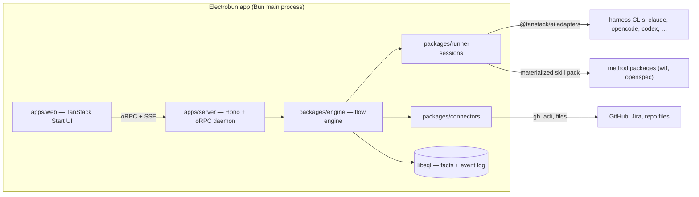

# Night Shift — Plan

> An open agent orchestrator for spec-driven development.

This document records the concept, the decisions behind it, the architecture, and the delivery order. The steering documents in `docs/steering/` hold the durable rules. This plan holds the route.

## 1. What Night Shift is

Night Shift is a team-facing workbench where a spec-driven development (SDD) method runs as a deterministic pipeline of agent sessions. People take part only at gates. The method is a plugin. WTF and OpenSpec ship first. The systems of record are plugins too. GitHub Issues, Jira, and repo files hold artifacts. GitHub pull requests and stacks are the code host.

Everything runs on the user's machine. The daemon is the product. The desktop app makes the daemon usable for people who will never run a script.

Night Shift replaces two things:

- `night-shift.py`, the shell script in `rpgdotexe/tools/night-shift/` that runs an Epic unattended. Its run policy is the seed of the engine.
- The hosted "agent orchestrator" class of tools. Their failure modes (session loss, orchestrator agents that strand a project, worktree corruption, unbounded concurrency, configuration drift) are the list of things the engine must get right.

## 2. Decisions

Each row is a settled decision. Change a row only with a new ADR.

| Topic | Decision |
| --- | --- |
| Users | Role-agnostic. A UI over the agent tools a team already uses. |
| Truth | Hybrid. The app owns runs, gates, sessions, and method state. The connector owns the artifacts. The app keeps a cached index. |
| Topology | Local now. One Bun daemon embedded in the desktop app. The same daemon can run on a company server later, with laptops as runners. |
| Identity | Better Auth always. Local mode auto-creates one user and one session. |
| Step execution | Every method step runs as a harness session (Claude Code, OpenCode, Codex, Copilot, and every other TanStack AI harness adapter). TanStack AI owns the orchestrator, the router, and the gate plumbing. |
| Skill packs | The runner materializes a pinned skill pack into a per-run plugin directory. The repo stays clean. |
| Method package | A git repo or npm package: skill directories plus `method.json` (artifact types, lifecycle states, detection markers, flows). Flows are fixed in the package in v1 and overridable by a repo file. A flow builder comes later. |
| Orchestrator | Stateless. Short steps at checkpoints that read durable state and return `continue` or `halt` plus steering notes, validated against a schema. The project chat is its human face. |
| Agent profiles | Harness or model, model name, effort, permission mode, time budget, sandbox provider. Flows reference profiles by name. |
| Run policy | Retries with a fresh session and a tight brief, rescue by a stronger profile, blocked propagation, network grace, usage-limit waits that resume the same session, a stop time. |
| Scheduling | Core. Locks on repos, branches, and declared file sets. Methods supply conflict hints. Concurrency cap per runner. |
| Gates | TanStack AI approval interrupts, persisted and resolvable by anyone with write access on the project. A method may narrow this. Every resolution writes back to the artifact. |
| Needs input | Two modes per step: intercept the harness ask-the-user tool mid-session, or a structured end-of-step report with a needs-input item. |
| Runner | The daemon on a machine. In-process in v1, behind an NDJSON event protocol so a remote runner is a transport change. Pool membership is opt-in. Headless mode is the same binary without a tray. |
| Worktrees | The user's own clone. Worktrees live in a sibling directory. Garbage collection never deletes a dirty tree. |
| Connectors | CLI-first (`gh`, `acli`) behind a transport-agnostic interface. MCP per vendor when a CLI falls short. Credentials are the user's own CLI logins. Anything the app holds lives in the OS keychain. Index refresh by polling and on demand. |
| Connector kinds | Artifact connectors (GitHub Issues, Jira, repo files) and code-host connectors (GitHub PRs and stacks). A project binds one of each. |
| PR follow-through | Core after the first slice. CI failures and review comments route back to the owning session. Board columns derive from PR, check, and review facts. |
| State model | Durable facts in the database. Status is always derived. Every change appends to an event log that fans out to the UI over SSE. |
| Configuration | One versioned file per project, `.nightshift/project.json`, with a published zod schema and a doctor. Machine-local settings stay in the app. A method's own config (for example `.wtf/config.json`) is read, never duplicated. |
| Session view | Structured transcript. "Take over" hands the user the resume command. |
| Notifications | OS notifications plus write-back on the artifact. Slack after server mode exists. |
| Tenancy | Workspace → Project. Tenant id on every row. No cross-workspace queries. |
| Shell | Electrobun. Bun is the main process, so the daemon runs in-process with no sidecar. |
| Platforms | macOS and Linux in v1. |
| License | Apache-2.0. Built in public. |
| Process | Built with WTF from the first Epic. The current script runs the nights until Night Shift runs its own. |

Decided without a question, flagged here: a step runs in one repo, so a cross-repo change is two steps. Session transcripts are stored in full on disk with an index in the database.

## 3. Architecture



### Packages

| Package | Owns |
| --- | --- |
| `apps/server` | The daemon. Hono, oRPC router, Better Auth, SSE fan-out of the event log, OS notifications. |
| `apps/web` | The UI. Spec tree and artifact editor, pipeline board, session transcript, gate inbox, run history with cost, doctor, settings, project chat. |
| `apps/desktop` | The Electrobun shell. Tray, window, auto-update. No logic. |
| `packages/db` | Drizzle schema on libsql. Durable facts, the event log, tenant id on every row. Full transcripts live on disk, indexed here. |
| `packages/api` | oRPC contracts shared by server and web. |
| `packages/config` | The `.nightshift/project.json` schema, the loader, the doctor. |
| `packages/methods` | The `method.json` schema, the loader, skill pack materialization, detection. |
| `packages/engine` | Flow graph, frontier computation, scheduler with locks and a concurrency cap, run policy, gates, orchestrator decisions, worktree garbage collection. |
| `packages/runner` | The runner protocol (NDJSON events, in-process transport), harness sessions through `@tanstack/ai` adapters, sandbox middleware, needs-input interception, session resume. |
| `packages/connectors` | The artifact and code-host interfaces. `github-issues`, `repo-files`, `github-prs` in v1. `jira` next. |
| `packages/ui` | Shared components and tokens. |

### Method packages

`method.json` declares:

- `artifacts`: types, hierarchy, lifecycle states, where they live (issues or files).
- `detect`: markers that bind a repo to this method (`.wtf/config.json`, `openspec/`).
- `profiles`: the default agent profiles the flows reference.
- `flows`: named graphs of steps. A step names a skill, a profile, inputs, a needs-input mode, and whether a gate follows.

The WTF package lives in the `wtf` repo next to `skills/`. The OpenSpec package is a thin wrapper until upstream adopts the manifest.

## 4. Delivery

### Slice 1 — Chat to issue

Bind a repo. Detect WTF. Type "write an epic for X" in the project chat. Hit a gate. See the issue on GitHub.

Proves: method packs, skill pack materialization, harness invocation, gates, the GitHub Issues connector, the event log, chat.

### Slice 2 — One Feature, unattended

Run one Feature from an existing Epic. Wake up to a stack of pull requests.

Proves: the flow engine, run policy, worktrees, the code-host connector, the stateless orchestrator, the board.

### Slice 3 — OpenSpec

Bind a repo that uses OpenSpec. Run a proposal through apply.

Proves: the method abstraction and the repo-files connector.

### Then

PR follow-through. Jira. Flow builder. Server mode with remote runners. Windows. Slack.

## 5. Setup

The repo was scaffolded with Better-T-Stack:

```bash
bunx create-better-t-stack@latest create nightshift \
  --frontend tanstack-start --backend hono --runtime bun --api orpc \
  --database sqlite --orm drizzle --db-setup none \
  --auth better-auth --payments none \
  --addons electrobun turborepo biome lefthook \
  --examples none --git --package-manager bun --install \
  --web-deploy none --server-deploy none --disable-analytics
```

Daily commands:

```bash
bun install            # dependencies
bun run db:push        # apply the schema to local.db
bun run dev            # web + server with hot reload
bun run dev:desktop    # the Electrobun shell with hot reload
bun run check          # Biome lint + format
bun run check-types    # TypeScript
bun run build          # everything, desktop last
```

WTF is set up in this repo (`.wtf/config.json`, issue templates, labels). Plan work with `/wtf.write-epic`, build with `/wtf.loop` or the current night-shift script.

## 6. Open items

- The `method.json` schema is a draft until the OpenSpec package exists.
- The TanStack AI harness adapters pin `@tanstack/ai` 0.68. Confirm the sandbox middleware works inside an Electrobun main process before Slice 1 ends.
- Electrobun packaging needs a static web build of TanStack Start. Confirm before Slice 2.
