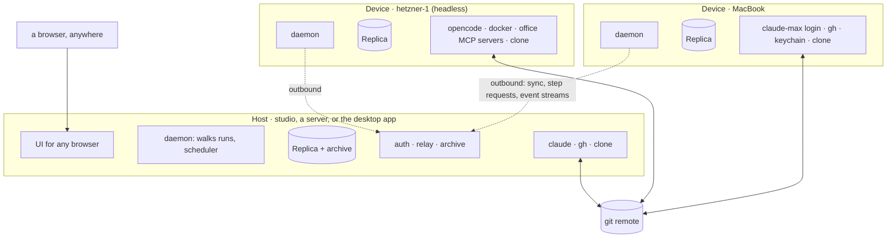
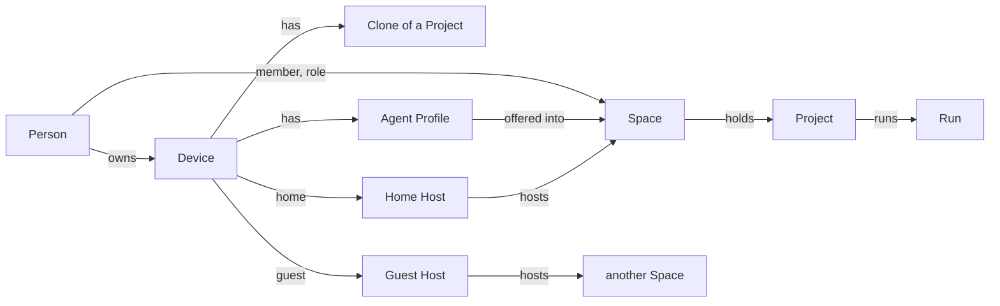
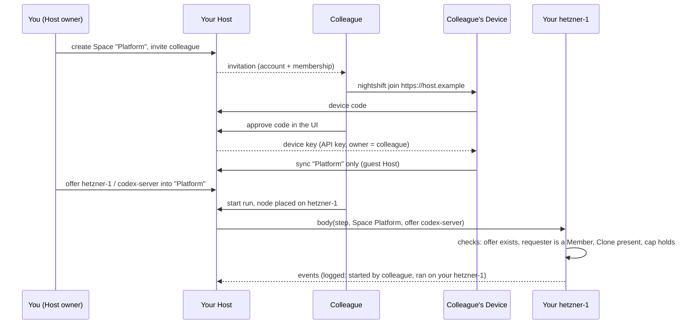

# Devices: running Night Shift on more than one computer

Status: proposal, 2026-10-19, revised twice the same day. Nothing here is
built. The shape is decided: **peers with a local Replica, synced through a
Host**. Three other shapes (a hub with thin runners, peers on one shared
remote database, independent daemons with git as the bus) were compared
and set aside; the first revision of this file has them.

## The wish

- Run the engine on another computer: a second laptop, or a headless
  server.
- Several devices, like several projects. Each device has its own agents
  (harnesses, logins) and its own tools (programs, MCP servers).
- A flow says where a node runs, so compute is split across devices.
- Any client, from anywhere, opens Night Shift and starts a flow whose
  nodes are the responsibility of other machines.
- A project is shared between devices through its remote repository, like
  two developers.
- Every device keeps a local copy of the data, and the copies stay in sync.
- The network of machines is secure by default. A colleague can join one
  project and never touch private projects or settings.

## What is true today

| Fact | Where |
| --- | --- |
| One daemon writes one database. A second daemon on it refuses to start (the Lease). | `packages/engine/src/lease.ts` |
| A Project is an absolute path of a clone, unique in the database. | `project.repo_path` |
| A Run has one worktree, a sibling folder of that clone, on this computer. | `run.worktree_path`, `worktrees.ts` |
| Harnesses, CLI Tools, Connections, Secrets and Agent Profiles are daemon-wide and say "this computer". | the Agents and Settings pages |
| Transcripts and command logs are files in the daemon's data directory. | `transcripts.ts` |
| Every daemon's scheduler reads every project's `.nightshift/schedules.json`. | `scheduler.ts` |
| The UI talks to one server URL. Procedures are public: local single-user mode. | `VITE_SERVER_URL`, `routers/index.ts` |
| Better Auth is wired; one local user is auto-created. | `packages/auth` |
| TECH constraint already written: "Put a tenant id on every row. No query crosses a workspace." | `docs/steering/TECH.md` |

What already points the way: the oRPC ADR ("remote runners call it
later"), the tenant-id constraint, and the engine's data rule: **durable
facts, derived status, an append-only event log**. After the 2026-10-19
refactors every node body runs through one step runner, whose
`body(step, entry)` is the exact piece of a step that touches a computer.

## Vocabulary

| Term | Meaning |
| --- | --- |
| Person | A user account on a Host. Better Auth's user. |
| Device | A computer that runs Night Shift: a full daemon with its own Replica, its own agents, tools, secrets and Clones. Owned by one Person. Named by them ("MacBook", "studio", "hetzner-1"). The desktop app is a Device. |
| Host | A Device that also runs the auth server, the relay and the archive, and serves the UI to a browser. Any Device can be a Host, the desktop app too. A Host is where Devices find each other, not an authority over their data. |
| Home Host | The one Host a Device's owner runs or trusts with the Device's private configuration. A Device has exactly one. |
| Guest Host | Any other Host a Device joins, for the shared Spaces its owner is a member of there. A guest Host never receives the Device's private configuration. |
| Replica | A Device's local database: everything its owner may see, as far as the Device has synced. The UI reads its own Device's Replica. |
| Owner | The one Device (or Walker) that writes a row. Sync never merges two writers of one row. |
| Walker | The Device that drives a Run's Thread and writes its event log and transcripts. One per Run at a time. Default: the Space's Host. |
| Space | The unit of sharing and of sync: Projects, their Runs, their Gates, Offers into it, and Members with roles. A Better Auth organization. Every Person has a personal Space nobody can be invited to. |
| Member | A Person in a Space, with a role: owner, admin, member, viewer, or a custom one. |
| Offer | A Device's Agent Profile made available to one Space, with limits: a permission-mode cap and a session cap. The only way a Space's Members run anything on a Device they do not own. |
| Clone | A Project's repository on one Device, at a path. Its existence is known to the Space; its path only to the Device's owner. |
| Placement | Which Device a step's body runs on: the node's `device`, else the profile's Device, else the Walker. Across Persons, only through an Offer. |
| Hand-off | The git push and fetch of the Run's branch between two steps on different Devices. |
| Capabilities | The facts a Device reports: harnesses and models, programs, secret names, Clones, online state. Private to its owner; an Offer exposes one profile's name. |

## The shape



Every Device is a full Night Shift on its own libsql. Devices connect
outbound to a Host and exchange what changed. Any Device's UI shows every
Device, run and gate it may see, from its own Replica. A Run is walked by
one Walker; its steps run where they are placed.

## Why it holds: every row has one Owner

Night Shift's data falls into five classes. Each has one writer, so run
data never needs conflict resolution.

| Class | Examples | Owner | Sync rule |
| --- | --- | --- | --- |
| Device facts | harnesses and models, programs, secret names, binary paths, session cap, Clones, online state | the Device | copy the Owner's latest version |
| Device configuration | its Agent Profiles, CLI Tools, Connections, Offers | the Device, edited from any of its owner's UIs | the Device document (Yjs): edits merge, the Owner applies them |
| Space definitions | Projects by remote, which Devices have a Clone, Offers into the Space, Members (mirrored from auth) | any Member for Projects; the offering Device for Offers | the Space document (Yjs) |
| Run history | runs, steps, sessions, events, `HandedOff` | the Walker | exchange by cursor: immutable rows, the union is the merge |
| Run state | LangGraph checkpoints, transcripts, command logs | the Walker | copied to the Space's Host archive when a node ends; fetched on demand |

Consequences: status derives the same on every Replica (a Run's events
come from one Walker in one order; `event.seq` becomes `(walkerId, seq)`),
and exactly-one is by rule, not by lock (the Walker is chosen at start,
the step's Device is the Placement; moving a Run is a person's action).

## Sync layers

Two mechanisms, each on the data it is good at:

- **Yjs through Hocuspocus** for the Device document and the Space
  document: small, mutable, edited from several UIs. Hocuspocus 4 (stable
  2026-05) runs in the Host's daemon with `onAuthenticate` and a SQLite
  persistence extension; awareness gives presence. Yjs is not for run
  history: the whole document loads into memory and log-shaped documents
  grow without bound.
- **Event log exchange over oRPC** for run history and run state: a Device
  asks its Host "what do you have of owner X after seq N", streams new
  events live, and copies checkpoints and transcripts to the archive.
  Immutable or single-owner rows make the merge trivial. This is the
  custom piece; it is small because nothing in it resolves a conflict.

Watched, not used: Turso Sync (`@tursodatabase/sync`, local writes with
push and pull to a primary) is the one-mechanism alternative once it is
1.0 and Drizzle speaks it; today it is the new engine at 0.8-pre with a
known replay bug. LiveStore has our event-sourcing model but is 0.4 on a
Cloudflare-shaped backend. cr-sqlite upstream is dormant.

## Security and sharing

### The trust model

Four things, kept apart:

| Thing | Answers | Backed by |
| --- | --- | --- |
| Person | who | Better Auth user on a Host; invitation-only signup; the first user is the Host admin (admin plugin) |
| Device | which machine, owned by whom | an API key (API key plugin) bound to the owner, issued by the device authorization flow (RFC 8628, device authorization plugin) with approval in the UI; hashed at rest; revocable on the Devices page |
| Space | what is shared with whom | an organization (organization plugin): members, roles, invitations, the active Space of a session, permission checks |
| Offer | which compute a Space may use | a row in the Device document and the Space document, enforced by the offering Device itself |



### Private by default

- Everything a Person makes starts in their **personal Space**: projects,
  runs, gates. Nobody can be invited to it. Sharing is a new Space plus an
  invitation, never a switch on something private.
- A Device's configuration (profiles, tools, connections, secret names,
  binary paths) lives in its **Device document**, which syncs only through
  its **home Host** and only to Devices of the same owner. A guest Host
  never receives it. A Member of a shared Space sees of your Device only:
  its name, that it is online, that it has a Clone of the shared Project,
  and the names of the profiles you offered.
- **Secrets never leave their Device.** Values are in that Device's
  keychain or environment; `${NAME}` resolves where the MCP server starts.
  Even secret names are owner-private.
- **Every row carries a Space id** (the TECH constraint). The Host filters
  every sync, relay and stream by membership. The Replica holds many
  Spaces; every query is scoped to one.

### Sharing a project with a colleague

1. You create a Space "Platform" and invite the colleague by email. Your
   Host is invitation-only, so the invitation is also their account.
2. You move (or add) the Project into "Platform". Its Runs and Gates are
   now the Space's. Your other projects stay in your personal Space.
3. The colleague pairs a Device with your Host: `nightshift join
   https://host.example` prints a code, they approve it in your Host's UI,
   their Device gets a key. Your Host is a **guest Host** for that Device:
   it receives "Platform" and nothing else. Their private work stays on
   their own home Host.
4. Their Device adds its Clone of the Project. Now both of you see where
   the Project exists. They draw flows in their Clone and push; you pull.
5. If you want their flows to use your hetzner-1, you **offer** profile
   `codex-server` of hetzner-1 into "Platform", with a permission cap
   (`acceptEdits` at most) and two sessions at most. They place a node on
   `hetzner-1` with `codex-server`. A node of theirs that names anything
   else on hetzner-1 refuses to start.
6. Every step that runs through an Offer logs who started the Run and
   whose Device ran it. Your Devices page shows "runs for Platform" on
   hetzner-1 and lets you withdraw the Offer at any time; running steps
   end as stopped.



### Roles and permissions

The organization plugin's access control, with Night Shift's statements:

| Statement | Actions |
| --- | --- |
| `project` | add, remove, move |
| `run` | start, stop, resume, move, export |
| `gate` | resolve |
| `signal` | send |
| `offer` | use |
| `member` | invite, remove, role |
| `space` | settings, delete |

Default roles: **owner** (all), **admin** (all but `space.delete`),
**member** (`project.add`, `run.*`, `gate.resolve`, `signal.send`,
`offer.use`), **viewer** (nothing that writes). Custom roles through the
plugin's dynamic access control when someone needs "may resolve gates but
not start runs". Checks run on the server (`hasPermission`), never only in
the client.

A Device key's own permissions are narrower than its owner's: `sync`
(pull, push), `relay` (serve bodies), `archive` (put, get). Who may do what
in a Space is always the owner's membership, checked per call.

### What the offering Device enforces itself

The Host is trusted to relay and to filter, but the Device that runs
someone else's step checks again, from its own Replica, before it starts
anything:

- The request names a Space and an Offer this Device made into that Space.
- The requester is a Member of that Space with `offer.use`.
- The Project is one this Device has a Clone of, in that Space.
- The permission mode and the session count stay within the Offer's caps.
- The run worktree gets a git identity of the Person who started the Run
  (`user.name`, `user.email` in the worktree's config), so commits are in
  their name, not the Device owner's.

What an Offer cannot hide, and the Offer dialog says so: an agent on your
Device runs with your harness login and your CLI tools. A `gh pr create`
in a flow a colleague wrote is your `gh`. Offer a profile whose tools you
would hand to that Person.

### Secure by default

1. A Host listens on localhost until it has an `https://` address. Join
   URLs are `https://` only. A Host without a certificate authority can
   use a self-signed certificate: the pairing code shows its fingerprint,
   the Device pins it on approval. See "Connectivity" for how a Host gets
   an address.
2. Signup is invitation-only. The first user is the Host admin.
3. Devices pair by the device authorization flow with approval in the UI.
   Keys are hashed at rest, carry the Device id as metadata, expire after
   a configurable idle time, and are revoked from the Devices page.
   Revoking a Device ends its sync, its Offers and its running steps.
4. Private by default, as above. Sharing is a Space, an invitation and an
   Offer, each explicit.
5. The Host filters by membership; the Device re-checks Offers. Two
   checks, two code paths.
6. Audit in the Space's event log: `MemberJoined`, `MemberRemoved`,
   `OfferMade`, `OfferWithdrawn`, `DeviceJoined`, `DeviceRevoked`, and
   `RunStarted` with the Person, `StepStarted` with the Device.
7. Better Auth 1.6.11 or later: CVE-2026-45337 let an authenticated user
   approve another user's pending device code in 1.6.0–1.6.10.
8. Later: end-to-end encryption of Device documents, so even the home Host
   stores only blobs; and "sign in with your own Night Shift" (the OIDC
   provider plugin on the home Host, generic OAuth on the guest Host), so
   a colleague needs no second password.

What is deliberately not promised: the Host operator can read what the
Host archives for the Spaces it hosts. Transcripts of shared Runs are
shared Runs. Put a Space on a Host whose operator may see it.

## The design

### The Device port

What a step body needs from a computer, as one interface with two adapters.

```ts
type Device = {
  id: string;
  name: string;
  state(): DeviceState;
  capabilities(): Capabilities;
  session(input: AgentSessionInput): AsyncIterable<AgentEvent>;
  exec(input: CommandInput): AsyncIterable<CommandEvent>;
  callTool(input: ToolCallInput): Promise<ToolResult>;
  decide(input: DecisionInput): Promise<DecisionResult>;
  worktree(run: RunRef): Promise<Worktree>;
};
```

`localDevice(deps)` is what `services.ts` wires today. `remoteDevice(relay,
id)` makes the same calls through the Host to that Device's daemon, which
serves them with its own `localDevice` after the Offer checks. The
Walker's step runner asks `deviceFor(node, run)` once per step; node
bodies stop touching `harness`, `spawn`, MCP or `Bun.which` directly.

### Agents and tools per Device

Agent Profiles, CLI Tools and Connections are a Device's own. The Agents
page groups them by Device. A flow names a profile; the profile's Device is
where it runs. Two Devices may define a profile with the same name; a
node's `device` picks, else the Walker's own. Across Persons, a profile is
visible only as an Offer.

### Placement

1. The node's `device`. 2. The profile's Device. 3. The Walker.

Explicit names, not a matcher. The run-start requirements read the placed
Device's capabilities, or the Offer: "The flow uses `gh` on `hetzner-1`,
but that device has no `gh`"; "hetzner-1 offers `codex-server` to this
Space, not `claude`". `device: "any"` can come later.

### Who walks

A Run's Walker is chosen at start; the default is the Space's Host, because
it stays on and a browser-only client has no daemon. A Device that starts
a Run for itself is its own Walker. The Run's worktree lives on the Device
of its first placed step. "Move this Run to studio" ends the walk here and
resumes it there from the archived checkpoint.

### Projects and Clones

A Project is its normalised remote, in exactly one Space. A Clone is
(project, device, path). Adding a folder whose `origin` matches an existing
Project makes a Clone of it. A repository without a remote is bound to one
Device for good. Flows and schedules stay in the repository; each Device
reads them from its own Clone. A Schedule names the Device that fires it
(`device` in `schedules.json`, default the Space's Host), so it never
fires twice.

### Worktrees and the Hand-off

One worktree per Device a Run's steps touch, all on `nightshift/<run8>`.
Between two steps on different Devices: push, fetch and checkout,
`HandedOff` logged. A dirty tree at the hand-off is decision 3.

### Recovery

- Placed Device offline when a step must start: the step sleeps with reason
  `device-offline`, woken when it reconnects.
- Placed Device offline during a step: its daemon keeps the session and
  buffers events; the Walker reattaches, or resumes with the harness
  session id (`continue, with-session`).
- Walker offline during a remote step: the placed Device keeps running;
  the Walker's recovery asks it before re-running.
- Host offline: every Device keeps walking its own runs on its Replica.
  Cross-device steps wait. Sync catches up.
- A Device that cannot reach anyone for long aborts its sessions. The
  limit is a Device setting.

### The relay

In the Host's daemon: Hocuspocus for the documents (`onAuthenticate`
resolves the Device key to its owner and the documents that owner may
open), and oRPC procedures, all called outbound by Devices: `sync.pull`,
`sync.push`, `sync.stream`, `archive.put`, `archive.get`, `devices.work`
(bodies and their event streams between Walker and placed Device). The
Host never calls into a Device.

### Connectivity

Three questions, kept apart: how a Device finds its Host (addressing),
how the bytes get there through NAT (reachability), and whether Devices
need to talk without the Host (peer to peer).

**Addressing: a Host has several addresses, a Device falls through them.**
A Host advertises every `https://` name it has in the Space document, in
order of preference: a LAN name (`studio.local`, found by mDNS), a tailnet
name (`studio.tail1234.ts.net`), a public name
(`nightshift.example.com`). A Device tries them in that order and keeps
the first that answers, so at home it talks on the LAN, in the tailnet it
stays private, and from a café without the VPN it uses the public name.
The join URL is any one of them; after pairing the Device learns the rest.
Night Shift never needs to know how a name resolves.

**Reachability: the Host's way out is a deployment choice.** Three are
documented and tested; Night Shift ships none of them.

| Way out | When | Gives | Mind |
| --- | --- | --- | --- |
| A public server (a VPS, Dokploy) with a domain and automatic TLS | you already run a server | a public name for browsers and Devices alike | the Host operator reads what it archives, as always |
| A tailnet: Tailscale Serve for Devices in the tailnet, Tailscale Funnel to publish the same Host to the public internet | a home Host, no port to open | a tailnet name with a Let's Encrypt certificate; Funnel adds a public name on 443, 8443 or 10000 | Funnel is beta, bandwidth-capped, and does no login check of its own: Night Shift's auth stands alone there |
| An outbound tunnel: Cloudflare Tunnel (with Access in front if wanted), or self-hosted frp or rathole on a VPS | a home Host without Tailscale | a public name on your own domain | one more daemon on the Host |

All three end in an `https://` name, so to Night Shift they are the same.
A Host with no name at all stays on localhost: a single-Device Night
Shift, which is today.

**Peer to peer: not now, and not our own signalling.** Direct
Device-to-Device links would let two Devices sync and run cross-device
steps while the Host is down, and keep LAN traffic local. They cost a
second identity (node keys next to Device keys), a NAT-traversal stack,
relays for the hole punches that fail, and they do nothing for a browser,
which still needs an `https://` Host. The transport is therefore a port,
`Link`, with one adapter in the first slices: `httpsLink` (oRPC plus the
Hocuspocus WebSocket over one TLS connection). The adapter to add later is
**iroh**, not a signalling app of our own: iroh 1.0 (2026-06) dials by
public key, brings its own relays and discovery, and has npm bindings
(Node 20+, prebuilt, macOS arm64 only; Bun untested). A Device key is
already a key pair's worth of identity, so "dial the Device" fits. LAN
discovery by mDNS is the small first step on that road, and does not need
iroh.

### What moves in the UI

| Page | Change |
| --- | --- |
| Sidebar | A Space switcher (the session's active organization). Personal first. |
| Settings → "This computer" | This Device's entry on the Devices page: home Host, guest Hosts, "Be a Host". |
| Devices | Mine, with everything; the Space's, with name, online, Clones of its Projects and Offers. Pair a Device: the code to approve. |
| Agents | My Devices' profiles, tools, connections. An "Offer to a Space" action on a profile. |
| Projects | Per Space. A Project shows its Clones per Device. "Move to Space". |
| Members (new) | The organization plugin's members, roles and invitations, per Space. |
| Flow editor | A Device field on Agent, Command, Tool, Decision and Value nodes, listing my Devices and the Space's Offers. |
| Start run | Walker and worktree Device. |
| Run page | Walker, each step's Device and Person, Hand-offs, "Move to…". |
| Inbox | Gates of every Space I am in. |

### What moves in the data

| Where | Change | Owner |
| --- | --- | --- |
| auth tables | organization, member, invitation, apiKey, deviceCode (plugins' migrations) | the Host |
| `space_id` | on project, run, step, event, clone, offer; the tenant id | — |
| `device` | id, owner, name, platform, home host, last seen | the Device |
| Device document (Yjs) | facts, binary paths, session cap, profiles, CLI tools, connections, offers | the Device |
| Space document (Yjs) | projects, clone existence per device, offers, member mirror | Members / offering Devices |
| `project` | `space_id`, `remote`; `repo_path` and its unique index go | any Member |
| `clone` | project, device, path | the Device |
| `offer` | device, profile, space, permission cap, session cap | the Device |
| `run`, `step`, `event` | `space_id`, `walker_id`, `device_id`, `started_by`; `seq` per Walker | the Walker |
| `sync_cursor` | per Host and owner: the last seq seen | the Device |
| archive | checkpoints and transcripts per Space | the Host, copies only |
| events | `StepStarted` gains `deviceId`; new `DeviceJoined`, `DeviceRevoked`, `DeviceOnline`, `DeviceOffline`, `HandedOff`, `WalkerMoved`, `MemberJoined`, `MemberRemoved`, `OfferMade`, `OfferWithdrawn`. Existing payloads keep their fields. | |

## Slices

1. **The seam and the Owner rule.** The Device port with the local
   adapter. Projects by remote with Clones. `event.seq` per Walker. One
   Device row. No behaviour change.

   *Landed (the Owner rule in the data):*
   - **One Device row.** `device` (id, name, platform, home host, last
     seen, created at, `self`). The row with `self` set is this computer;
     a partial unique index allows one. `self` is the Replica's own fact:
     a Device row that sync brings in never has it. The migration makes
     the row (a random UUID) so it can stamp the old rows in SQL;
     `selfDevice(db)` (engine) returns `{ id, name }`, makes the row in a
     database without one, and fills a blank name from the host name
     (without `.local`) and the platform. The daemon passes its id to the
     engine as `walkerId`.
   - **Projects by remote, with Clones.** `project.remote` is the
     normalised `origin`: `host/path`, no scheme, user, password, port or
     `.git`, host in lower case, path as is (`git@github.com:acme/app.git`
     and `https://github.com/acme/app` are `github.com/acme/app`). A path
     or `file:` remote is none. `repo_path` is gone; `clone` holds
     (project, device, path), unique per (device, path) and per (project,
     device): a Device has at most one Clone of a Project, so "this
     computer's folder" of a Project is one path. The engine's `Project`
     keeps `repoPath`, resolved from that Clone, and gains `remote`.
   - **Adding a folder:** a Clone here at that path gives its Project; else
     a Project with the folder's remote gets a Clone here (`CloneAdded`);
     else a new Project. A second folder of a Project that already has a
     Clone here is refused while the first folder exists; when the first
     folder is gone, or the Project was removed, the Clone moves to the
     new folder.
   - **Remotes of old rows.** SQL cannot run git, so the migration leaves
     `remote` null and gives every project a Clone here at its old path.
     The engine reads the `origin` of every Project here without a remote
     when it starts (`readRemotes`). A remote that another Project already
     has stays off: two clones of one repository that were two Projects
     stay two.
   - **`(walkerId, seq)`.** `event.seq` stays this Replica's local
     autoincrement: the read model, the run log and the stream cursors
     order by it, unchanged. Identity is the new `(walker_id, walker_seq)`,
     unique: the Walker that wrote the event and its own count, 1, 2, 3…
     `appendEvent` takes the count in its insert statement
     (`max(walker_seq) + 1` for that Walker), so two appends cannot share a
     number. A fact of no run (a project, a schedule) is written by this
     computer and counts in its sequence. Old events got `walker_seq = seq`.
     The sync cursor of slice 4 is "Walker X after `walker_seq` N".
   - `run.walker_id` (no foreign key: a run walked elsewhere may arrive
     before its Device) and `step.device_id` are this computer for every
     run and step today. Run bundles are written in format 2 (the
     project's Clones, the Walker columns). Format 1 bundles still open:
     the old `repo_path` reads as the project's one Clone, the remote as
     none, and the Walker and step Device as `unknown`.

   **Landed (the Device port):** `packages/engine/src/device/`.
   `types.ts` is the port, `local.ts` is `localDevice`, wired in
   `services.ts`. Choices where this file was open:
   - `capabilities(query?)` takes the programs to look up
     (`{ programs }`), so a run start asks for the CLI tools its nodes
     name. A kind says which with `NodeKind.programs`. Requirements read
     the `Capabilities` data, not functions.
   - `session` streams `ready` or `refused` first. The engine records
     `SessionStarted` between that and the harness start, so a session
     that cannot start writes no session, as before.
   - The Device fills `${NAME}` and adds the CLI tool help. The input
     carries connection names and the node's servers as written.
   - `exec` streams output and one `exit`. The Walker writes the command
     log and cuts `log_tail` (`runCommand(device, …)`).
   - `decide` takes a decision or a value (overloads). The default models
     come from `capabilities().decider.defaultModels`, so the transcript
     names the model before the Device is asked.
   - `callTool` answers once. The transcript gets the call and the answer
     together when the tool answers.
   - `worktree` adds the run's worktree. The git work of a Call with
     `each` (its item branches) and its glob source stay on the Walker
     until placement (slice 5).
   - The engine takes one `device`. `deviceFor(node, run)` always gives
     it. Agent Profiles stay on the engine (`profileFor`): a run resolves
     them at start, before placement.
   - `StepStarted` gains `deviceId`, and `step.device_id` is the same:
     the Device the step runner placed the step on, not the Walker.
     `services.ts` builds `localDevice` from the self `device` row.
2. **Spaces.** The organization plugin; every row gets a `space_id`; one
   personal Space holds everything; the Space switcher shows one. Sessions
   on the procedures replace public ones. No behaviour change for one
   person on one computer.

   *Landed (Spaces):*
   - **Spaces are organizations.** `packages/auth` adds Better Auth's
     organization plugin. `access.ts` holds the statements and the four
     roles of "Roles and permissions". The roles also keep the plugin's
     own statements (`organization`, `invitation`, `member` create,
     update, delete), because the plugin's endpoints check those. Custom
     roles (dynamic access control) are not on yet.
   - **A personal Space per Person.** `organization.personal` is a column
     (an additional field that a client cannot set). Its slug is
     `personal-<user id>`. A new Person gets one in the user-create hook.
     The hooks refuse an invitation to it, a member added to it, and its
     deletion. A new session starts in it. A session whose active Space
     the Person is no longer a member of works in the personal Space.
   - **The Person of this computer.** `device.owner_id` is the Device's
     Person. The migration names the earliest account, else it makes one
     (`local@nightshift.invalid`). Night Shift fills a blank name from the
     computer's account name when it starts, and `localPerson` makes a new
     Person for a database whose Person is gone.
   - **Backfill in SQL.** The migration makes the personal Spaces and
     their members in SQL, and puts every existing row in the personal
     Space of this computer's Person. So `space_id` is `NOT NULL` from the
     start. After the migration, the hooks make personal Spaces.
   - **`space_id`** is on project, clone, run, step, agent_session and
     event, without a foreign key (like `walker_id`). It is not on the
     Device's configuration (settings, profiles, CLI tools, connections,
     secrets): that is the Device's, not a Space's. LangGraph checkpoints
     have none: only their run reaches them.
   - **The engine's shape.** `createEngine` returns `Engine`, whose one
     method is `space(id)`: a `SpaceEngine`, the interface the API calls.
     Every method of it reads one Space. A project or run of another Space
     is "not found", the same answer as one that does not exist. The walk,
     recovery and the scheduler run over every Space. A run takes its
     project's Space; a step and a session take their run's; an event takes
     its run's, or for a fact of no run its project's, in the insert
     statement itself.
   - **A project is in one Space.** The remote stays unique on a Replica.
     A folder whose Clone or remote is a project of another Space is
     refused ("This folder is a project in another Space"). "Move to
     Space" comes with sharing.
   - **Sessions on the procedures.** Every procedure but the health check
     needs a session in a Space. A write needs a permission, checked on
     the server with the plugin's `hasPermission`: `project.add` and
     `remove`, `run.start`, `stop` and `resume`, `gate.resolve`,
     `signal.send`, and `run.export` on `/api/runs/:id/export`. Reads (runs,
     Gates, projects, the run stream) need membership only. This
     computer's configuration (settings, harnesses, profiles, connections,
     CLI tools, deciders, the folder picker, the git fixes, and the flow
     and schedule files in its Clone) is its owner's.
   - **The local session.** One person on one computer signs in to
     nothing. A request without a session, from a loopback address, with
     no `Origin` or one of Night Shift's own, gets a real Better Auth
     session of the computer's Person: the daemon adds its signed cookie
     to the request's headers, also for Better Auth's own endpoints. Every
     other request needs its own session. A page of another site in the
     same browser does not get the local session, and neither does a
     request from another computer (a daemon on `0.0.0.0` answered those
     before).
   - **Run bundles** are format 3: `space_id` on every row. Formats 1 and
     2 open with the Space `unknown`. An export reads the session's Space
     only.
   - **The Space switcher** is the sidebar header (the team switcher of
     `sidebar-07`): the Person's Spaces, personal first, shown as
     "Personal". `spaces.switch` sets the session's active organization;
     the app then goes home and reloads every query.
3. **The documents.** Device and Space documents in Yjs, persisted in the
   Replica; Hocuspocus in the daemon, verified on Bun. The Agents page
   grouped by Device.

   *Landed (part A, the Device document):*
   - **One Yjs document per Device**, `device:<id>`, opened by
     `openDeviceDocument` (`packages/engine/src/device/document.ts`). Its
     maps: `profiles`, `cliTools`, `connections` (name → plain JSON entry
     with `updatedAt`), `settings` (key → saved value), `facts`, `offers`
     (empty until slice 6) and `meta`. An entry is plain JSON, so an edit
     of one profile replaces that profile: concurrent edits of two fields
     of one profile keep one of them. A store parses each entry when it
     reads it; an entry it cannot read is skipped and stays.
   - **Facts** (`DeviceFacts`): platform, each added harness and where its
     CLI is, the programs on its PATH, the names of the secrets in its
     keychain, its Clones, `checkedAt`. The Owner writes them at start and
     every ten minutes (only what changed); the connection store writes
     the secret names when a secret is saved or removed. Secret values
     never enter the document.
   - **Persisted in the Replica**: `ydoc(name, state, updated_at)`, the
     full state (`Y.encodeStateAsUpdate`) after every change, one write at
     a time; a store's `save` resolves when the row is written. A clean
     stop (signals, the desktop app's stop) flushes the pending write.
   - **The stores are views of the document**, interfaces unchanged:
     `createProfileStore`, `createCliToolStore`, `createConnectionStore`,
     `createSettingsStore` take `{ document }` instead of `{ db }`. `load()`
     has nothing left to do; a remote edit shows in the next read.
   - **Import once.** On the first start without the document's
     `meta.importedAt`, the rows of `agent_profile`, `cli_tool`,
     `connection`, `setting` and `secret` (its names become
     `facts.secrets`) are copied in, in one transaction. The tables stay,
     read-only, with a comment in the schema: SQL cannot write a Yjs
     document, so the migration cannot move the rows, and dropping the
     tables in this slice's migration would lose them before the import
     runs. A later migration drops them, once every install has started
     this version.
   - **Hocuspocus in the daemon** at `/sync` (`apps/server/src/sync.ts`).
     Bun accepts the socket (the daemon's default export is `{ fetch,
     websocket }`) and hands it to Hocuspocus 4's `handleConnection`. The
     daemon is the Owner of the documents it serves, so Hocuspocus gets no
     persistence extension: on load it takes the Owner's state, and every
     update goes both ways (origin-tagged, so none echoes) until it
     unloads the document. The database extension (`fetch`/`store` over
     `documentRows(db)`) is for a Host that keeps documents it does not
     own: slice 4.
   - **Who may connect**: the Device's owner only, by the same rule as the
     procedures (`ownerOnly`, `apps/server/src/sync.ts`). The request's
     session decides; a request from this computer (`isThisComputer`: a
     loopback address, no `Origin` or one of the UI's) without a session
     of its own gets the local Person's session, as slice 2's procedures
     do. The session's Person must be the Device's owner, and the document
     one this daemon owns. The seam is `SyncAuthorize({ documentName,
     token, peer, request })`: slice 4 adds the Device key (its owner) and
     the home-Host rule.
   - **`bun --hot`**: the document and the relay are kept across reloads,
     and a store's view registers nothing on the document (`mapView`
     compares a per-map revision the document counts), so building the
     stores again leaves nothing behind.
   - **The Agents page** shows profiles, harnesses, tools and secrets under
     this Device's name, with "This computer" beneath it.
   - Not yet: the Space document (part B), a UI that syncs the document
     live (the UI still reads and writes through oRPC; the Owner applies
     those writes to the document).

   *Landed (part B, the Space document):*
   - **One Yjs document per Space**, `space:<id>`, in `ydoc` like the
     Device document (`packages/engine/src/space/document.ts`; both open
     through `openPersistedDocument`, `packages/engine/src/ydoc.ts`). Its
     maps: `projects` (id → name, remote, created, removed, updated),
     `clones` (`<project>/<device>` → that the Device has a Clone, and
     since when), `devices` (id → name, for the Devices with a Clone),
     `offers` (empty until slice 6), `members` (user id → name, role) and
     `meta`. A Clone's path is never in it: it stays in the Device's
     `clone` row and its Device document.
   - **The document is the source, the rows its projection.** The
     Replica's `project` rows follow the document after every write, the
     in the same queue as the save
     (`projectSpace`): a new entry makes a row, a changed one updates
     name, remote and removed. Engine queries stay in SQL. A projection
     never deletes a row and never takes a row of another Space (only a
     move changes a Project's Space); an entry the rows refuse (a remote
     another Project has) is skipped and tried again on the next write.
     `clone` rows stay the Device's own: SQL holds this Device's Clones
     with their paths, the document holds every Device's without.
   - **Import once.** The first open of a Space's document copies that
     Space's `project` rows and its Clones' existence in, and records it in
     `meta.importedAt`. The daemon and the engine open the document of
     every Space the Replica knows at start (`openAll`: each organization,
     and each Space a project row names) before the relay serves them.
   - **The engine writes the document.** Adding a Project defines it in
     the document first; its row follows before the call returns. Restore,
     remove, rename and `readRemotes` change the entry, not the row. A
     Clone added here is a `clone` row and a `clones` entry. An entry the
     document lacks (a row from before it) starts from the row. New
     events: `ProjectRenamed` and `ProjectMoved`. The engine logs the facts
     it makes, and nothing else writes the document.
   - **Members mirrored from auth.** On open, and from the organization
     plugin's hooks (a Space made, a Member added or removed, a new role,
     an invitation accepted: `createAuth(…, { onMembersChanged })`), the
     Space's `member` and `user` rows are written into `members`.
   - **Who may open it** (`documentAccess`, `apps/server/src/sync.ts`,
     which `ownerOnly` became): `device:<id>` its owner, as before;
     `space:<id>` a Member of that Space, by the same session rule, always
     read-only (Hocuspocus's `connectionConfig.readOnly`: it drops the
     client's updates). Anyone else is refused. The authorize function
     returns `SyncAccess` (`"write"`, `"read"` or `false`).
   - **Writes to a Space document go through the procedures.** A Yjs
     update is a merge of bytes, not an action: the relay cannot tell a
     rename from a removal, so it cannot check `project.remove` or log
     `ProjectRemoved`. The procedures can: they check the role with
     `hasPermission`, the engine writes the document and logs the event,
     and the relay carries the change to every Member. Slice 6 lets
     colleagues in, so no Member writes a Space document directly.
   - **Create Space** (`spaces.create`, the Space switcher): the
     organization plugin's `createOrganization`, slug `<name>-<8 hex>`, the
     creator its owner, and the session's active Space. The hook opens its
     document. The personal Space stays closed to others (slice 2's hooks).
   - **Move to Space** (`projects.move`, the project card's menu): needs
     `project.move` in both Spaces (`can(permissions, inSpace)`), and no
     run of the project running a step. One SQL transaction gives the new
     `space_id` to the project, its Clones, runs, steps, sessions and
     events (the runs' events, and the project's facts of no run by
     `payload.projectId`). Then the new Space's document gets the entry
     and its Clones, the old one loses them, and `ProjectMoved` (`from`,
     `to`) is logged in the new Space. The rows and the documents are not
     one transaction: a stop between them leaves the entry in the old
     document, whose projection cannot take the row back.
   - **Projects per Space** show their Clones: the engine's `Project` has
     `clones` (Device id, its name from the document, `thisDevice`). The
     project dashboard lists them: "This computer", then other Devices by
     name (none until slice 4). A project can be renamed from its card.
4. **A second Device.** Pairing by device authorization; the event log
   exchange; the archive; inbox and runs from both Devices on both.

   *Landed (part A, pairing a Device with a Host):*
   - **Host role.** "Be a Host" (`host`), the Host's addresses
     (`hostAddresses`, ordered, `https://`; `http://` on loopback for
     tests and development) and `deviceKeyIdleDays` (default 30) are
     settings in the Device document, with `NIGHTSHIFT_HOST` and
     `NIGHTSHIFT_HOST_ADDRESSES` as fallbacks. A daemon binds `127.0.0.1`
     until it is a Host with an `https://` address, then `0.0.0.0`
     (`reachFor`, read at start: the Devices page says when a restart
     applies a change). The desktop app binds the same. `127.0.0.1`, not
     Bun's `localhost` (which binds `::1` only): `127.0.0.1` callers reach
     it, and `localhost` callers (curl, browsers, Bun's fetch) fall back to
     it. Bun's WebSocket does not fall back, so the Link dials `127.0.0.1`
     for a `localhost` Host. Not a Host: no
     pairing, no Device key accepted (`hello` answers "not a Host", which
     a Device treats as offline, not as revoked).
   - **Certificates.** A Host behind an authority's certificate (Tailscale
     Serve, a proxy, Cloudflare) needs nothing. A daemon serves `https://`
     itself with `NIGHTSHIFT_TLS_CERT` and `NIGHTSHIFT_TLS_KEY`. A
     self-signed certificate is pinned: the joining Device reads it with
     a TLS handshake, prints its SHA-256 fingerprint with the code, the
     Host shows the fingerprint of the certificate it serves in "Pair a
     device" and on its Devices page, and the Device keeps the
     certificate in `host_link.certificate`. Bun 1.3's `fetch` and
     `WebSocket` never call `checkServerIdentity`, so the pin is the
     certificate as the only authority (`tls: { ca }`): a changed
     certificate fails the link (`apps/server/src/devices/tls.ts`). A
     certificate this computer already trusts is not pinned (renewals).
   - **Pairing** (`packages/auth/src/pairing.ts`): Better Auth 1.7.7's
     device authorization plugin, client id = the joining Device's id,
     codes valid 15 minutes, polled every 2 s. Reviewing a code binds it
     to the Person who entered it; another Person cannot review, approve
     or deny it (tested: CVE-2026-45337). The plugin's session token from
     `/device/token` is deleted at once: the Host answers the redeem with
     a Device key instead. The Device's name and platform are kept in
     memory with its pending code (a Host restart forgets them; the code
     still works, the Device shows as "Device").
   - **Device keys** (`packages/auth/src/device-keys.ts`, the API key
     plugin): prefix `nsd_`, bound to the approving Person, metadata
     `{ deviceId }`, permissions `sync`, `relay`, `archive`, hashed at
     rest, rate limit off. Idle expiry: a use moves `expiresAt` on, at
     most once a day. Pairing again replaces the Device's key.
   - **On the Host** (`apps/server/src/devices/host.ts`, the registry
     `packages/engine/src/device/registry.ts`): the paired Device's
     `device` row (name, platform, owner, `home_host` = the address it
     joined by when this is its home Host, else null, `last_seen_at`,
     new `revoked_at`), and `DeviceJoined`, `DeviceRevoked`,
     `DeviceOnline`, `DeviceOffline` in the owner's personal Space (a
     fact of no run names its Space: `EventInput.spaceId`). Online is
     derived: a heartbeat within 45 s. A Host that starts again logs
     `DeviceOffline` for a Device the log left online. Remove access:
     the key goes, `DeviceRevoked`, and the relay closes the Device's
     sockets (`sync.disconnect`, on the connection context the authorize
     hook returns).
   - **Device-key auth.** A procedure call with `Authorization: Bearer
     nsd_…` is a Device: no session, never the local session, even from
     loopback. `deviceProcedure("sync")` takes it (`link.hello`,
     `link.heartbeat`); `pairing.start` and `pairing.redeem` are public.
     On the relay, `documentAccess` takes a Device key as the provider
     token (`deviceKey` → `{ deviceId, personId, home }`): it opens the
     Device's own document, only on its home Host and only for the
     document's owner, to write; and the Space documents of the Spaces
     its Person is a Member of, to read. Any other document is refused,
     the Host's own Device document too. A Host keeps the
     Device documents of its home Devices (`KeptDocuments`: Hocuspocus
     loads and stores them in the Replica's `ydoc` rows); a guest Host
     keeps none, and refuses them.
   - **The joining Device** (`apps/server/src/devices/join.ts`, `bun run
     join <host> [--guest]` → the local daemon's `devices.join`, a
     stream): the link goes in `host_link` (Host id and name, addresses,
     pinned certificate, home or guest, the Person there, where the key
     is), its key in the keychain (`Bun.secrets`, service
     `nightshift-device-keys`), else in `<data dir>/device-keys/<host>`
     with mode 0600 (`NIGHTSHIFT_KEY_STORE=file` forces it). One home
     Host at most; a home link sets the self row's `home_host`.
   - **The Link** (`apps/server/src/devices/link.ts`): `httpsLink` tries
     the addresses in order (a refusal is an answer, a network error
     falls through), keeps the first that answers, learns the Host's
     list from each answer (the Host's order, then the ones it did not
     name), heartbeats every 15 s, backs off 1 s doubling to 60 s, and
     over a link to the home Host syncs this Device's document with the
     Hocuspocus provider. A refused key ends the link (`revoked`, key
     deleted). When the relay closes the socket it heartbeats at once, so
     Remove access ends the link in a moment.
   - **The Devices page** replaces Settings → "This computer" (Settings
     links to it): this computer (name, Be a Host and addresses, where
     its access to Hosts is saved, data folder), "Your devices" (online or
     last seen, Remove access) and "Hosts of this computer" (home or
     guest, status). "Pair a device" takes the code (Input OTP), shows
     the device and the fingerprint, and allows or declines it. The code
     link the CLI prints opens it filled in (`/devices?pair=`).
   - `BETTER_AUTH_URL` and `CORS_ORIGIN` are not sensitive in
     `.env.schema`: varlock refused responses that carried them.
   - Tests: `apps/server/src/devices/two-devices.test.ts` runs two
     daemons as processes (the services are one per process), B joins A
     through the CLI, A's Person approves, B is online on A, B's document
     opens on A, Remove access ends B's link, and A's log has the four
     events.
   - Not yet (part B): `sync.pull`/`push`/`stream`, the archive, the
     Space document on a Host, an mDNS name, listing a guest Host's
     Spaces. Joining from the desktop app's UI calls the same
     `devices.join`. A Person removing their own home link, and moving a
     home, need a UI.
5. **Placement.** Run-level, then per node with the Hand-off;
   `device-offline` sleep and reattach.
6. **Sharing.** Invitation-only signup, Members and roles, Offers with the
   Device-side checks, audit events, per-Person git identity in worktrees.

   *Landed (part A, Members):*
   - **Invitation-only.** Better Auth's admin plugin: `user.role` is the
     Person's role on the Host, `admin` for the Host admin, else `user`
     (not a role in a Space). The first Person is the Host admin: the
     user-create hook gives `admin` while the Host has none, and the
     migration names this computer's Person (else the earliest account).
     `localPerson`, which makes a Person without the hooks, claims it the
     same way. Email and password sign-up (`/sign-up/email`) is refused by
     a `hooks.before` unless the Host has nobody yet, or the body names a
     pending, unexpired invitation of that email (`invitationId`): so the
     link, not only the email, makes the account
     (`packages/auth/src/members.ts`). The admin's own `createUser` stays
     open to the Host admin. One person on one computer is untouched: the
     local Person and the local session make no sign-up.
   - **No email server.** Invitations are stored only (no
     `sendInvitationEmail`); the Members page shows the link to copy:
     `<the page's origin>/invite/<invitation id>`. The id is the link's
     secret. Invitations last seven days (`INVITATION_DAYS`), since a
     person passes the link on by hand. An email sender is the plugin's
     `sendInvitationEmail` hook, later. The link uses the origin of the
     browser that made it: open the Members page by the Host's `https://`
     address to get a link a colleague can use.
   - **Accepting** (`/invite/$invitationId`, outside the app's sidebar,
     like `/login`): `invitations.get` is public (Space, inviter, role,
     status, whether the email has an account here). No account: name and
     password make one (the email is the invitation's), then
     `invitations.accept`; an account: sign in, then accept; already
     signed in with that email: Join. Accepting makes the Person a Member
     and the session's active Space (the plugin does both), and the app
     goes home in it. `/login` signs in only: "New here? Open the
     invitation link."
   - **Members page** (`/members`, sidebar under Inbox): `members.list`
     (Members with name, email, role; pending invitations; what the
     session may change), `members.invite` (admin, member or viewer),
     `members.cancelInvitation`, `members.setRole`, `members.remove`, each
     behind its `member.invite`, `member.role` or `member.remove` check
     (`permitted`), then the organization plugin checks the role again
     (an admin cannot touch an owner; nobody deletes a Space without
     `space.delete`). Personal Space: "Nobody can join it" and Create
     Space. Custom roles are not in this slice.
   - **Audit.** The organization hooks report `MemberChange` (joined,
     removed, role) with the Person whose session called the endpoint
     (Better Auth's endpoint context, `tryGetCurrentAuthEndpointContext`).
     The daemon logs `MemberJoined` (`personId`, `role`, `by`,
     `invitedBy`), `MemberRoleChanged` (`previousRole`) and
     `MemberRemoved` in that Space (`engine.logMemberChange`). Making a
     Space logs its owner's `MemberJoined`. The Space document's member
     mirror follows as before.
   - **Who started a run.** `RunStarted` gains `startedBy` (appended), and
     `run.started_by` (no foreign key, like `walker_id`). `runs.start`
     passes the session's Person; a schedule's run has none. The migration
     names this computer's Person for every run no schedule started. A
     run's summary has `startedBy` (id and name, from the Replica's
     accounts); the run page's "Started by" says You, their name, or the
     schedule. Run bundles are format 4 (`started_by`); format 3 reads
     with none.
   - **Git identity per Person.** The worktree's own config gets the
     starter's `user.name` and `user.email` (`RunRef.author`,
     `setWorktreeAuthor`): `git config --worktree`, which needs
     `extensions.worktreeConfig` in the clone, set once (as `git
     sparse-checkout` does). The clone and its other worktrees keep their
     identity. A Person with no real email (`…@nightshift.invalid`, this
     computer's own) gets none: the repository's identity stays.
   - Tests: sign-up refused without an invitation, for another email and
     for a canceled one; the first Person is the Host admin; invite, sign
     up, accept, member in the Space; a viewer cannot invite; an admin
     cannot delete the Space; a removed member loses the Space (and its
     document on the relay); role changes and removals name who made
     them; `startedBy` and the worktree identity, and none for the local
     Person.
   - Not yet (part B, after placement): Offers and the offering Device's
     own checks; the git identity on a Device that runs a colleague's
     step comes with them.
7. **From anywhere.** TLS or tailnet guidance, the Linux binary, the
   desktop app as a Host or joining one.

   *Landed (from anywhere):*
   - **`nightshift`, one file** (`apps/server/scripts/build-binary.ts`,
     `bun run --cwd apps/server build:binary --target all`): `bun build
     --compile` for linux-x64, linux-arm64 and darwin-arm64. A generated
     entry embeds the web build and every `migration.sql` (imports `with {
     type: "file" }`) and hands them to the CLI (`src/headless/embedded.ts`).
     Two build plugins: varlock's loader becomes `process.env` (the shims
     the desktop app used, moved to `apps/server/src/shims`), and libsql's
     run-time pick of `@libsql/<target>` becomes a fixed `require` of the
     target's `index.node`, which the executable then embeds. Another
     platform's native package is downloaded from npm once, checked against
     the registry's integrity, and kept in `apps/server/.cache/`. No
     sourcemap file; identifiers stay unminified so a stack trace reads.
     Tested: the darwin binary on this Mac with a fresh data folder; both
     Linux binaries in a Debian container (x64 under emulation).
   - **The CLI** (`apps/server/src/cli.ts`): `nightshift serve` (flags
     over the environment: `--port`, `--data-dir`, `--host-address`
     repeated, `--listen`, `--tls-port`, `--web`), `nightshift join
     <host> [--guest]`, and new `nightshift pair <code> [--yes]`, which
     approves a code on a Host without a screen (it calls the local
     daemon's `devices.review` and `approve` as this computer's Person;
     `docker exec` works). `serve` fills the environment the way the
     desktop app did (`apps/server/src/daemon-env.ts`, now shared):
     `BETTER_AUTH_URL` and `CORS_ORIGIN` default to the first `https://`
     Host address (the UI is served by the daemon itself), else
     `http://localhost:<port>`. It extracts the migrations to
     `<data dir>/migrations` before the server loads
     (`migrateDb(db, { migrationsFolder })`).
   - **The daemon serves its UI** when it has one (embedded, or
     `NIGHTSHIFT_WEB_DIR`, `src/headless/web.ts`): GET only, never `/rpc`,
     `/api`, `/sync`; `/` only for `Accept: text/html` (a probe still gets
     "OK"); a prerendered page by path, else `index.html`, which routes in
     the browser (React reports a recoverable hydration mismatch there).
     Each page gets `<meta name="nightshift-daemon">`, and the UI then
     calls the origin it came from instead of `VITE_SERVER_URL`
     (`apps/web/src/lib/server-url.ts`): a Host has several addresses, and
     the one the browser used is the one that answers.
   - **Secrets without a keychain.** The auth secret: `BETTER_AUTH_SECRET`,
     else the file `BETTER_AUTH_SECRET_FILE`, else `BETTER_AUTH_SECRET` in
     the secrets folder, else made once in the data folder (0600). A
     `${NAME}`: the environment, then a file `NAME` in the secrets folder
     (`NIGHTSHIFT_SECRETS_DIR`, else systemd's `CREDENTIALS_DIRECTORY`),
     read at start, under the environment. Secrets saved on the
     Connections page go to the keychain where it works, else
     `<data dir>/secrets/<NAME>` (0600), the same choice as Device keys
     (`packages/engine/src/keychain.ts`, `NIGHTSHIFT_KEY_STORE=file`). The
     Devices page says where: "Secrets and access to your Hosts".
   - **Listening.** `NIGHTSHIFT_LISTEN` narrows where a Host binds (default
     `0.0.0.0`): `127.0.0.1` when its way out runs on the same computer. A
     daemon that is not a Host binds `127.0.0.1` whatever it says. With its
     own certificate, `nightshift serve` and the desktop app keep plain
     http on `127.0.0.1:PORT` for this computer (the window, the CLI) and
     serve https on `NIGHTSHIFT_TLS_PORT` (default `PORT + 443`) at the
     Host's hostname (`apps/server/src/serve.ts`). `bun run dev` keeps
     slice 4's single listener.
   - **A proxy is not this computer.** Every way out connects to the
     daemon from the loopback. The local session now also needs no
     forwarding header (`Forwarded`, `X-Forwarded-For`, `X-Forwarded-Host`,
     `X-Real-IP`, `CF-Connecting-IP`, `Tailscale-User-Login`) and a
     loopback name in the URL (a TCP tunnel such as rathole passes the
     public name on). The daemon's own `http://localhost:PORT` and
     `http://127.0.0.1:PORT` are trusted origins, for its UI over an SSH
     tunnel.
   - **The desktop app** starts the daemon with `serveDaemon`, so it binds
     by the Host rules and serves its certificate (it passed no `tls`
     before), flushes the Space documents on quit, and its Devices page
     has **Join a Host** (`join-host-dialog.tsx`: address, home or guest,
     the code and fingerprint, waits, closes when the Host allows it; the
     same `devices.join` stream). A streaming procedure's error now
     reaches the UI as its message (`readable`, `packages/api`); before,
     "declined" or "expired" read "Internal server error". A certificate
     this computer can neither trust nor pin (a proxy's private authority)
     says so when joining.
   - **Link order** was already right in part A: the Device saves the
     Host's list from the pairing answer, learns it again from every
     `hello` and heartbeat (the Host's order, then its own others), and
     tries them in order. Tested with the binary: a Host with
     `https://studio-lan.invalid:3932, https://localhost:3932`, joined at
     the second, keeps both and is online at the second.
   - **Deploy** (`deploy/`): a two-stage Dockerfile (Node for the Vite
     build, whose prerender does not run on Bun alone; `oven/bun:1.3.10-slim`
     with git and ssh to run), `docker-compose.yml` with Caddy, and a systemd
     unit with `LoadCredential=`. Guides in `docs/deploy/`: LAN with a
     self-signed certificate (`.local` by mDNS, first address), tailnet
     (Serve, Funnel and its caveats), public server (Compose with Caddy,
     Dokploy, plain Caddy), outbound tunnel (Cloudflare Tunnel, frp,
     rathole). Tested end to end: the image behind Caddy, a computer
     joining it as a guest, `docker exec … nightshift pair`. Tailscale,
     Let's Encrypt, Cloudflare Tunnel, frp and rathole are written from
     their docs.
   - Not yet: a browser on another computer must sign in to a Host, and
     sign-up stays open until slice 6 makes it invitation-only: the guides
     say to publish a public address only then. A Host behind a proxy
     trusts only `CORS_ORIGIN` and `BETTER_AUTH_URL` as page origins, not
     every Host address. The desktop app does not serve its UI to other
     computers' browsers. A container sees an SSH-tunnelled request as
     another computer's.

Slices 1 to 3 are refactors in the shape of the eight that landed on
2026-10-19. Slice 4 is the first that needs a second computer.

## Decisions

Taken on 2026-10-19:

1. **Sync layers**: Yjs + Hocuspocus for the documents, event log exchange
   over oRPC for run history.
2. **Spaces as Better Auth organizations**, a personal Space per Person,
   home and guest Hosts per Device.
3. **A dirty tree at a Hand-off fails the step** with a clear reason. No
   automatic commit.
4. **Default Walker**: the Space's Host.
5. **Offers are per (Device, profile, Space) with caps.**
6. **Connectivity**: a Host advertises several `https://` addresses and a
   Device falls through them (LAN, tailnet, public); the Host's way out is
   one of three documented deployments, none shipped; the transport is a
   `Link` port with `httpsLink` now and iroh as the later peer-to-peer
   adapter (see "Connectivity").

Nothing is open. The next step is slice 1.

## Open items

- ~~Verify Hocuspocus 4 and `ws` under Bun 1.3 in the daemon process.~~
  Done in slice 3: Hocuspocus 4.7 runs in the daemon on Bun 1.3.10, with
  no `ws`. Hocuspocus 4 takes any WebSocket-like object and a standard
  `Request` (`handleConnection(socket, request, context)`), so Bun's own
  `server.upgrade` and `websocket` handlers feed it (`open`, `message`,
  `close`, and `pong` → `touch()`). Its bundled `Server` class uses
  `node:http` with crossws, and is not needed. One trap: Bun empties a
  request's headers once it upgrades it, so the sync keeps a copy for
  `onAuthenticate`. `HocuspocusProvider` syncs under Bun with its global
  `WebSocket` (`apps/server/src/sync.test.ts`). The SQLite extension
  needs `better-sqlite3`, which Bun does not load: the Replica's own
  `ydoc` table is used instead.
- ~~Better Auth version: the device authorization plugin needs 1.6.11+.~~
  1.7.7, with a test that one Person cannot approve another's code.
- A headless Device has no keychain: secrets from its environment or a
  file its service manager provides. Say which on the Devices page.
  Done for Device keys in slice 4 and for secrets in slice 7 (files in
  the data folder, a secrets folder, systemd credentials).
- A `${NAME}` the placed Device lacks should refuse at run start.
- The usage-limit sleep is per harness login, so per Device. The sleep
  module needs the Device in its key.
- Transcripts of a Run walked elsewhere are fetched from the archive on
  open. Archive retention is undecided, as run retention is today.
- Direct Device-to-Device sync on one LAN without the Host: later.
- Identity across Hosts: a colleague has an account per Host until the
  OIDC provider plugin makes the home Host the login for guest Hosts.
- End-to-end encryption of Device documents: later; the home-Host rule
  covers the colleague case without it.
- ~~VISION lists "shared runners" and "server mode" as out of scope.~~
  Updated with slice 4.

## Sources

- Better Auth: [organization plugin](https://better-auth.com/docs/plugins/organization), [device authorization plugin](https://better-auth.com/docs/plugins/device-authorization), [API key plugin](https://better-auth.com/docs/plugins/api-key), [CVE-2026-45337](https://app.opencve.io/cve/CVE-2026-45337)
- Turso Sync: [Introducing Databases Anywhere](https://turso.tech/blog/introducing-databases-anywhere-with-turso-sync), [usage](https://docs.turso.tech/sync/usage), [replay bug #9330](https://github.com/tursodatabase/turso/issues/9330)
- Hocuspocus: [4 is now stable](https://tiptap.dev/blog/release-notes/hocuspocus-4-stable-release), [SQLite extension](https://tiptap.dev/docs/hocuspocus/server/extensions/sqlite), [hooks](https://tiptap.dev/docs/hocuspocus/server/hooks), [authentication](https://tiptap.dev/docs/hocuspocus/guides/authentication)
- Yjs growth: [document growing unbounded](https://discuss.yjs.dev/t/document-growing-unbounded/3729), [memory requirements](https://discuss.yjs.dev/t/understanding-memory-requirements-for-production-usage/198)
- LiveStore: [how it works](https://docs.livestore.dev/evaluation/how-livestore-works/), [changelog](https://dev.docs.livestore.dev/changelog/). cr-sqlite: [Fly's fork](https://github.com/superfly/cr-sqlite)
