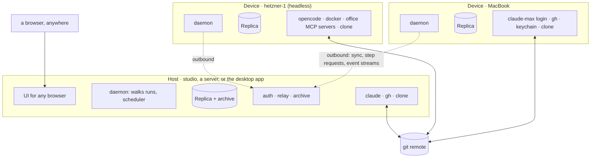
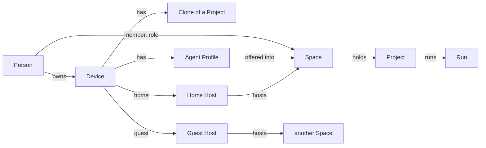
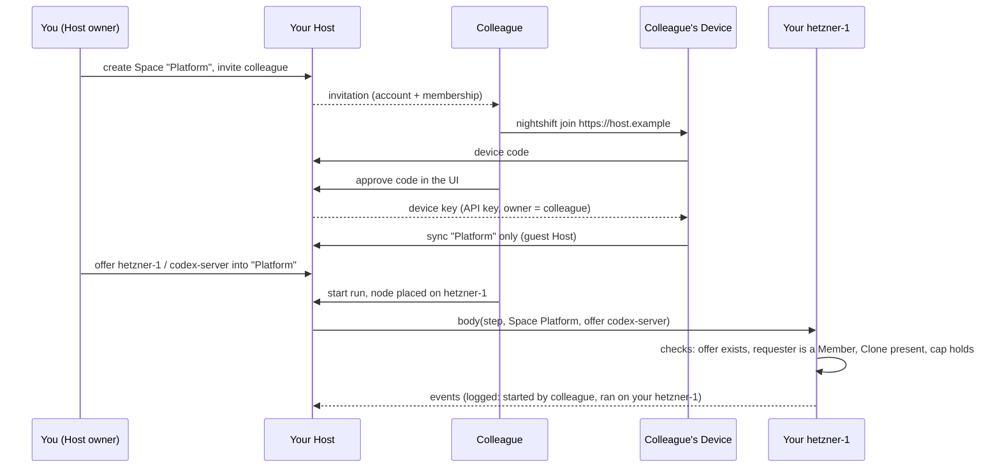

# Devices: running Night Shift on more than one computer

Status: proposal, 2026-10-19, revised twice the same day. Nothing here is
built. The shape is decided: **peers with a local Replica, synced through a
Host**. Three other shapes (a hub with thin runners, peers on one shared
remote database, independent daemons with git as the bus) were compared
and set aside; the first revision of this file has them.

## The wish

- Run the engine on another computer: a second laptop, or a headless
  server.
- Several devices, like several projects. Each device has its own agents
  (harnesses, logins) and its own tools (programs, MCP servers).
- A flow says where a node runs, so compute is split across devices.
- Any client, from anywhere, opens Night Shift and starts a flow whose
  nodes are the responsibility of other machines.
- A project is shared between devices through its remote repository, like
  two developers.
- Every device keeps a local copy of the data, and the copies stay in sync.
- The network of machines is secure by default. A colleague can join one
  project and never touch private projects or settings.

## What is true today

| Fact | Where |
| --- | --- |
| One daemon writes one database. A second daemon on it refuses to start (the Lease). | `packages/engine/src/lease.ts` |
| A Project is an absolute path of a clone, unique in the database. | `project.repo_path` |
| A Run has one worktree, a sibling folder of that clone, on this computer. | `run.worktree_path`, `worktrees.ts` |
| Harnesses, CLI Tools, Connections, Secrets and Agent Profiles are daemon-wide and say "this computer". | the Agents and Settings pages |
| Transcripts and command logs are files in the daemon's data directory. | `transcripts.ts` |
| Every daemon's scheduler reads every project's `.nightshift/schedules.json`. | `scheduler.ts` |
| The UI talks to one server URL. Procedures are public: local single-user mode. | `VITE_SERVER_URL`, `routers/index.ts` |
| Better Auth is wired; one local user is auto-created. | `packages/auth` |
| TECH constraint already written: "Put a tenant id on every row. No query crosses a workspace." | `docs/steering/TECH.md` |

What already points the way: the oRPC ADR ("remote runners call it
later"), the tenant-id constraint, and the engine's data rule: **durable
facts, derived status, an append-only event log**. After the 2026-10-19
refactors every node body runs through one step runner, whose
`body(step, entry)` is the exact piece of a step that touches a computer.

## Vocabulary

| Term | Meaning |
| --- | --- |
| Person | A user account on a Host. Better Auth's user. |
| Device | A computer that runs Night Shift: a full daemon with its own Replica, its own agents, tools, secrets and Clones. Owned by one Person. Named by them ("MacBook", "studio", "hetzner-1"). The desktop app is a Device. |
| Host | A Device that also runs the auth server, the relay and the archive, and serves the UI to a browser. Any Device can be a Host, the desktop app too. A Host is where Devices find each other, not an authority over their data. |
| Home Host | The one Host a Device's owner runs or trusts with the Device's private configuration. A Device has exactly one. |
| Guest Host | Any other Host a Device joins, for the shared Spaces its owner is a member of there. A guest Host never receives the Device's private configuration. |
| Replica | A Device's local database: everything its owner may see, as far as the Device has synced. The UI reads its own Device's Replica. |
| Owner | The one Device (or Walker) that writes a row. Sync never merges two writers of one row. |
| Walker | The Device that drives a Run's Thread and writes its event log and transcripts. One per Run at a time. Default: the Space's Host. |
| Space | The unit of sharing and of sync: Projects, their Runs, their Gates, Offers into it, and Members with roles. A Better Auth organization. Every Person has a personal Space nobody can be invited to. |
| Member | A Person in a Space, with a role: owner, admin, member, viewer, or a custom one. |
| Offer | A Device's Agent Profile made available to one Space, with limits: a permission-mode cap and a session cap. The only way a Space's Members run anything on a Device they do not own. |
| Clone | A Project's repository on one Device, at a path. Its existence is known to the Space; its path only to the Device's owner. |
| Placement | Which Device a step's body runs on: the node's `device`, else the profile's Device, else the Walker. Across Persons, only through an Offer. |
| Hand-off | The git push and fetch of the Run's branch between two steps on different Devices. |
| Capabilities | The facts a Device reports: harnesses and models, programs, secret names, Clones, online state. Private to its owner; an Offer exposes one profile's name. |

## The shape



Every Device is a full Night Shift on its own libsql. Devices connect
outbound to a Host and exchange what changed. Any Device's UI shows every
Device, run and gate it may see, from its own Replica. A Run is walked by
one Walker; its steps run where they are placed.

## Why it holds: every row has one Owner

Night Shift's data falls into five classes. Each has one writer, so run
data never needs conflict resolution.

| Class | Examples | Owner | Sync rule |
| --- | --- | --- | --- |
| Device facts | harnesses and models, programs, secret names, binary paths, session cap, Clones, online state | the Device | copy the Owner's latest version |
| Device configuration | its Agent Profiles, CLI Tools, Connections, Offers | the Device, edited from any of its owner's UIs | the Device document (Yjs): edits merge, the Owner applies them |
| Space definitions | Projects by remote, which Devices have a Clone, Offers into the Space, Members (mirrored from auth) | any Member for Projects; the offering Device for Offers | the Space document (Yjs) |
| Run history | runs, steps, sessions, events, `HandedOff` | the Walker | exchange by cursor: immutable rows, the union is the merge |
| Run state | LangGraph checkpoints, transcripts, command logs | the Walker | copied to the Space's Host archive when a node ends; fetched on demand |

Consequences: status derives the same on every Replica (a Run's events
come from one Walker in one order; `event.seq` becomes `(walkerId, seq)`),
and exactly-one is by rule, not by lock (the Walker is chosen at start,
the step's Device is the Placement; moving a Run is a person's action).

## Sync layers

Two mechanisms, each on the data it is good at:

- **Yjs through Hocuspocus** for the Device document and the Space
  document: small, mutable, edited from several UIs. Hocuspocus 4 (stable
  2026-05) runs in the Host's daemon with `onAuthenticate` and a SQLite
  persistence extension; awareness gives presence. Yjs is not for run
  history: the whole document loads into memory and log-shaped documents
  grow without bound.
- **Event log exchange over oRPC** for run history and run state: a Device
  asks its Host "what do you have of owner X after seq N", streams new
  events live, and copies checkpoints and transcripts to the archive.
  Immutable or single-owner rows make the merge trivial. This is the
  custom piece; it is small because nothing in it resolves a conflict.

Watched, not used: Turso Sync (`@tursodatabase/sync`, local writes with
push and pull to a primary) is the one-mechanism alternative once it is
1.0 and Drizzle speaks it; today it is the new engine at 0.8-pre with a
known replay bug. LiveStore has our event-sourcing model but is 0.4 on a
Cloudflare-shaped backend. cr-sqlite upstream is dormant.

## Security and sharing

### The trust model

Four things, kept apart:

| Thing | Answers | Backed by |
| --- | --- | --- |
| Person | who | Better Auth user on a Host; invitation-only signup; the first user is the Host admin (admin plugin) |
| Device | which machine, owned by whom | an API key (API key plugin) bound to the owner, issued by the device authorization flow (RFC 8628, device authorization plugin) with approval in the UI; hashed at rest; revocable on the Devices page |
| Space | what is shared with whom | an organization (organization plugin): members, roles, invitations, the active Space of a session, permission checks |
| Offer | which compute a Space may use | a row in the Device document and the Space document, enforced by the offering Device itself |



### Private by default

- Everything a Person makes starts in their **personal Space**: projects,
  runs, gates. Nobody can be invited to it. Sharing is a new Space plus an
  invitation, never a switch on something private.
- A Device's configuration (profiles, tools, connections, secret names,
  binary paths) lives in its **Device document**, which syncs only through
  its **home Host** and only to Devices of the same owner. A guest Host
  never receives it. A Member of a shared Space sees of your Device only:
  its name, that it is online, that it has a Clone of the shared Project,
  and the names of the profiles you offered.
- **Secrets never leave their Device.** Values are in that Device's
  keychain or environment; `${NAME}` resolves where the MCP server starts.
  Even secret names are owner-private.
- **Every row carries a Space id** (the TECH constraint). The Host filters
  every sync, relay and stream by membership. The Replica holds many
  Spaces; every query is scoped to one.

### Sharing a project with a colleague

1. You create a Space "Platform" and invite the colleague by email. Your
   Host is invitation-only, so the invitation is also their account.
2. You move (or add) the Project into "Platform". Its Runs and Gates are
   now the Space's. Your other projects stay in your personal Space.
3. The colleague pairs a Device with your Host: `nightshift join
   https://host.example` prints a code, they approve it in your Host's UI,
   their Device gets a key. Your Host is a **guest Host** for that Device:
   it receives "Platform" and nothing else. Their private work stays on
   their own home Host.
4. Their Device adds its Clone of the Project. Now both of you see where
   the Project exists. They draw flows in their Clone and push; you pull.
5. If you want their flows to use your hetzner-1, you **offer** profile
   `codex-server` of hetzner-1 into "Platform", with a permission cap
   (`acceptEdits` at most) and two sessions at most. They place a node on
   `hetzner-1` with `codex-server`. A node of theirs that names anything
   else on hetzner-1 refuses to start.
6. Every step that runs through an Offer logs who started the Run and
   whose Device ran it. Your Devices page shows "runs for Platform" on
   hetzner-1 and lets you withdraw the Offer at any time; running steps
   end as stopped.



### Roles and permissions

The organization plugin's access control, with Night Shift's statements:

| Statement | Actions |
| --- | --- |
| `project` | add, remove, move |
| `run` | start, stop, resume, move, export |
| `gate` | resolve |
| `signal` | send |
| `offer` | use |
| `member` | invite, remove, role |
| `space` | settings, delete |

Default roles: **owner** (all), **admin** (all but `space.delete`),
**member** (`project.add`, `run.*`, `gate.resolve`, `signal.send`,
`offer.use`), **viewer** (nothing that writes). Custom roles through the
plugin's dynamic access control when someone needs "may resolve gates but
not start runs". Checks run on the server (`hasPermission`), never only in
the client.

A Device key's own permissions are narrower than its owner's: `sync`
(pull, push), `relay` (serve bodies), `archive` (put, get). Who may do what
in a Space is always the owner's membership, checked per call.

### What the offering Device enforces itself

The Host is trusted to relay and to filter, but the Device that runs
someone else's step checks again, from its own Replica, before it starts
anything:

- The request names a Space and an Offer this Device made into that Space.
- The requester is a Member of that Space with `offer.use`.
- The Project is one this Device has a Clone of, in that Space.
- The permission mode and the session count stay within the Offer's caps.
- The run worktree gets a git identity of the Person who started the Run
  (`user.name`, `user.email` in the worktree's config), so commits are in
  their name, not the Device owner's.

What an Offer cannot hide, and the Offer dialog says so: an agent on your
Device runs with your harness login and your CLI tools. A `gh pr create`
in a flow a colleague wrote is your `gh`. Offer a profile whose tools you
would hand to that Person.

### Secure by default

1. A Host listens on localhost until it has an `https://` address. Join
   URLs are `https://` only. A Host without a certificate authority can
   use a self-signed certificate: the pairing code shows its fingerprint,
   the Device pins it on approval. See "Connectivity" for how a Host gets
   an address.
2. Signup is invitation-only. The first user is the Host admin.
3. Devices pair by the device authorization flow with approval in the UI.
   Keys are hashed at rest, carry the Device id as metadata, expire after
   a configurable idle time, and are revoked from the Devices page.
   Revoking a Device ends its sync, its Offers and its running steps.
4. Private by default, as above. Sharing is a Space, an invitation and an
   Offer, each explicit.
5. The Host filters by membership; the Device re-checks Offers. Two
   checks, two code paths.
6. Audit in the Space's event log: `MemberJoined`, `MemberRemoved`,
   `OfferMade`, `OfferWithdrawn`, `DeviceJoined`, `DeviceRevoked`, and
   `RunStarted` with the Person, `StepStarted` with the Device.
7. Better Auth 1.6.11 or later: CVE-2026-45337 let an authenticated user
   approve another user's pending device code in 1.6.0–1.6.10.
8. Later: end-to-end encryption of Device documents, so even the home Host
   stores only blobs; and "sign in with your own Night Shift" (the OIDC
   provider plugin on the home Host, generic OAuth on the guest Host), so
   a colleague needs no second password.

What is deliberately not promised: the Host operator can read what the
Host archives for the Spaces it hosts. Transcripts of shared Runs are
shared Runs. Put a Space on a Host whose operator may see it.

## The design

### The Device port

What a step body needs from a computer, as one interface with two adapters.

```ts
type Device = {
  id: string;
  name: string;
  state(): DeviceState;
  capabilities(): Capabilities;
  session(input: AgentSessionInput): AsyncIterable<AgentEvent>;
  exec(input: CommandInput): AsyncIterable<CommandEvent>;
  callTool(input: ToolCallInput): Promise<ToolResult>;
  decide(input: DecisionInput): Promise<DecisionResult>;
  worktree(run: RunRef): Promise<Worktree>;
};
```

`localDevice(deps)` is what `services.ts` wires today. `remoteDevice(relay,
id)` makes the same calls through the Host to that Device's daemon, which
serves them with its own `localDevice` after the Offer checks. The
Walker's step runner asks `deviceFor(node, run)` once per step; node
bodies stop touching `harness`, `spawn`, MCP or `Bun.which` directly.

### Agents and tools per Device

Agent Profiles, CLI Tools and Connections are a Device's own. The Agents
page groups them by Device. A flow names a profile; the profile's Device is
where it runs. Two Devices may define a profile with the same name; a
node's `device` picks, else the Walker's own. Across Persons, a profile is
visible only as an Offer.

### Placement

1. The node's `device`. 2. The profile's Device. 3. The Walker.

Explicit names, not a matcher. The run-start requirements read the placed
Device's capabilities, or the Offer: "The flow uses `gh` on `hetzner-1`,
but that device has no `gh`"; "hetzner-1 offers `codex-server` to this
Space, not `claude`". `device: "any"` can come later.

### Who walks

A Run's Walker is chosen at start; the default is the Space's Host, because
it stays on and a browser-only client has no daemon. A Device that starts
a Run for itself is its own Walker. The Run's worktree lives on the Device
of its first placed step. "Move this Run to studio" ends the walk here and
resumes it there from the archived checkpoint.

### Projects and Clones

A Project is its normalised remote, in exactly one Space. A Clone is
(project, device, path). Adding a folder whose `origin` matches an existing
Project makes a Clone of it. A repository without a remote is bound to one
Device for good. Flows and schedules stay in the repository; each Device
reads them from its own Clone. A Schedule names the Device that fires it
(`device` in `schedules.json`, default the Space's Host), so it never
fires twice.

### Worktrees and the Hand-off

One worktree per Device a Run's steps touch, all on `nightshift/<run8>`.
Between two steps on different Devices: push, fetch and checkout,
`HandedOff` logged. A dirty tree at the hand-off is decision 3.

### Recovery

- Placed Device offline when a step must start: the step sleeps with reason
  `device-offline`, woken when it reconnects.
- Placed Device offline during a step: its daemon keeps the session and
  buffers events; the Walker reattaches, or resumes with the harness
  session id (`continue, with-session`).
- Walker offline during a remote step: the placed Device keeps running;
  the Walker's recovery asks it before re-running.
- Host offline: every Device keeps walking its own runs on its Replica.
  Cross-device steps wait. Sync catches up.
- A Device that cannot reach anyone for long aborts its sessions. The
  limit is a Device setting.

### The relay

In the Host's daemon: Hocuspocus for the documents (`onAuthenticate`
resolves the Device key to its owner and the documents that owner may
open), and oRPC procedures, all called outbound by Devices: `sync.pull`,
`sync.push`, `sync.stream`, `archive.put`, `archive.get`, `devices.work`
(bodies and their event streams between Walker and placed Device). The
Host never calls into a Device.

### Connectivity

Three questions, kept apart: how a Device finds its Host (addressing),
how the bytes get there through NAT (reachability), and whether Devices
need to talk without the Host (peer to peer).

**Addressing: a Host has several addresses, a Device falls through them.**
A Host advertises every `https://` name it has in the Space document, in
order of preference: a LAN name (`studio.local`, found by mDNS), a tailnet
name (`studio.tail1234.ts.net`), a public name
(`nightshift.example.com`). A Device tries them in that order and keeps
the first that answers, so at home it talks on the LAN, in the tailnet it
stays private, and from a café without the VPN it uses the public name.
The join URL is any one of them; after pairing the Device learns the rest.
Night Shift never needs to know how a name resolves.

**Reachability: the Host's way out is a deployment choice.** Three are
documented and tested; Night Shift ships none of them.

| Way out | When | Gives | Mind |
| --- | --- | --- | --- |
| A public server (a VPS, Dokploy) with a domain and automatic TLS | you already run a server | a public name for browsers and Devices alike | the Host operator reads what it archives, as always |
| A tailnet: Tailscale Serve for Devices in the tailnet, Tailscale Funnel to publish the same Host to the public internet | a home Host, no port to open | a tailnet name with a Let's Encrypt certificate; Funnel adds a public name on 443, 8443 or 10000 | Funnel is beta, bandwidth-capped, and does no login check of its own: Night Shift's auth stands alone there |
| An outbound tunnel: Cloudflare Tunnel (with Access in front if wanted), or self-hosted frp or rathole on a VPS | a home Host without Tailscale | a public name on your own domain | one more daemon on the Host |

All three end in an `https://` name, so to Night Shift they are the same.
A Host with no name at all stays on localhost: a single-Device Night
Shift, which is today.

**Peer to peer: not now, and not our own signalling.** Direct
Device-to-Device links would let two Devices sync and run cross-device
steps while the Host is down, and keep LAN traffic local. They cost a
second identity (node keys next to Device keys), a NAT-traversal stack,
relays for the hole punches that fail, and they do nothing for a browser,
which still needs an `https://` Host. The transport is therefore a port,
`Link`, with one adapter in the first slices: `httpsLink` (oRPC plus the
Hocuspocus WebSocket over one TLS connection). The adapter to add later is
**iroh**, not a signalling app of our own: iroh 1.0 (2026-06) dials by
public key, brings its own relays and discovery, and has npm bindings
(Node 20+, prebuilt, macOS arm64 only; Bun untested). A Device key is
already a key pair's worth of identity, so "dial the Device" fits. LAN
discovery by mDNS is the small first step on that road, and does not need
iroh.

### What moves in the UI

| Page | Change |
| --- | --- |
| Sidebar | A Space switcher (the session's active organization). Personal first. |
| Settings → "This computer" | This Device's entry on the Devices page: home Host, guest Hosts, "Be a Host". |
| Devices | Mine, with everything; the Space's, with name, online, Clones of its Projects and Offers. Pair a Device: the code to approve. |
| Agents | My Devices' profiles, tools, connections. An "Offer to a Space" action on a profile. |
| Projects | Per Space. A Project shows its Clones per Device. "Move to Space". |
| Members (new) | The organization plugin's members, roles and invitations, per Space. |
| Flow editor | A Device field on Agent, Command, Tool, Decision and Value nodes, listing my Devices and the Space's Offers. |
| Start run | Walker and worktree Device. |
| Run page | Walker, each step's Device and Person, Hand-offs, "Move to…". |
| Inbox | Gates of every Space I am in. |

### What moves in the data

| Where | Change | Owner |
| --- | --- | --- |
| auth tables | organization, member, invitation, apiKey, deviceCode (plugins' migrations) | the Host |
| `space_id` | on project, run, step, event, clone, offer; the tenant id | — |
| `device` | id, owner, name, platform, home host, last seen | the Device |
| Device document (Yjs) | facts, binary paths, session cap, profiles, CLI tools, connections, offers | the Device |
| Space document (Yjs) | projects, clone existence per device, offers, member mirror | Members / offering Devices |
| `project` | `space_id`, `remote`; `repo_path` and its unique index go | any Member |
| `clone` | project, device, path | the Device |
| `offer` | device, profile, space, permission cap, session cap | the Device |
| `run`, `step`, `event` | `space_id`, `walker_id`, `device_id`, `started_by`; `seq` per Walker | the Walker |
| `sync_cursor` | per Host and owner: the last seq seen | the Device |
| archive | checkpoints and transcripts per Space | the Host, copies only |
| events | `StepStarted` gains `deviceId`; new `DeviceJoined`, `DeviceRevoked`, `DeviceOnline`, `DeviceOffline`, `HandedOff`, `WalkerMoved`, `MemberJoined`, `MemberRemoved`, `OfferMade`, `OfferWithdrawn`. Existing payloads keep their fields. | |

## Slices

1. **The seam and the Owner rule.** The Device port with the local
   adapter. Projects by remote with Clones. `event.seq` per Walker. One
   Device row. No behaviour change.

   *Landed (the Owner rule in the data):*
   - **One Device row.** `device` (id, name, platform, home host, last
     seen, created at, `self`). The row with `self` set is this computer;
     a partial unique index allows one. `self` is the Replica's own fact:
     a Device row that sync brings in never has it. The migration makes
     the row (a random UUID) so it can stamp the old rows in SQL;
     `selfDevice(db)` (engine) returns `{ id, name }`, makes the row in a
     database without one, and fills a blank name from the host name
     (without `.local`) and the platform. The daemon passes its id to the
     engine as `walkerId`.
   - **Projects by remote, with Clones.** `project.remote` is the
     normalised `origin`: `host/path`, no scheme, user, password, port or
     `.git`, host in lower case, path as is (`git@github.com:acme/app.git`
     and `https://github.com/acme/app` are `github.com/acme/app`). A path
     or `file:` remote is none. `repo_path` is gone; `clone` holds
     (project, device, path), unique per (device, path) and per (project,
     device): a Device has at most one Clone of a Project, so "this
     computer's folder" of a Project is one path. The engine's `Project`
     keeps `repoPath`, resolved from that Clone, and gains `remote`.
   - **Adding a folder:** a Clone here at that path gives its Project; else
     a Project with the folder's remote gets a Clone here (`CloneAdded`);
     else a new Project. A second folder of a Project that already has a
     Clone here is refused while the first folder exists; when the first
     folder is gone, or the Project was removed, the Clone moves to the
     new folder.
   - **Remotes of old rows.** SQL cannot run git, so the migration leaves
     `remote` null and gives every project a Clone here at its old path.
     The engine reads the `origin` of every Project here without a remote
     when it starts (`readRemotes`). A remote that another Project already
     has stays off: two clones of one repository that were two Projects
     stay two.
   - **`(walkerId, seq)`.** `event.seq` stays this Replica's local
     autoincrement: the read model, the run log and the stream cursors
     order by it, unchanged. Identity is the new `(walker_id, walker_seq)`,
     unique: the Walker that wrote the event and its own count, 1, 2, 3…
     `appendEvent` takes the count in its insert statement
     (`max(walker_seq) + 1` for that Walker), so two appends cannot share a
     number. A fact of no run (a project, a schedule) is written by this
     computer and counts in its sequence. Old events got `walker_seq = seq`.
     The sync cursor of slice 4 is "Walker X after `walker_seq` N".
   - `run.walker_id` (no foreign key: a run walked elsewhere may arrive
     before its Device) and `step.device_id` are this computer for every
     run and step today. Run bundles are written in format 2 (the
     project's Clones, the Walker columns). Format 1 bundles still open:
     the old `repo_path` reads as the project's one Clone, the remote as
     none, and the Walker and step Device as `unknown`.

   **Landed (the Device port):** `packages/engine/src/device/`.
   `types.ts` is the port, `local.ts` is `localDevice`, wired in
   `services.ts`. Choices where this file was open:
   - `capabilities(query?)` takes the programs to look up
     (`{ programs }`), so a run start asks for the CLI tools its nodes
     name. A kind says which with `NodeKind.programs`. Requirements read
     the `Capabilities` data, not functions.
   - `session` streams `ready` or `refused` first. The engine records
     `SessionStarted` between that and the harness start, so a session
     that cannot start writes no session, as before.
   - The Device fills `${NAME}` and adds the CLI tool help. The input
     carries connection names and the node's servers as written.
   - `exec` streams output and one `exit`. The Walker writes the command
     log and cuts `log_tail` (`runCommand(device, …)`).
   - `decide` takes a decision or a value (overloads). The default models
     come from `capabilities().decider.defaultModels`, so the transcript
     names the model before the Device is asked.
   - `callTool` answers once. The transcript gets the call and the answer
     together when the tool answers.
   - `worktree` adds the run's worktree. The git work of a Call with
     `each` (its item branches) and its glob source stay on the Walker
     until placement (slice 5).
   - The engine takes one `device`. `deviceFor(node, run)` always gives
     it. Agent Profiles stay on the engine (`profileFor`): a run resolves
     them at start, before placement.
   - `StepStarted` gains `deviceId`, and `step.device_id` is the same:
     the Device the step runner placed the step on, not the Walker.
     `services.ts` builds `localDevice` from the self `device` row.
2. **Spaces.** The organization plugin; every row gets a `space_id`; one
   personal Space holds everything; the Space switcher shows one. Sessions
   on the procedures replace public ones. No behaviour change for one
   person on one computer.
3. **The documents.** Device and Space documents in Yjs, persisted in the
   Replica; Hocuspocus in the daemon, verified on Bun. The Agents page
   grouped by Device.
4. **A second Device.** Pairing by device authorization; the event log
   exchange; the archive; inbox and runs from both Devices on both.
5. **Placement.** Run-level, then per node with the Hand-off;
   `device-offline` sleep and reattach.
6. **Sharing.** Invitation-only signup, Members and roles, Offers with the
   Device-side checks, audit events, per-Person git identity in worktrees.
7. **From anywhere.** TLS or tailnet guidance, the Linux binary, the
   desktop app as a Host or joining one.

Slices 1 to 3 are refactors in the shape of the eight that landed on
2026-10-19. Slice 4 is the first that needs a second computer.

## Decisions

Taken on 2026-10-19:

1. **Sync layers**: Yjs + Hocuspocus for the documents, event log exchange
   over oRPC for run history.
2. **Spaces as Better Auth organizations**, a personal Space per Person,
   home and guest Hosts per Device.
3. **A dirty tree at a Hand-off fails the step** with a clear reason. No
   automatic commit.
4. **Default Walker**: the Space's Host.
5. **Offers are per (Device, profile, Space) with caps.**
6. **Connectivity**: a Host advertises several `https://` addresses and a
   Device falls through them (LAN, tailnet, public); the Host's way out is
   one of three documented deployments, none shipped; the transport is a
   `Link` port with `httpsLink` now and iroh as the later peer-to-peer
   adapter (see "Connectivity").

Nothing is open. The next step is slice 1.

## Open items

- Verify Hocuspocus 4 and `ws` under Bun 1.3 in the daemon process.
- Better Auth version: the device authorization plugin needs 1.6.11+.
- A headless Device has no keychain: secrets from its environment or a
  file its service manager provides. Say which on the Devices page.
- A `${NAME}` the placed Device lacks should refuse at run start.
- The usage-limit sleep is per harness login, so per Device. The sleep
  module needs the Device in its key.
- Transcripts of a Run walked elsewhere are fetched from the archive on
  open. Archive retention is undecided, as run retention is today.
- Direct Device-to-Device sync on one LAN without the Host: later.
- Identity across Hosts: a colleague has an account per Host until the
  OIDC provider plugin makes the home Host the login for guest Hosts.
- End-to-end encryption of Device documents: later; the home-Host rule
  covers the colleague case without it.
- VISION lists "shared runners" and "server mode" as out of scope. This
  proposal moves them in scope. Update VISION when slice 4 starts.

## Sources

- Better Auth: [organization plugin](https://better-auth.com/docs/plugins/organization), [device authorization plugin](https://better-auth.com/docs/plugins/device-authorization), [API key plugin](https://better-auth.com/docs/plugins/api-key), [CVE-2026-45337](https://app.opencve.io/cve/CVE-2026-45337)
- Turso Sync: [Introducing Databases Anywhere](https://turso.tech/blog/introducing-databases-anywhere-with-turso-sync), [usage](https://docs.turso.tech/sync/usage), [replay bug #9330](https://github.com/tursodatabase/turso/issues/9330)
- Hocuspocus: [4 is now stable](https://tiptap.dev/blog/release-notes/hocuspocus-4-stable-release), [SQLite extension](https://tiptap.dev/docs/hocuspocus/server/extensions/sqlite), [hooks](https://tiptap.dev/docs/hocuspocus/server/hooks), [authentication](https://tiptap.dev/docs/hocuspocus/guides/authentication)
- Yjs growth: [document growing unbounded](https://discuss.yjs.dev/t/document-growing-unbounded/3729), [memory requirements](https://discuss.yjs.dev/t/understanding-memory-requirements-for-production-usage/198)
- LiveStore: [how it works](https://docs.livestore.dev/evaluation/how-livestore-works/), [changelog](https://dev.docs.livestore.dev/changelog/). cr-sqlite: [Fly's fork](https://github.com/superfly/cr-sqlite)
