# Flow canvas: layout, routing and sections

**Status, 2026-10-24:** research only. No code changed. Two questions from the
developer, after screenshots of the 20-node `feature-factory` flow:

1. How do we lay out a long flow and route its edges so that a person can
   follow them? Today the edges run in dense parallel lanes, pass under
   nodes, pile their labels between nodes, and loops run back across a whole
   row.
2. Should a flow have "sections" that hold part of it, like a TouchDesigner
   component holds a network? What would that mean for the file, the engine
   and the run page?

Every claim links to its source. **Inference** marks what is ours.

## 0. Summary and recommendation

**Routing and layout.** Replace dagre with ELK Layered (`elkjs`) for the
"Lay out" action. Draw each edge from the bend points that ELK returns,
until a person moves a node. ELK does what we built or miss today, in one
run:

- orthogonal routing that keeps edges apart and out of nodes;
- a fixed order of ports per side, so outcome handles map one to one;
- room for edge labels;
- loops routed around the nodes (`feedbackEdges`);
- wrapping a long flow into rows (`wrapping.strategy`);
- compound nodes, which a Section needs (`hierarchyHandling`).

Three changes need no library and shrink the problem first:

- **One edge per node pair.** Draw the edges that share a source and a
  target as one edge with a combined label ("found · none · failed").
  In `feature-factory` that removes 8 of 36 drawn edges.
- **Fewer edge labels.** The node already shows each outcome next to its
  handle. Show the label on the edge only where it adds something: a
  merged edge, a `max`, the run counts, or a selected edge.
- **Remove `wrap()` and `useCarryY`.** Use ELK's wrapping instead, or
  drop wrapping once Sections make flows short.

Keep left to right inside a Section: our nodes list their outcomes as rows
with a handle on the right. "Lay out" picks the direction of the Sections
themselves, and can combine both (§5.1).
libavoid-js (routing around nodes that a person placed) is the second step,
only if routes after a manual drag still disappoint.

**Sections.** Build a visual **Section** first: a named, coloured frame
around nodes of one flow. It folds into a summary box that keeps its
boundary edges. It is stored in the flow file as a list of node ids. The
engine and LangGraph do not see it. Add **"Make subflow from section"**
later, as a guided action that writes a new flow file and puts a Call node
(Subflow) in its place. That action is only safe when the Section has one
entry, does not share variables, and does not loop back out of itself.
Do not build inline nested flows in one file. It changes the meaning of
node ids, templates, variables and the run log, and the Call node already
gives real nesting with a contract. See §3.6 for the staged path.

## 1. What we have today

### 1.1 Layout (`apps/web/src/features/flows/editor/lib/flow-layout.ts`)

- A person presses "Lay out" (`editor-canvas.tsx`, `autoLayout`). Positions
  go into the flow file through `moveNode`. Edges are never stored.
- Dagre with `rankdir: "LR"`. A depth-first walk from `start` marks loops
  as `back` and adds them reversed, and gives dagre `constraints` so that
  `pass` sits above `fail`.
- `wrap()` then cuts the dagre columns into rows, at cuts that at most one
  edge crosses, and picks the cut that shows nodes biggest.
- The graph is made with `new dagre.graphlib.Graph()`, which is not a
  multigraph. Two outcomes of one node to the same target become one dagre
  edge. Labels get no width or height, so dagre reserves no room for them.
  We ignore the edge `points` that dagre returns. (From the code, and from
  dagre's type definitions in `@dagrejs/dagre@3.1.1` `dist/dagre.d.ts`.)

### 1.2 Edges (`apps/web/src/features/flows/canvas/outcome-edge.tsx`)

- Every edge is React Flow's `getSmoothStepPath` from handle to handle. It
  knows nothing of other nodes. It goes straight through a node in the way.
- `useLane` shifts the vertical run of edges that share both ends by
  14 px, and their labels by 24 px. `useCarryY` searches for a clear
  height for the edge that carries over from one row to the next.
- Each edge has a Badge label at the middle of the path.

### 1.3 Nodes (`apps/web/src/features/flows/canvas/flow-node.tsx`)

- One input handle on the left (`Position.Left`).
- One row per outcome, with its label and a source handle on the right
  (`Position.Right`, `id = outcome`). So the outcome name already shows
  on the node.

### 1.4 The feature-factory flow, in numbers

From `.nightshift/flows/feature-factory.json` in the ZAC clone:

- 20 nodes and 36 edges, but only 28 distinct node pairs. Six pairs carry
  14 edges between them: `design → spec` ×4 (found, none, unavailable,
  failed), and `ux → ui_design`, `ui_design → security`, `security → code`,
  `code → verdict` and `approver → publish` ×2 each (pass and changes, or
  approve and escalate).
- 5 loops: `clarify → spec`, `validate → spec`, `stack → build`,
  `verdict → build` and `human → build`.
- The longest path is 16 nodes long, so any layered layout is a long strip.

**Inference.** Most of the "dense bundle" in the screenshots is parallel
edges between the same two nodes, plus labels that repeat what the node
rows already say. The long horizontal lines are the 5 loops, which leave a
row at its end and come back to its start.

### 1.5 The Call node (Subflow), the closest thing to nesting

- The Call node runs another flow file of the project, once or once per
  element (`packages/flows/src/nodes/call.ts`). The app shows it as
  "Subflow" (`docs/glossary.md`, "Call Node").
- The engine runs the called flow as a LangGraph subgraph inside the
  node's step (`packages/engine/src/graph/nodes/call.ts`, "design rule 6").
- Without `each`, the Call node ends `pass` or `fail`, never on the called
  flow's own end labels. That label is the output `ended`
  (`call.ts`, `callOutputFields`).
- A flow's variables belong to one invocation. A called flow does not see
  its caller's variables (`docs/research/variables.md` §2).
- In the editor, the node opens the called flow as its own page
  (`OpenFlowContext`, `flow-editor.tsx` `openFlow`). "Create" writes a new
  flow file and points the node at it.
- On the run page, a breadcrumb over the graph goes into the call in focus
  (`apps/web/src/features/runs/components/run-focus.tsx`).

## 2. Routing and auto layout

### 2.1 The Medium article and where it comes from

The article "Routing Orthogonal Diagram Connectors in JavaScript" (The
Startup, Medium) could not be read: medium.com answered with a Cloudflare
block, and no mirror worked. React Flow's layouting guide links to it as a
resource for routing edges
([reactflow.dev/learn/layouting/layouting](https://reactflow.dev/learn/layouting/layouting)).
The author's code is the GitHub gist
[jose-mdz/4a8894c152383b9d7a870c24a04447e4](https://gist.github.com/jose-mdz/4a8894c152383b9d7a870c24a04447e4)
("Orthogonal Diagram Connector", 2020, `ortho-connector.ts` and a demo).
The gist names `https://jose.page`, whose title is "Jose Menendez". We could
not confirm the article's byline. The summary below is from the code.

What `OrthogonalConnector.route()` does:

1. Takes **two** rectangles, a side and a relative position on each side,
   a `shapeMargin`, and global bounds.
2. Inflates both shapes by the margin. Their edges, plus the two connection
   points, become vertical and horizontal **rulers**.
3. Cuts the bounds into a grid of cells along the rulers. Each cell gives
   up to 9 **spots**: corners, side midpoints and the centre. Spots inside
   the two inflated shapes are dropped.
4. Connects each spot to its nearest spot left, right, up and down. The
   weight is the distance.
5. Runs **Dijkstra** from the point just outside the source to the point
   just outside the target. A turn costs extra: `(edgeWeight + 1)²`.
   The "lowest distance" step scans a set, so it is O(n²) in spots.
6. Removes points that do not bend.

Limits that matter for us (from the code):

- The only obstacles are the two connected shapes. Other nodes are not
  obstacles, so the route can still pass under them.
- It routes one connector at a time. Parallel connectors are not kept
  apart, so they overlap.
- No licence is stated in the gist.

**The primary source.** The sparse grid of rulers is a simple form of the
*orthogonal visibility graph* of Wybrow, Marriott and Stuckey,
"Orthogonal Connector Routing", GD 2009, LNCS 5849, pp. 219–231
([DOI 10.1007/978-3-642-11805-0_22](https://doi.org/10.1007/978-3-642-11805-0_22),
[author PDF](https://people.eng.unimelb.edu.au/pstuckey/papers/gd09.pdf)).
The paper has three stages:

1. **Orthogonal visibility graph.** Its nodes are the "interesting points"
   (shape corners and connection points) that can see each other along
   horizontal and vertical lines. **All** shapes are obstacles. It is built
   in O(n²) with a line sweep (§4, Theorem 1).
2. **A\* search** per connector. Each queue entry keeps the direction of
   entry, so the cost can count bends as well as length. The cost is "a
   monotonic function of the connector length and number of bends" (§5).
3. **Ordering and nudging** (§6). Connectors that share segments are
   ordered so that they cross only where they enter or leave the shared
   path. They are then nudged apart and centred in their "alleys" with a
   separation-constraint solver.

Their timings (2009 laptop): 19 ms for a 36-node grid, 456 ms for a
231-node random graph (Table 1). The authors say this is fast enough "to
reroute connectors even during direct manipulation".

The paper implements this in **libavoid**, part of Adaptagrams
([adaptagrams.org/documentation/libavoid.html](https://www.adaptagrams.org/documentation/libavoid.html)),
"a cross-platform C++ library providing fast, object-avoiding orthogonal
and polyline connector routing for use in interactive diagram editors".
Its routing options include `idealNudgingDistance`,
`nudgeOrthogonalSegmentsConnectedToShapes`,
`nudgeSharedPathsWithCommonEndPoint`, `segmentPenalty`, `crossingPenalty`
and `reverseDirectionPenalty`
([namespaceAvoid](https://www.adaptagrams.org/documentation/namespaceAvoid.html)).

**Inference.** The gist is stage 2 of the paper for one connector, without
stages 1 and 3. Stage 3 (nudging shared paths apart) is what our bundles
need, and it is the hard part. Building it ourselves goes against the
preference for maintained libraries.

### 2.2 The options

| | ELK Layered (`elkjs`) | libavoid-js | react-flow-smart-edge | dagre (today) | Own Medium-style router |
| --- | --- | --- | --- | --- | --- |
| What it does | Places nodes **and** routes edges | Routes edges around nodes at fixed places | Routes each edge around nodes, on a grid | Places nodes | Routes one edge |
| Version | 0.12.0, 2026-07-17 | 0.5.0-beta.5, 2026-02-23 (stable: 0.4.5) | 5.0.0, 2026-08-16 | 3.1.2, 2026-10-23 (we pin 3.1.1) | — |
| Activity | `kieler/elkjs`, pushed 2026-10-19 | `Aksem/libavoid-js`, last commit 2026-09-05, 46 stars | `tisoap/react-flow-smart-edge`, 365 stars | `dagrejs/dagre`, pushed 2026-10-23 | ours |
| Licence | EPL-2.0 OR GPL-3.0-or-later | LGPL-2.1-or-later | MIT | MIT | ours |
| Size | `elk.bundled.js` 1.61 MB, 469 KB gzip | `libavoid.wasm` 492 KB, 182 KB gzip, plus JS glue | small, peer `@xyflow/react` | `dagre.min.js` 49 KB, 17 KB gzip | small |
| Ports with side and order | yes, `portConstraints` | yes, connection pins | handles as given | no | sides only |
| Keeps parallel edges apart | yes, routing slots per layer gap | yes, nudging (paper §6) | no; "hops" over crossings | no routing | no |
| Edge labels | reserves room (label dummy nodes) | no | "avoid areas" for labels | reserves room if given a size | no |
| Groups / compound | yes, `hierarchyHandling` | clusters | "subflow aware" | clusters, open React Flow issue | no |
| Runs off the main thread | yes, Web Worker | wasm, worker by us | yes, Web Worker by default | no | — |
| After a manual drag | stale: no standalone routing in elkjs | made for it: incremental | made for it | — | made for it |

Sources: npm metadata (`npm view <pkg>`) and the GitHub API on
2026-10-24; sizes measured on the npm tarballs. The rest comes from each
row's docs:
[ELK Layered reference](https://eclipse.dev/elk/reference/algorithms/org-eclipse-elk-layered.html),
[elkjs README](https://github.com/kieler/elkjs#readme),
[libavoid-js README](https://github.com/Aksem/libavoid-js),
[smart-edge README](https://github.com/tisoap/react-flow-smart-edge),
[dagre wiki](https://github.com/dagrejs/dagre/wiki), and
[React Flow layouting](https://reactflow.dev/learn/layouting/layouting).

React Flow's own guidance
([layouting](https://reactflow.dev/learn/layouting/layouting)):

- Its table gives edge routing only for ELK. It calls ELK "the most
  configurable option" and the most complicated.
- Dagre's sub-flow layout has an open issue "if any nodes in the sub-flow
  are connected to nodes outside the sub-flow".
- For routing around nodes it points to a **Pro** example built on
  libavoid-js ([edge-routing](https://reactflow.dev/examples/edges/edge-routing),
  paid, under the xyflow Pro License), to react-flow-smart-edge, and to the
  Medium article.

### 2.3 ELK Layered for Night Shift

ELK Layered is "a layer-based algorithm" that "arranges as many edges as
possible into one direction by placing nodes into subsequent layers"
([reference](https://eclipse.dev/elk/reference/algorithms/org-eclipse-elk-layered.html)).
The options that answer our problems:

| Our problem | ELK option | Default | Source |
| --- | --- | --- | --- |
| Edges pass under nodes, overlap | `elk.edgeRouting: ORTHOGONAL` (default for layered), `spacing.edgeEdge`, `spacing.edgeNode` | ORTHOGONAL, 10, 10 | Layered reference |
| One handle per outcome, in order | `elk.portConstraints: FIXED_ORDER`, ports with `elk.port.side` and `elk.port.index` | UNDEFINED | [portConstraints](https://eclipse.dev/elk/reference/options/org-eclipse-elk-portConstraints.html); `FIXED_ORDER` = "The side is fixed for each port, and the order of ports is fixed for each side" ([`PortConstraints.java`](https://github.com/eclipse-elk/elk/blob/master/plugins/org.eclipse.elk.core/src/org/eclipse/elk/core/options/PortConstraints.java)) |
| Loops run across the row | `elk.layered.feedbackEdges: true`, "Whether feedback edges should be highlighted by routing around the nodes" | false | [feedbackEdges](https://eclipse.dev/elk/reference/options/org-eclipse-elk-layered-feedbackEdges.html) |
| Which edges are loops | `elk.layered.cycleBreaking.strategy`: `DEPTH_FIRST`, `MODEL_ORDER`, … | GREEDY | [cycleBreaking](https://eclipse.dev/elk/reference/options/org-eclipse-elk-layered-cycleBreaking-strategy.html) |
| Keep the file's order | `elk.layered.considerModelOrder.strategy`, "Preserves the order of nodes and edges in the model file if this does not lead to additional edge crossings" | NONE | [considerModelOrder](https://eclipse.dev/elk/reference/options/org-eclipse-elk-layered-considerModelOrder-strategy.html) |
| Labels pile up | edge `labels` with a size; `edgeLabels.placement` (CENTER), `layered.edgeLabels.centerLabelPlacementStrategy` | CENTER, MEDIAN_LAYER | Layered reference; [`LabelDummyInserter.java`](https://github.com/eclipse-elk/elk/blob/master/plugins/org.eclipse.elk.alg.layered/src/org/eclipse/elk/alg/layered/intermediate/LabelDummyInserter.java): "inserts dummy nodes into edges that have center labels to reserve space for them" |
| A long flow becomes a strip | `elk.layered.wrapping.strategy: MULTI_EDGE` with `elk.aspectRatio`; edges between chunks are "wrapped around from the end of one chunk to the start of the other" | OFF | [wrapping](https://eclipse.dev/elk/reference/options/org-eclipse-elk-layered-wrapping-strategy.html) |
| Sections | `elk.hierarchyHandling: INCLUDE_CHILDREN` lays out "that node and all of its descendants in a single layout run" | INHERIT (root: SEPARATE_CHILDREN) | [hierarchyHandling](https://eclipse.dev/elk/reference/options/org-eclipse-elk-hierarchyHandling.html) |
| Phases in order | `elk.partitioning.activate` + `elk.partitioning.partition`: "Nodes with lower partition IDs will appear to the left of nodes with higher partition IDs" | false | [partition](https://eclipse.dev/elk/reference/options/org-eclipse-elk-partitioning-partition.html) |

How ELK keeps parallel edges apart:

- Between two layers, the orthogonal router makes one "trunk" (a vertical
  segment, in a left-to-right layout) per port. It assigns the trunks to
  separate routing slots so they do not overlap.
- It is "inspired by" Sander, "Layout of directed hypergraphs with
  orthogonal hyperedges", GD 2003, LNCS 2912
  ([`OrthogonalRoutingGenerator.java`](https://github.com/eclipse-elk/elk/blob/master/plugins/org.eclipse.elk.alg.layered/src/org/eclipse/elk/alg/layered/p5edges/orthogonal/OrthogonalRoutingGenerator.java),
  [`HyperEdgeSegment.java`](https://github.com/eclipse-elk/elk/blob/master/plugins/org.eclipse.elk.alg.layered/src/org/eclipse/elk/alg/layered/p5edges/orthogonal/HyperEdgeSegment.java)).
- Edges that share a port share a trunk, and the split and merge points
  come back as `junctionPoints`
  ([JSON format](https://eclipse.dev/elk/documentation/tooldevelopers/graphdatastructure/jsonformat.html)).
- `layered.mergeEdges` applies only to edges *without* ports: "all such
  incoming edges share an input port"
  ([mergeEdges](https://eclipse.dev/elk/reference/options/org-eclipse-elk-layered-mergeEdges.html)).
  It does not merge our outcome edges, because each outcome is its own port.

**Using ELK's bend points in a React Flow edge.**

- React Flow's ELK examples read back only node `x` and `y`. React Flow then
  draws its own edges. The multiple-handles example maps each handle id to
  an ELK port (targets `WEST`, sources `EAST`, `portConstraints:
  FIXED_ORDER`)
  ([elkjs-multiple-handles](https://reactflow.dev/examples/layout/elkjs-multiple-handles),
  [elkjs](https://reactflow.dev/examples/layout/elkjs)).
- No official React Flow example draws ELK's bend points or uses ELK for
  sub flows.
- ELK returns each edge as `sections[]`, each with `startPoint`,
  `bendPoints[]` and `endPoint`, and labels with `x`, `y`, `width` and
  `height` ([JSON format](https://eclipse.dev/elk/documentation/tooldevelopers/graphdatastructure/jsonformat.html)).
- Edge points are "relative to the edge's containing node". With compound
  nodes that is the lowest common ancestor, written to `container`. Set
  `org.eclipse.elk.json.edgeCoords: ROOT` (and `shapeCoords: ROOT`) to get
  global coordinates
  ([coordinate system](https://eclipse.dev/elk/documentation/tooldevelopers/graphdatastructure/coordinatesystem.html)).

**Inference, a design.**

- Keep the routes in memory next to the positions that the layout wrote,
  not in the flow file. Routes are derived, and storing them would churn
  the file.
- `OutcomeEdge` takes `data.route` when present. It draws a polyline with
  rounded corners (about 15 lines, since `getSmoothStepPath` takes only two
  ends) and puts the label at ELK's label box.
- When a person moves a node, the edges of that node drop their route and
  fall back to today's smooth step. "Lay out" routes everything again.
- elkjs loads lazily in a Web Worker, so its 469 KB gzip costs nothing
  until the first "Lay out". It supports workers "out of the box"
  ([README](https://github.com/kieler/elkjs#readme)).

**Limits.**

- elkjs is "a graph layout engine *only*".
- "Standalone edge routing" (route without moving nodes) and layouts that
  consider earlier results are open requests (elk#315, elkjs#100, in the
  README FAQ).
- ELK has a libavoid connector that "only route[s] the edges without
  touching the node's positions"
  ([org.eclipse.elk.alg.libavoid](https://eclipse.dev/elk/reference/algorithms/org-eclipse-elk-alg-libavoid.html)).
  It is not among elkjs's algorithms (`layered`, `stress`, `mrtree`,
  `radial`, `force`, `disco`, plus `box`, `fixed` and `random`, per the
  README).
- The build is GWT-transpiled Java. The README lists bundler issues ("Can't
  resolve web-worker", "Poor modularization").
- In Bun, `elk-worker.js` takes the worker branch because `self` is
  defined. Our trial had to delete `globalThis.self` first. The browser is
  not affected. (Seen in our trial, from the code of `elk-worker.js`.)

**A trial on feature-factory.** We ran a throwaway script in the session
scratchpad, not in the repo. It used elkjs 0.12.0 on Bun 1.3.10, nodes of
256×120, `FIXED_ORDER` ports, labels sized by their text, `feedbackEdges`,
and `DEPTH_FIRST` cycle breaking.

| Layout | Drawn edges | Size (px) | Bends | Time |
| --- | --- | --- | --- | --- |
| RIGHT, one edge per outcome | 36 | 7632 × 472 | 66 | ~60 ms |
| RIGHT, one edge per node pair | 28 | 8128 × 616 | 50 | 46 ms |
| DOWN, one edge per node pair | 28 | 965 × 4432 | 48 | 49 ms |
| RIGHT, pairs, `wrapping: MULTI_EDGE`, aspect 1.6 | 28 | 3108 × 1388 | 68 | 74 ms |
| RIGHT, pairs, 5 Sections as compound nodes | 28 | 7059 × 652 | 66 | 60 ms |
| DOWN, pairs, 5 Sections as compound nodes | 28 | 977 × 3621 | 72 | 41 ms |

What the trial shows:

- Speed is no concern: it runs in tens of milliseconds after the first run.
- Merging pairs cuts bends by about a quarter.
- Both directions give a strip of about 1:6 or 16:1. Wrapping brings it to
  about 2:1, like our `wrap()`, but with routed edges.
- Sections as compound nodes lay out fine. The page is just as long while
  every Section is open (see §3).

### 2.4 libavoid-js

- A port of libavoid to WebAssembly, "started as part of a research project
  at Technische Universität Wien". It runs in the browser and in Node
  ([README](https://github.com/Aksem/libavoid-js)).
- The current line is a beta (0.5.0-beta.5). There are few contributors.
  The last commit adds a browser export condition (2026-09-05).
- React Flow's Pro edge-routing example uses it, so it works with React
  Flow 12. That example's code is paid.
- **Fit (inference).** It solves "a person placed the nodes; route every
  edge around them, keep parallel edges apart" while the person drags. ELK
  does not do that. It does not place nodes, so it is a partner for ELK,
  not a replacement.
- **Risks (inference).**
  - LGPL-2.1 is fine for loading an unmodified, separate `.wasm` file, but
    a change to the library must be published.
  - The bus factor is low.
  - It adds 182 KB gzip.
  - Its API is libavoid's C++ API through embind. That means manual memory
    management (`delete()` on objects), which is easy to leak in React
    effects.

### 2.5 dagre's limits

From the [dagre wiki](https://github.com/dagrejs/dagre/wiki) and the
3.1.1 types:

- Its options are `rankdir`, `align`, `nodesep`, `edgesep`, `ranksep`,
  `ranker` and `acyclicer`, plus edge `minlen`, `weight` and label
  `width`, `height`, `labelpos`. Node size is the only node option.
  **There are no ports and no sides.**
- Edges come back as `points`, "the control points of the edge". These are
  for a spline, not orthogonal segments.
- Compound graphs exist (`compound: true` in `GraphLabel`). React Flow
  documents the open issue with edges that leave a sub flow.
- 3.x adds `constraints` (left and right pairs within a rank) and
  `customOrder`, which we use.

**Inference.** Every remaining fix on dagre would be our own code: lanes,
carry-over heights, label offsets, wrapping. That is the code we want to
delete.

### 2.6 The specific problems

**Parallel outcome edges: merge, do not bundle.**

- Draw one edge per (source, target) pair. Its stems leave from each
  outcome handle and join after a short run, as ELK's per-port trunks do.
  The label lists the outcomes: "pass · changes".
- Selecting the edge selects its first outcome edge. A small menu, or the
  inspector, picks the others.
- In feature-factory this changes 36 edges to 28.
- **Inference.** Real edge bundling (curving unrelated edges together)
  hides which outcome goes where, so it is the wrong tool for a flow.

**Label pile-ups.**

- Give ELK each label's size so that it reserves room.
- Show an edge label only where the node row does not already say it:
  merged edges, `max`, run counts ("taken 2/3"), selected or hovered edges,
  and edges whose source is off screen.
- ELK's `centerLabelPlacementStrategy` (`MEDIAN_LAYER`, `TAIL_LAYER`,
  `HEAD_LAYER`, `SPACE_EFFICIENT_LAYER`) chooses which layer gap holds a
  long edge's label.
- Labels at the tail (`edgeLabels.placement: TAIL`) read as "this outcome
  leaves here" and cannot stack between two nodes. (Inference.)

**Loops ("back edges").**

- Keep marking them by a depth-first walk from `start`. ELK's
  `DEPTH_FIRST` or `MODEL_ORDER` cycle breaking does the same.
- `feedbackEdges: true` routes them around the nodes instead of through
  the row.
- Draw loops in a quieter style (dashed, or lighter) so the forward path
  reads first. (Inference.)
- With Sections, most loops stay inside one Section and become short. In
  feature-factory, 3 of the 5 do (`clarify → spec`, `validate → spec`,
  `stack → build`). See §4.

**Top to bottom, or left to right.**

- The trial gives a strip either way (§2.3). Direction alone does not fix
  a 16-node path.
- Our nodes are a vertical list of outcome rows with a handle on the
  right (§1.3). Top to bottom would put the handles on the bottom edge, so
  the rows would become a horizontal strip. A node 256 px wide fits two or
  three outcome names, and a Decision with five options does not fit.
  (Inference.)
- Recommendation: keep left to right, with handles left and right. Let
  Sections and wrapping deal with length. If we try top to bottom later,
  make it a per-flow choice (`elk.direction`), with outcome chips on the
  bottom.

**`wrap()`.**

- Retire it. ELK's `wrapping.strategy` does the same job (chunks, edges
  carried from the end of one chunk to the start of the next) and routes
  the carried edges.
- Once a long flow has Sections, the top level is short and needs no
  wrapping at all (§4).
- `useCarryY` and `useLane` then go too.

## 3. Sections and nesting

### 3.1 TouchDesigner

TouchDesigner has two separate tools. One is visual grouping, one is real
nesting.

**Real nesting: the COMP.**

- "Components (or COMPs) … contain their own networks … Sub-networks create
  a hierarchy of networks that can be navigated (using the network path)"
  ([Component](https://docs.derivative.ca/Component)).
- The Base COMP is "the most basic shell of a component … used when a new
  network is required" ([Base COMP](https://docs.derivative.ca/Base_COMP)).
- The Container COMP nests in the same way, but it is for UI panels
  ([Container COMP](https://docs.derivative.ca/Container_COMP)).
- **Its interface is operators inside it.** "For each In CHOP inside a
  component, there is one input connector added to the In CHOP's parent
  component" ([In CHOP](https://docs.derivative.ca/In_CHOP)), and the same
  holds for Out operators ([Out CHOP](https://docs.derivative.ca/Out_CHOP)).
- Inputs are on the left and outputs on the right, "alphanumerically
  ordered" by the In and Out operators' names
  ([Component](https://docs.derivative.ca/Component),
  [In DAT](https://docs.derivative.ca/In_DAT)).
- **Paths.** A COMP is a level in the path, "like folders/directories":
  `/project1/container1/button2/text1`, and `..` is the parent
  ([Network Path](https://docs.derivative.ca/Network_Path)).
- Python reaches nodes with `op()` and `parent(n)`
  ([td Module](https://docs.derivative.ca/Td_Module)).
- **Going in and out.**
  - In: double-click the COMP, select it and press Enter, press `i`, or
    zoom in.
  - Out: press `u`, zoom out, or click a name in the **path bar** at the top
    of the pane, which works as a breadcrumb
    ([Network Editor](https://docs.derivative.ca/Network_Editor)).
  - Clicking the last level of the path lists the child components
    ([Network Path](https://docs.derivative.ca/Network_Path)).

**Visual grouping: Annotate COMP.** It comes in three modes: Comment
(Shift-C), Network Box (Shift-B) and Annotate (Shift-A).

- They are "colored rectangles … for comments and node grouping". With
  "Enclose OPs", dragging the box drags the nodes inside it. Alt-drag moves
  the box alone ([Annotate COMP](https://docs.derivative.ca/Annotate_COMP)).
- A node dragged over the edge of a Network Box makes the box grow around
  it. Utility nodes are hidden from `op()` and `findChildren` by default
  ([Network Utilities](https://docs.derivative.ca/Network_Utilities:_Comments,_Network_Boxes,_Annotates)).
- **Inference.** Boxed nodes stay siblings in the same network. Their
  paths do not change. Only a COMP changes the path.

**Reuse.**

- A **Clone** "will be forced to contain the same nodes, wiring and
  parameters as its master component". Edits to the master change all
  clones ([Clone](https://docs.derivative.ca/Clone)).
- The **Replicator COMP** is "the 'for-loop' of operators": one copy per
  table row ([Replicator COMP](https://docs.derivative.ca/Replicator_COMP)).
- A **.tox** file holds one component, which loads into other projects.
  The `External .tox Path` parameter sources a COMP from disk on start
  ([.tox](https://docs.derivative.ca/.tox)).
- **Inference, the mapping to Night Shift.** A COMP is our Call node and
  its flow file. In/Out operators are our flow `inputs` and `outputs`. A
  `.tox` is a flow file. A Replicator is a Call with `each`. What we lack
  is the Network Box, and the "enter in place" feel of `i` and `u`.

### 3.2 Other node editors

| Product | Visual grouping | Real nesting | Interface of a nested part | In and out | Reuse |
| --- | --- | --- | --- | --- | --- |
| Houdini | Network box ("minimize the box to hide parts of the network"), sticky note ([organize](https://www.sidefx.com/docs/houdini/network/organize.html)) | Subnet; "Collapse to Subnet" rewires the selection ([subnet](https://www.sidefx.com/docs/houdini/nodes/sop/subnet.html)) | Four fixed subnet inputs; promoted parameters | I or Enter, U; path gadget ([navigate](https://www.sidefx.com/docs/houdini/network/navigate.html)) | Digital asset (HDA), locked instances, edits reach all ([assets](https://www.sidefx.com/docs/houdini/assets/intro.html)) |
| Unreal Blueprints | Comment box; nodes inside move with it ([comments](https://dev.epicgames.com/documentation/en-us/unreal-engine/comments-in-unreal-engine)) | Collapse Nodes → collapsed graph; also to Function or Macro ([collapsing](https://dev.epicgames.com/documentation/en-us/unreal-engine/collapsing-graphs-in-unreal-engine)) | Inputs and Outputs nodes with pins | Double-click opens a graph | Function is called; Macro is copied in at compile ([best practices](https://dev.epicgames.com/documentation/en-us/unreal-engine/blueprint-best-practices-in-unreal-engine)) |
| Blender | Frame: "separate logical sections … without creating a reusable Node Group" ([frame](https://docs.blender.org/manual/en/latest/interface/controls/nodes/types/layout/frame.html)) | Node group, Ctrl-G makes Group Input and Output from the cut links ([groups](https://docs.blender.org/manual/en/latest/interface/controls/nodes/groups.html)) | Group Input and Output, socket panel | Tab in, Tab or Ctrl-Tab out; breadcrumbs top left | One data-block, used many times |
| Node-RED | Group; also scopes environment variables ([groups](https://nodered.org/docs/user-guide/editor/workspace/groups)) | Subflow; "Selection to Subflow" only if the wires in go to one node ([subflows](https://nodered.org/docs/user-guide/editor/workspace/subflows)) | At most one input, many outputs, per-instance properties | Opens as a tab | Subflow template in the palette |
| n8n | Sticky notes; Canvas Groups: collapsible, not nested, outside nodes connect only to the first or last node, collapse saved per browser ([canvas groups](https://docs.n8n.io/build/understand-workflows/workflow-components/canvas-groups)) | Separate workflow via Execute Sub-workflow ([sub-workflows](https://docs.n8n.io/flow-logic/subworkflows/)); "convert selection" needs one start node and one end node and rewrites references into inputs ([conversion](https://docs.n8n.io/workflows/subworkflow-conversion/)) | Trigger input fields | Link to the sub-execution | Called by id |
| ComfyUI | Group or frame, Ctrl+G ([shortcuts](https://docs.comfy.org/interface/shortcuts)) | Subgraph from selection, nestable ([subgraph](https://docs.comfy.org/interface/features/subgraph)) | Input and output slots, promoted widgets | Double-click in; Esc or the navigation bar out | Blueprints are independent copies |
| Figma | Section, Shift+S ([sections](https://help.figma.com/hc/en-us/articles/9771500257687)) | — | — | — | Components, a separate feature |

**Inference: the patterns.**

1. Every editor with nesting also has a cheaper visual group. People use
   both.
2. A visual group moves its contents and changes nothing about how the
   graph runs.
3. Nesting always has an explicit boundary (In and Out nodes, or a socket
   list). The "collapse selection" action makes that boundary from the cut
   edges. Node-RED and n8n allow it only with one entry.
4. n8n's Canvas Groups allow only one entry and one exit, so a collapsed
   group is one box with one edge in and one edge out.

### 3.3 LangGraph subgraphs (our engine)

From [use-subgraphs](https://docs.langchain.com/oss/javascript/langgraph/use-subgraphs)
(JS):

- "A subgraph is a graph that is used as a node in another graph."
- **Add as node:** pass a compiled subgraph to `addNode` when the two
  graphs share state keys.
- **Call inside a node:** use this for different schemas, mapping state
  in and out (`await subgraph.invoke({...})`). Our Call node does this
  (§1.5).
- By default a subgraph "inherits the parent's checkpointer to support
  interrupts and durable execution". "Interrupts still propagate to the
  top-level graph regardless of nesting."
- When resumed, the parent runs the calling node again from its start
  ([interrupts](https://docs.langchain.com/oss/javascript/langgraph/interrupts)).
- Streaming with `subgraphs: true` yields `[namespace, data]`, where the
  namespace is a path like `["parent_node:<task_id>", "child_node:<task_id>"]`
  ([streaming](https://docs.langchain.com/oss/javascript/langgraph/streaming)).
- `Command.PARENT` lets a subgraph node go to a node of the parent graph
  ([graph API](https://docs.langchain.com/oss/javascript/langgraph/use-graph-api)).
- `getGraphAsync({ xray })` draws compiled subgraphs inline, to a depth
  ([graph.ts](https://github.com/langchain-ai/langgraphjs/blob/main/libs/langgraph-core/src/graph/graph.ts)).

**Inference.**

- A visual Section needs nothing from LangGraph.
- An inline nested flow (option c) would be either flattened into the
  parent graph at compile time, like an Unreal macro, or compiled as a
  subgraph with shared keys.
- Flattening changes node ids (they must stay unique and readable in
  templates). A subgraph changes how resume works, and edges that leave
  the subgraph need `Command.PARENT`.
- Both touch the resume and re-entry rules that the Call node already
  solves for flow files.

### 3.4 React Flow mechanics

From [sub flows](https://reactflow.dev/learn/layouting/sub-flows) and the
[Node type](https://reactflow.dev/api-reference/types/node):

- A child sets `parentId`, and its position becomes relative to the parent.
  "Parent nodes [must] appear before their children in the nodes array."
- `extent: 'parent'` keeps a child inside its parent. `expandParent` grows
  the parent when a child is dragged to its edge.
- `parentId` "just does one thing: It positions it relatively to its
  parent". The `group` type is "just a convenience node type that has no
  handles".
- Edges to children are drawn above nodes, and `zIndex` tunes that.
- `hidden` hides a node, which is the basis for collapse.
- The examples that group a selection, attach a node to a parent, and
  expand and collapse are **Pro**
  ([selection grouping](https://reactflow.dev/examples/grouping/selection-grouping),
  [parent-child](https://reactflow.dev/examples/grouping/parent-child-relation),
  [expand-collapse](https://reactflow.dev/examples/layout/expand-collapse)).
  The plain sub flow example is free
  ([sub flows](https://reactflow.dev/examples/grouping/sub-flows)).
- With ELK, a Section is a compound node (`children`, with
  `hierarchyHandling: INCLUDE_CHILDREN`). With `shapeCoords: ROOT`, ELK
  returns global positions, so the file can keep absolute positions.

**Inference.** We do not need `parentId`.

- Draw a Section as a node behind its members (`zIndex` below), sized to
  their bounding box plus padding, the way Blender's frame "Shrink" works.
- Node positions in the file stay absolute. Moving a node into or out of a
  Section changes no coordinates, and `moveNode` stays as it is.
- Dragging the Section header moves its members.
- This avoids the ordering rule and relative coordinates in every
  hit-test and in the run view.

### 3.5 Options for Night Shift

New product word: **Section**, a named part of one flow's canvas. It needs
a glossary entry, and it must not be confused with Subflow (the Call node).

| | (a) Section: a visual frame | (b) Section → Subflow: extract to a flow file | (c) Inline nested flow in the same file |
| --- | --- | --- | --- |
| What the person gets | Name, colour and note around nodes. It folds into a summary box with its boundary edges, and the layout keeps its members together. | One action turns a Section into a new flow file with inputs and outputs. A Call node (Subflow) takes its place. | A node that holds a flow inside it, opened in place |
| File (`packages/flows`) | Optional `sections: [{ id, label, color?, description?, nodes: string[] }]` on the flow. Validation: unique ids; a node in at most one Section; unknown ids give a warning. No version bump needed, the field is optional (as `variables` was). | No new shape: it writes a new flow (`inputs`, `outputs`, `start`) and a `call` node. | A new node type with its own `nodes`, `edges`, `start`, and maybe its own inputs and outputs. Ids are scoped, so template paths change (`{{review.code.data}}`?). |
| Engine and LangGraph | None | None. Uses the Call node as it is. | Large: flatten or subgraph (§3.3), plus resume points, the step log scope, and edges that leave the inner flow |
| Editor | A frame node behind its members. Make Section from selection (Cmd+G?). Fold and unfold. When folded: one input handle, and one handle per boundary (node, outcome) that leaves, labelled "verdict · pass". ELK lays it out as a compound node, or as one node when folded. | A guided dialog: what becomes an input or an output, and what blocks the change | Enter and exit in place (`i` and `u`, a breadcrumb), as TouchDesigner does |
| Run page | Frames show. A folded Section shows the state of its members (running, waiting on a Gate, failed) and the node in it that runs now. | Today's Call view with its breadcrumb (`run-focus.tsx`) | A new scope kind next to Call scopes |
| Effort (inference) | S to M: schema and validation, frame node, fold, ELK compound | M: the extraction analysis and dialog | L, and it duplicates the Call node |
| Risks | Fold state: in the file it changes for everyone; per browser, as in n8n, it does not. A summary box with many boundary handles. | Breaks things a Section can do but a flow cannot (below) | Two ways to nest, with different rules; template and log migration |

**Why (b) cannot be automatic.** In the feature-factory flow, the obvious
Section "Review" (`ux`, `ui_design`, `security`, `code`, `verdict`) fails
three rules of today's Call node:

1. **Exits.** It leaves on `verdict.changes → build`,
   `verdict.changes → publish` and `verdict.pass → approver`. A Call node
   ends only `pass` or `fail`, and the end label goes to `{{call.ended}}`
   (§1.5). The caller needs a Decision by rule after the Call to route on
   it.
2. **Variables.** The reviewers append to the `findings` variable. A
   called flow has its own variables (`variables.md` §2). The findings
   must become an output of the Subflow, and the caller must write them
   back.
3. **Loops.** `verdict → build` is a loop from inside the Section to
   outside it. A loop cannot cross a Call boundary. The Call ends, and the
   caller loops.

Templates inside that read nodes outside (`{{spec.data}}`) must become
inputs. Templates outside that read nodes inside must become outputs, as n8n
does when it converts. So (b) is a guided action that lists what changes
and refuses when it cannot keep the meaning. It is not a silent rewrite.

### 3.6 Recommendation and staged path

1. **Edges first** (no file change):
   - draw one edge per node pair;
   - show fewer edge labels;
   - replace dagre with ELK (ports, labels, `feedbackEdges`, wrapping);
   - draw ELK routes until a node moves;
   - remove `wrap()`, `useLane` and `useCarryY`.
2. **Section (a):**
   - add `sections` to the file, the frame node, and "Make section" from a
     selection;
   - ELK compound layout;
   - fold and unfold, with boundary handles;
   - frames and folded state on the run page.
3. **Measure.** If edges after manual moves still cross nodes, try
   libavoid-js for those moves only, behind a flag, and compare it with
   react-flow-smart-edge.
4. **"Make subflow from section" (b)**, with the checks of §3.5. Maybe also
   "Open in place" for a Subflow: show the called flow inside the canvas,
   read only, with a breadcrumb. That gives the TouchDesigner `i` and `u`
   feel for real nesting without (c).
5. **Do not build (c)** unless the steps above leave a need that the Call
   node cannot meet.

## 4. Sketch: feature-factory with Sections and routed edges

Five Sections, left to right. Inside a Section the nodes run left to right
too. Merged edges carry their outcomes on one label. Loops (dotted) run
around their Section, not across the page.

```mermaid
flowchart LR
  subgraph intake["Intake"]
    branch -->|busy| rest
    branch -->|ready| design
  end
  subgraph specify["Spec"]
    spec -->|needs-refinement| clarify
    clarify -.->|answer ×3| spec
    spec -->|specified| validate
    validate -.->|invalid ×2| spec
  end
  subgraph buildS["Build"]
    build -->|built| stack
    stack -.->|mixed ×2| build
    stack -->|ordered| scope
  end
  subgraph review["Review"]
    ux -->|pass · changes| ui_design
    ui_design -->|pass · changes| security
    security -->|pass · changes| code
    code -->|pass · changes| verdict
  end
  subgraph ship["Ship"]
    approver -->|approve · escalate| publish
    publish -->|pass| route
    route -->|approved| ready
    route -->|needs-human| human
    human -->|approve| ready
    human -->|close| close
  end
  design -->|found · none · unavailable · failed| spec
  validate -->|valid| build
  scope -->|frontend| ux
  scope -->|backend| security
  build -->|blocked| human
  verdict -.->|changes ×2| build
  verdict -->|changes| publish
  verdict -->|pass| approver
  human -.->|revise ×3| build
```



Folded, the top level is five boxes and seven boundary edges, small enough
to need no wrapping. These are the boundary edges counted from the file:

```
┌────────┐ design.found·none·    ┌──────┐ validate.valid ┌───────┐ scope.frontend·backend ┌────────┐
│ Intake │──unavailable·failed──▶│ Spec │───────────────▶│ Build │───────────────────────▶│ Review │
└────────┘                       └──────┘                └───────┘◀── verdict.changes ×2 ──└────────┘
                                                          │   ▲                                │
                                            build.blocked │   │ human.revise ×3                │ verdict.pass·changes
                                                          ▼   │                                ▼
                                                         ┌──────────────────────────────────────┐
                                                         │ Ship                                 │
                                                         └──────────────────────────────────────┘
```

## 5. Decisions (2026-10-24)

The developer answered the open questions:

1. **Fold state:** per browser, as in n8n. The flow file holds the Sections,
   not whether they are folded. *Replaced 2026-10-26:* a Section is always
   one box. You open it as in TouchDesigner: zoom far into the box (or use
   its Open button) and the canvas shows only its nodes, zoom far out and
   the box takes their place again. Nothing is folded or kept per browser.
   "Lay out" lays out the nodes inside each box too.
2. **Section membership:** a Section is one connected part with one entry.
   The editor refuses a selection that is not. *Added 2026-10-26:* a
   Section can hold other Sections (`sections` on the Section). A node is
   in the lowest Section that holds it. Inside an open Section, the inner
   ones show as boxes. Zoom out goes up one level, and the breadcrumb shows
   every level.
3. **Edge labels:** the canvas may hide labels that the node rows already
   show. Labels stay on merged edges, `max`, run counts, and hover or
   selection.
4. **Direction:** "Lay out" decides, and may combine both directions. See
   §5.1.
5. **Size:** ELK at 469 KB gzip is acceptable, loaded only for "Lay out".
6. **Subflow in place:** yes. Open a Subflow inside the canvas, read only,
   with a breadcrumb.
7. **Glossary:** "Section" is added to `docs/glossary.md`, apart from
   Subflow.

### 5.1 Combining directions in one layout

Tested with `elkjs` 0.12.0 on a small graph of three Sections (a scratch
script, not in the repo):

- **One run with `hierarchyHandling: INCLUDE_CHILDREN` uses one direction
  for the whole graph.** The root said `DOWN` and each Section said `RIGHT`;
  ELK laid out the nodes inside every Section top to bottom too. So one
  nested run cannot mix directions.
- **With `SEPARATE_CHILDREN` (the default), each Section keeps its own
  `elk.direction`.** ELK lays out each Section first, then the Sections as
  boxes. But an edge from a node in one Section to a node in another gets
  no route in this mode.
- **Ports on the Section's frame fix that.** Split each edge that crosses a
  Section into three parts: node to a port on the frame (inside the
  Section), port to port (at the top level), port to node (inside the other
  Section). With `portConstraints: FIXED_SIDE`, ELK routed all three parts:
  nodes left to right inside each Section, Sections top to bottom.
  The editor joins the three parts into one drawn edge.
- Loops between Sections need the back edges our `walk()` already finds.
  Without them ELK breaks the cycle itself and may put a later Section
  first.

**So "Lay out" can decide (inference):**

- Inside a Section, keep left to right. The node's outcome rows put the
  handles on the right.
- For the Sections themselves (and for a flow without Sections), lay out
  the candidates: left to right, top to bottom, and left to right with
  ELK's wrapping. Keep the one whose nodes show biggest when fitted to the
  viewport. That is the score `wrap()` uses today.
- A folded Section is one box, so the top level stays small and cheap to
  lay out more than once.

## Sources

- Night Shift code:
  - `apps/web/src/features/flows/editor/lib/flow-layout.ts`, `editor-canvas.tsx`, `flow-editor.tsx`
  - `apps/web/src/features/flows/canvas/outcome-edge.tsx`, `flow-node.tsx`, `open-flow-context.ts`
  - `apps/web/src/features/runs/components/run-focus.tsx`
  - `packages/flows/src/flow/flow.ts`, `flow/node.ts`, `nodes/call.ts`
  - `packages/engine/src/graph/compile.ts`, `graph/nodes/call.ts`
  - `docs/glossary.md`, `docs/research/variables.md`
- Wybrow, Marriott, Stuckey. Orthogonal Connector Routing. GD 2009, LNCS 5849, 219–231. [DOI](https://doi.org/10.1007/978-3-642-11805-0_22), [PDF](https://people.eng.unimelb.edu.au/pstuckey/papers/gd09.pdf)
- Sander. Layout of directed hypergraphs with orthogonal hyperedges. GD 2003, LNCS 2912, 381–386 (cited in ELK's router)
- libavoid: [overview](https://www.adaptagrams.org/documentation/libavoid.html), [options](https://www.adaptagrams.org/documentation/namespaceAvoid.html); libavoid-js: [repo](https://github.com/Aksem/libavoid-js), npm `libavoid-js`
- Orthogonal connector gist: [jose-mdz/4a8894c1…](https://gist.github.com/jose-mdz/4a8894c152383b9d7a870c24a04447e4)
- ELK: [Layered](https://eclipse.dev/elk/reference/algorithms/org-eclipse-elk-layered.html), [JSON format](https://eclipse.dev/elk/documentation/tooldevelopers/graphdatastructure/jsonformat.html), [coordinates](https://eclipse.dev/elk/documentation/tooldevelopers/graphdatastructure/coordinatesystem.html), [source](https://github.com/eclipse-elk/elk), [elkjs](https://github.com/kieler/elkjs)
- dagre: [wiki](https://github.com/dagrejs/dagre/wiki), `@dagrejs/dagre@3.1.1` `dist/dagre.d.ts`
- React Flow: [layouting](https://reactflow.dev/learn/layouting/layouting), [sub flows](https://reactflow.dev/learn/layouting/sub-flows), [Node](https://reactflow.dev/api-reference/types/node), [elkjs](https://reactflow.dev/examples/layout/elkjs), [elkjs multiple handles](https://reactflow.dev/examples/layout/elkjs-multiple-handles), [edge routing (Pro)](https://reactflow.dev/examples/edges/edge-routing)
- react-flow-smart-edge: [repo](https://github.com/tisoap/react-flow-smart-edge)
- TouchDesigner: [Component](https://docs.derivative.ca/Component), [Base COMP](https://docs.derivative.ca/Base_COMP), [Container COMP](https://docs.derivative.ca/Container_COMP), [In CHOP](https://docs.derivative.ca/In_CHOP), [Out CHOP](https://docs.derivative.ca/Out_CHOP), [In DAT](https://docs.derivative.ca/In_DAT), [Network Path](https://docs.derivative.ca/Network_Path), [Network Editor](https://docs.derivative.ca/Network_Editor), [Annotate COMP](https://docs.derivative.ca/Annotate_COMP), [Network Utilities](https://docs.derivative.ca/Network_Utilities:_Comments,_Network_Boxes,_Annotates), [Clone](https://docs.derivative.ca/Clone), [Replicator COMP](https://docs.derivative.ca/Replicator_COMP), [.tox](https://docs.derivative.ca/.tox), [td Module](https://docs.derivative.ca/Td_Module)
- Houdini, Unreal, Blender, Node-RED, n8n, ComfyUI and Figma: the links in §3.2
- LangGraph JS: [subgraphs](https://docs.langchain.com/oss/javascript/langgraph/use-subgraphs), [interrupts](https://docs.langchain.com/oss/javascript/langgraph/interrupts), [streaming](https://docs.langchain.com/oss/javascript/langgraph/streaming), [graph API](https://docs.langchain.com/oss/javascript/langgraph/use-graph-api), [graph.ts](https://github.com/langchain-ai/langgraphjs/blob/main/libs/langgraph-core/src/graph/graph.ts)
