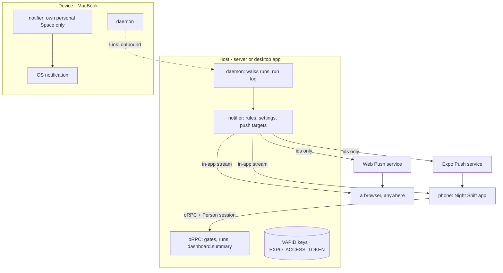

# Mobile: the phone app, a notifier for every screen, one inbox

Status: decided, 2026-10-21. Nothing here is built. The shape is decided:
**the phone is a Person's client of a Host**, not a Device. A notifier on
the server tells the person about Gates and runs on every screen they use.
The Needs-you inbox shows the Gates of every Space the person is in. The
research behind it compared four vendor remotes and the open-source field.
Its findings are in "Why this shape" and "Sources".

## The wish

- Start a flow from the phone, with its inputs, on a computer you choose.
- Follow a run live, and see when a computer is offline.
- Answer a Gate with one tap. Some Gates from the lock screen.
- Get told when a Gate waits, a run finishes or a run fails, also with
  every Night Shift page closed.
- Choose what you get told about, on which screens, and when to stay quiet.
- Answer once, and the question goes away on every screen.
- See the Gates of every Space you are in, in one inbox.
- Keep the data on your own Host. No vendor relay holds a transcript.

## What is true today

| Fact | Where |
| --- | --- |
| Every notification comes from an open web page. It polls `gates.list` and `runs.list` every 5 s and compares each poll with the last one. A closed tab tells you nothing. | `apps/web/src/shared/shell/use-night-notifications.ts` |
| The notification settings are per Device ("on this Mac"), in the Device document. | `apps/web/src/features/settings/components/notifications-card.tsx` |
| The inbox reads the open Gates of the active Space only. It is derived from the run log. | `listGates` in `packages/engine/src/read/read-model.ts` |
| The dashboard computes spend, nights and flow health in the browser from all of `runs.list`. | `apps/web/src/features/dashboard/` |
| Better Auth uses cookie sessions. It has no plugin for a native app. A `Bearer` header is read as a Device key (`nsd_`). | `packages/auth/src/auth.ts`, `packages/daemon/src/http/context.ts` |
| The run stream replays from `afterSeq`. The web app owns the reconnect loop and its dedup. | `runs.watch`, `apps/web/src/features/runs/hooks/use-run-stream.ts` |
| A Gate is addressable: `gates.resolve({ runId, stepId, choice, note })`. | `packages/api/src/gates/router.ts` |
| A Device's own personal Space never reaches a Host. A Host's personal Space shows as "Personal on <Host>". | `packages/devices/src/exchange/client.ts`, `links/host-spaces.ts` |
| VISION listed "Windows and mobile" as out of scope. | `docs/steering/VISION.md` (changed with this design) |

Most of the API a phone needs exists. It is the same oRPC router that the
web app and paired Devices use.

| Phone need | What exists | Gap |
| --- | --- | --- |
| Start a flow with inputs on a chosen computer | `runs.start`, `runs.placements` | none |
| Live run progress | `runs.watch` from `afterSeq` | A phone in a pocket gets no stream: push |
| Answer a Gate | `gates.list`, `gates.resolve` | The inbox reads one Space |
| Stop, resume, signal | `runs.stop`, `runs.resume`, `runs.signal` | none |
| Dashboard | none on the server | `dashboard.summary` |
| Notifications | browser polling | a notifier on the server |
| Sign in from a native app | cookie sessions for browsers | `@better-auth/expo` |

## Vocabulary

| Term | Meaning |
| --- | --- |
| Phone | A phone with the Night Shift app, signed in to a Host as a Person. It reads and acts. It runs nothing. It shows in Settings under the Person, and the Person can remove it. Not a Device. |
| Screen | Where a person sees Night Shift: a browser, the desktop app, or a phone. A word for this document and for the settings ("which screens"), not a row. |
| Push target | A browser or a phone that gets notifications while no Night Shift page is open: its push address, a name, and when it was last seen. A phone is one push target plus its session. |
| Notifier | The server piece that reads the run log and decides whom to tell, about what, and on which screen. |
| Channel | One way the notifier reaches a screen: the in-app stream, Web Push, a desktop notification, or Expo Push. |
| Notification settings | The Person's choices: which events, quiet hours, and which screens. They belong to the Person, not to a computer. |
| Quiet hours | A daily time window in which Night Shift sends no push. Gates still wait. Pages that are open still update. |
| Lock-screen Gate | A Gate whose flow author allows an answer from the lock screen (`lockScreen: true` on a Decision `by: "person"`). Only these get Approve and Reject buttons on a notification. |
| Needs-you inbox | The open Gates of every Space the person is in, each with its Space. |
| Sender | The one daemon that sends notifications for a Space. |

## The shape

- The phone talks oRPC to the Host's `https://` address with a Person
  session. It has no Replica, no Link, no Device key and no `device` row.
- The notifier reads the run log. It needs no new event to decide.
- Push payloads carry ids and one plain sentence. The app fetches the rest
  from the Host.

## Why this shape

In 2026 four vendors shipped the same remote control: Claude Code Remote
Control, Codex Remote, Cursor for iOS and Copilot CLI remote. A local agent
connects out to the vendor's cloud. The vendor relays the traffic, stores
the transcript, and forwards permission prompts to the phone. Open-source
tools (Happy, HAPI) copy the design with their own relay and QR pairing.

Night Shift already has the three server pieces these products had to
build. The Host is the relay, and every Device reaches it over an outbound
Link. The run log replays from `afterSeq`. A Gate is a structured question
with an answer procedure. So the phone needs no new relay.

Night Shift wins where chat remotes are weak. A Gate has a question and a
fixed set of options, so a tap answers it. One app covers every harness.
Runs outlive the phone, and often the laptop. Transcripts stay on the
person's own Host. A colleague in a shared Space can answer a Gate.

The comments under the vendor demos set the bar. The connection state must
show and must recover. Approvals must always work on a phone. You must be
able to start work from the phone. Notification controls are part of the
product. The top comment asks for "work-life balance, not work-life
integration". So the phone buzzes rarely, and only for what a flow says
needs a person.

## The design

### The phone is a Person's client of a Host

A Device is a full daemon with its own Replica, agents, tools, secrets and
Clones. A phone can do none of that. The devices design already draws the
other role: "a browser, anywhere" that points at the Host's UI. The phone
takes that role.

- **Sign-in.** The app holds a Better Auth Person session as a cookie,
  through `@better-auth/expo`. The cookie lives in `expo-secure-store`.
  oRPC calls send it as a header. The Host adds the app's `nightshift://`
  scheme to its trusted origins. The active Space and two-factor sign-in
  work as in a browser. A Host started with `--require-two-factor` asks
  the phone for a code too.
- **No Device key.** A Device key carries only `sync`, `relay` and
  `archive`. It has no session and no Space, so it cannot start a run or
  answer a Gate.
- **Pairing.** First version: you type the Host's address, your email,
  your password and your code. Later: a QR code in web Settings with the
  Host's addresses and a one-time code.
- **Addresses.** The phone keeps the Host's `https://` addresses and
  tries them in order, as a Link does. No Wi-Fi name detection.
- **Revoke.** Settings lists each phone with its name and when it was last
  seen. "Remove" ends its session and deletes its push target.

### Personal work on the phone

A Device sends a Host only the Spaces the Host keeps. A Device's own
personal Space never leaves it. So a phone that connects to a Host cannot
see the runs in a laptop's own personal Space.

Decision: **personal work that you want on the phone runs in the Host-kept
personal Space**, "Personal on <Host>". No engine change. A Device's own
personal Space stays on that computer, and it notifies only on that
computer. The Space switcher on the phone shows the Host's Spaces only.

### The inbox belongs to the Space

The Needs-you inbox stays derived from the run log (`listGates`). There is
no separate inbox store, on a computer or on a phone.

- The person sees the open Gates of **every Space they are in**, as the
  devices plan says. Each Gate shows its Space. The `gates` procedures get
  a read across the person's Spaces. A Gate of a Space where the person
  only reads shows without its options.
- A "dismissed" or "seen" state belongs to the Person, never to one
  computer. It is stored with the notifier's tables, keyed `runId:stepId`.
- Answering stays `gates.resolve`, checked against the Gate's Space and
  the person's role there.

### One notifier, a channel per screen

A new package, `@nightshift/notifications` (layer 3), is the notifier. The
daemon wires it. It reads the run log and decides whom to tell.

**Events.** A new Gate (keyed `runId:stepId`), a run that finished, a run
that failed. The same three the web app knows today. The first read after
a start is the baseline: it tells nobody about old Gates.

**Settings.** The settings belong to the Person, on the Host that keeps
the Space:

| Setting | Values |
| --- | --- |
| Events | Gate waits, run finished, run failed: each on or off |
| Quiet hours | Off, or a start time and an end time, in the person's time zone |
| Screens | This browser, each phone, the desktop app: each on or off |
| Phone delay | How long the phone waits after an open screen (3 minutes by default) |

**Channels.** Each channel sits behind a port, with a fake for tests.

| Channel | Reaches | Keys | Library |
| --- | --- | --- | --- |
| In-app stream | Every open page and the open phone app | none | oRPC event iterator. It replaces the web app's 5 s polling. |
| Web Push | A browser with every Night Shift page closed | VAPID keys, made and kept by the Host | `web-push` |
| Desktop notification | This computer's desktop | none | The daemon on that computer, through an OS port |
| Expo Push | The phone app in the background | `EXPO_ACCESS_TOKEN` on the Host, optional | `expo-server-sdk` |

**Rules.**

1. **Answer once, clear everywhere.** When a Gate closes, the notifier
   withdraws its notification on every channel that can withdraw. A
   notification that is already shown answers nothing once the Gate is
   closed.
2. **The active screen goes first.** The in-app stream tells every open
   screen at once. A push to the phone waits for the phone delay. It goes
   only if the Gate is still open and nobody opened it.
3. **One sender per Space.** A Host sends for the Spaces it keeps. A
   Device sends only for its own personal Space. Two daemons never send
   the same notification.
4. **Quiet hours hold pushes.** In quiet hours no push goes out. When they
   end, one notification says how many Gates still wait.
5. **No content in a push.** A push carries ids and one sentence: "A Gate
   waits for you." The app or the page fetches the question from the Host.

**Without keys.** `EXPO_ACCESS_TOKEN` is optional. Without it, Expo
still sends for a project that does not require a token ("enhanced push
security" off in Expo). A project that requires one refuses the pushes,
and the phone then gets the in-app stream only. A Host with phones should
set the token and turn enhanced push security on: then only that Host can
push to the phones, and nobody else who learns a push token.

### Lock-screen Gates are marked by the flow author

A Decision `by: "person"` gets an optional flag, `lockScreen: true`. The
editor shows it as "Allow an answer from the lock screen". The author knows
the risk of a Gate. The app does not guess it.

- A lock-screen Gate gets Approve and Reject buttons on the notification.
  The buttons use `authenticationRequired`, so the phone unlocks first.
  This works only for a Gate with two options.
- Every other Gate opens the app. The app asks for a biometric check
  (`expo-local-authentication`) before it sends the answer.
- Every answer is bound to one `runId` and `stepId`. The Host refuses it
  once that Gate is closed. A stale notification cannot answer another
  Gate.
- A push is no proof that a Gate is marked: anyone with the phone's push
  token can send one. Before a button answer goes out, the phone reads the
  open Gates from the Host and sends only to a marked Gate, with one of its
  choices. The answer carries `via: "lock-screen"`, and the Host refuses it
  for a Gate that is not marked.
- Until the action handler is tested on iOS with SDK 58, iOS opens the app
  for every answer.

### Phone push contract

What the Host sends through Expo Push (`packages/notifications/src/channels/expo.ts`),
and what the phone app must do with it. The values in the tables below have one
source: the contract entry `@nightshift/notifications/contract` (`contract/`: the keys,
the categories, channels and buttons, `PushData`, and where a tap goes). The Host builds
pushes from it, and the phone and the browser read it through `@nightshift/client`.

**Registration.** The app registers its Expo push token with
`notifications.targets.register({ kind: "expo", name, platform, endpoint: <ExpoPushToken[...]> })`
on every start. The Host upserts by token. After Expo reports
`DeviceNotRegistered` the Host forgets the token, and the next start
registers it again. Expo gives a push token only with the EAS project id
(`expo.extra.eas.projectId` in `apps/mobile/app.json`, written by
`eas init`). Without it the app works, but the phone does not register.

**Every push** has a `title` (one sentence, for example "A Gate waits for
you") and no `body`. `threadId`, `collapseId` and the Android `tag` are the
key, so a second push of one key replaces the first. The `data`:

| Field | Value |
| --- | --- |
| `kind` | `gate-opened`, `run-finished`, `run-failed` or `gates-waiting` |
| `key` | `runId:stepId` for a Gate, `runId:end:<seq>` for a run's end, `waiting:<ms>` for `gates-waiting` |
| `spaceId`, `runId` | The run and its Space. Null for `gates-waiting`, which spans Spaces |
| `stepId` | The Gate's step. Null for a run and for `gates-waiting` |
| `count` | `gates-waiting` only: how many Gates wait |
| `options` | `gate-decide` only: `[{ id, label }, { id, label }]`, the two options in the author's order |

**Categories.** The app defines them with
`Notifications.setNotificationCategoryAsync`:

| `categoryId` | When | Actions | A tap |
| --- | --- | --- | --- |
| `gate-decide` | A Gate the author marked (`lockScreen: true`) with exactly two options, sent to a person whose role allows an answer | `approve` and `reject`, both `isAuthenticationRequired: false` and `opensAppToForeground: false`: the author marked the Gate, so the answer needs no unlock | Opens the Gate |
| `gate-open` | Every other Gate, and `gates-waiting` | none | Opens the Gate, or the inbox when `runId` is null. A biometric check comes before the answer |
| `run` | A run that finished or failed | none | Opens the run |

The action `approve` answers `options[0].id`, `reject` answers
`options[1].id`: `gates.resolve({ runId, stepId, choice })`. The buttons
say "Approve" and "Reject", because an iOS category has fixed button
titles. `options[n].label` is the author's text for the app to show. The
button sends `via: "lock-screen"`, and the Host alone checks it. `gates.resolve`
declares its refusals: `GATE_CLOSED` (the Gate does not wait anymore: someone
answered it, its run ended, or an answer is on its way), `NEEDS_APP` (the author
did not mark the Gate for the lock screen, or the choice is not one of its
choices), `FORBIDDEN` (the role does not allow an answer) and `NOT_FOUND` (the
Gate is not in one of the person's Spaces). The phone does nothing more for a
closed Gate, shows "Answer this Gate in the app" for `NEEDS_APP`, and "Your
answer was not sent" for any other refusal or error.

**Priority.** Gates and `gates-waiting`: `priority: "high"`,
`interruptionLevel: "time-sensitive"` (the app needs the Time Sensitive
Notifications capability), Android `channelId: "gates"` (high importance).
Runs: `priority: "normal"`, `interruptionLevel: "active"`, Android
`channelId: "runs"` (default importance). The app defines both Android
channels at start.

**Withdraw.** Expo cannot delete a delivered notification from the server.
When a Gate closes, the Host sends a data-only push to every phone that
got it: `data: { withdraw: key }`, `contentAvailable: true`,
`priority: "normal"`, no title and no sound. The app handles it in a
background notification task (`Notifications.registerTaskAsync`, with
`remote-notification` in the iOS background modes) and in its foreground
listener. It finds the shown notification whose `data.key` is the key
(`getPresentedNotificationsAsync`) and dismisses it
(`dismissNotificationAsync`). iOS delivers background pushes on a
best-effort basis, so the app also dismisses, when it opens, every Gate
notification that `gates.list` no longer has. The iOS simulator
(`xcrun simctl push`) does not hand a push without an alert to the app,
so test the background withdraw on a phone.

### The dashboard summary moves to the server

A `dashboard.summary` procedure computes what `apps/web/src/features/dashboard/`
computes today from all of `runs.list`: spend, nights, flow health and run
outcomes. The logic goes in a package, next to the run read model ("apps
wire, packages decide"). The web app and the phone both read it. The web
app stops loading every run for its home page.

### The app

The app is `apps/mobile`. It reads and acts. It does not edit flows or
schedules.

| Screen | What it does |
| --- | --- |
| Sign in | The Host's address, email, password, code |
| Needs you | The open Gates of every Space. Answer one. |
| Runs | The runs of the active Space, with status. A run page with the live steps. |
| Start run | Pick a flow, fill its inputs, pick the computer |
| Home | The dashboard summary |
| Settings | Notification settings, this phone, sign out |

The stack:

| Part | Choice |
| --- | --- |
| Skeleton | Better-T-Stack, `native-uniwind` template |
| Framework | Expo SDK 58, Expo Router |
| Styling | Uniwind |
| Components | React Native Reusables (shadcn for React Native) in `@nightshift/ui-native`, installed with its CLI. Not the HeroUI Native that the template ships. |
| API | oRPC over `expo/fetch`, TanStack Query |
| Auth | `@better-auth/expo` |
| Environment | varlock |
| Push | `expo-notifications` |
| Biometric check | `expo-local-authentication` |
| QR code (later) | `expo-camera` |
| Live Activities, widgets | `expo-widgets` (see below) |

No Yjs and no libsql on the phone. `expo-sqlite` dropped libsql in SDK 58,
and a client that reads and acts needs no Replica.

Event iterators do not retry by themselves. The reconnect loop of the run
stream (`afterSeq` and dedup) moves out of `apps/web` into
`@nightshift/client`, so both apps use one copy.

### Widgets and Live Activities

Researched on 2026-10-22 against `expo-widgets` 58.0.22 and `@expo/ui`
58.0.22, the versions for SDK 58.

What `expo-widgets` does:

| Need | iOS | Android |
| --- | --- | --- |
| Home screen widget | Yes, WidgetKit, also the lock-screen families (`accessoryRectangular`, `accessoryInline`) | Yes, Glance, with `enableAndroid: true` |
| Update from the app | `updateSnapshot(props)`, or `updateTimeline` for later entries | `updateSnapshot(props)` only |
| Tap opens a link | `widgetURL(url)` modifier | No. A widget button sends a broadcast to the widget. There is no link. |
| Live Activity | Yes, ActivityKit: `createLiveActivity`, `start`, `update`, `end`, `getInstances` | No |
| Ongoing notification with progress | No | Yes, `createCustomNotification` (new in 58.0.17): `post`, `update`, `cancel`, `ongoing`, `timeoutAfter`, `url`, and a `LinearProgressIndicator` |

How it is set up. The config plugin `expo-widgets` in `app.json` adds a
widget extension target (`ExpoWidgetsTarget`) and an App Group
(`groupIdentifier`, default `group.<bundle id>`) to the app at prebuild.
Each `widgets[]` entry is one widget kind, and its `name` must match
`createWidget(name, ...)`. A Live Activity has no entry: it is
registered at runtime. Android needs `enableAndroid: true`. It does not
work in Expo Go: it needs a development build, and a new build after a
change to the plugin options.

How data gets to the widget. The layout is a function with the
`'widget'` directive. `babel-preset-expo` turns it into a string, and
the extension runs it in its own JavaScript runtime with only `@expo/ui`
components (SwiftUI on iOS, Jetpack Compose on Android) as globals. It
may use nothing but its props and its environment: no imports, no
hooks, no app state. `updateSnapshot` writes the props to the App
Group's shared `UserDefaults` (iOS) or the app's storage (Android) and
reloads the widget. So the app writes ready-made texts and colors into
the props.

Live Activity push. A Live Activity can be started and updated from the
app while it runs. Push updates (`enablePushNotifications`,
`getPushToken`, `addPushToStartTokenListener`, iOS 17.2+ for push to
start) go to APNs directly, with the `liveactivity` push type and a
token per activity. The Expo push service does not send them. Night
Shift's Host sends through Expo Push only, so Night Shift updates its
Live Activities locally: in the background they go out of date (the
`staleDate`), and they catch up when the app opens. Push updates would
need the Host to hold an APNs key (`.p8`) of the app's team, which a
personal development build does not have.

What Night Shift does with it (the `glance` vertical of `apps/mobile`):

- **Home screen widget** "Night Shift" (`NightShiftGlance`): how many
  Gates wait for you and the three newest runs of the active Space, each
  with its flow and status. Counts, flow names and statuses only, never a
  Gate's question or a run's inputs. The app writes it each time the
  inbox or the runs refresh. `updateGlance(snapshot)` is the one door,
  also for a background push task. A tap opens the inbox on iOS.
- **Follow on the lock screen** on the run screen, and a switch on the
  Start tab. iOS: a Live Activity with the flow, the step that runs now,
  "Step 2 of 5", a progress bar and the status. Android: an ongoing
  notification with the same, which a tap opens on the run. The app
  reads a followed run every 5 seconds while it runs, and ends the
  activity or notification when the run ends.
- "Step x of y": x is how many of the flow's nodes have started (a node
  the run came back to counts once), y is how many nodes the flow has.
  Steps of a called flow do not count. A branch the run skips leaves x
  below y, so an ended run says "Ran 4 of 5 steps".

Checked on 2026-10-22 with a development build on the iOS 27 simulator
(`expo run:ios`, no EAS): the widget extension builds and embeds, the
small and medium widget show the live count and runs and follow a
refresh, a tap opens the inbox, and a followed run's Live Activity
starts (iOS asks once to allow Live Activities), moves from step to
step, shows "Waiting for you" at a Gate, and ends with "Finished".
Android was checked to prebuild (the widget receiver and the
notification permission are in the manifest), not built or run.

Sources: [Expo Widgets docs](https://docs.expo.dev/versions/latest/sdk/widgets/),
the `expo-widgets` 58.0.22 package (its `CHANGELOG.md`, `plugin/src`,
`src/CustomNotifications.ts`), [Live Activities with Expo end to end](https://expo.dev/blog/live-activities-with-expo-end-to-end-client-and-backend)
(the backend sends to APNs with a `.p8` key), [Apple ActivityKit push updates](https://developer.apple.com/documentation/activitykit/starting-and-updating-live-activities-with-activitykit-push-notifications).

### Packages and layers

| Package | Layer | Owns | May import |
| --- | --- | --- | --- |
| `@nightshift/ui-native` | 0, beside `ui` | React Native Reusables components and tokens for `apps/mobile` | only itself |
| `@nightshift/notifications` | 3, beside `devices` | The notifier: rules, person settings, push targets, the channels behind ports, its tables | layer 2 and lower |
| `@nightshift/client` | 5, beside `daemon` | Client logic for `apps/web` and `apps/mobile`: oRPC query factories, the run-stream reconnect loop, derived view types, the notify rules of the in-app stream | `@nightshift/api/client` (types) and the `@nightshift/flows` root |
| `apps/mobile` | 6 | The phone app | `@nightshift/client`, `@nightshift/api/client` (types), the `@nightshift/flows` root, `@nightshift/ui-native` |

`@nightshift/client` uses no DOM, no React Native, and no Node or Bun API.
React and TanStack Query are allowed. `apps/web` gains it too.
`docs/steering/STRUCTURE.md` holds the rules. `scripts/check-layers.ts`
and `biome.json` check them.

### Security

The phone holds a Person session. With it you can start runs and answer
Gates that release code execution. So the phone is as strong as the web UI,
and it gets the same protections and more.

- Two-factor sign-in, as for any other computer.
- A revocable phone record: Remove ends the session and the push target.
- Lock-screen answers only for Gates that the author marked.
- A biometric check in the app for every other Gate.
- An answer is valid for one `runId:stepId` only.
- No content in push payloads. Apple, Google and Expo see ids only.
- The app never shows agent-made HTML or JavaScript in a web view. It
  runs nothing itself. This keeps it clear of App Store rule 2.5.2.

## What moves in the UI

| Page | Change |
| --- | --- |
| Inbox (web) | Gates of every Space I am in, with the Space on each Gate. |
| Settings → Notifications (web) | The Person's settings: events, quiet hours, screens, phone delay. "Get notifications in this browser" turns on Web Push. |
| Settings → Phones (web) | Each phone: name, last seen, Remove. Later: a QR code to add one. |
| Home (web) | Reads `dashboard.summary`. |
| Flow editor | "Allow an answer from the lock screen" on a Decision that you decide. |
| Phone app (new) | Sign in, Needs you, Runs, run page, Start run, Home, Settings. |

## What moves in the data

| Where | Change | Owner |
| --- | --- | --- |
| Decision node | optional `lockScreen` on `by: "person"` | `flows` |
| push target table | person, kind (web or phone), push address, name, last seen, session | `notifications` |
| notification settings table | person, events, quiet hours, screens, phone delay | `notifications` |
| sent notifications table | person, key (`runId:stepId` or run id), channel, sent at, withdrawn at, seen at | `notifications` |
| Host keys | the VAPID key pair, made on the first start | `notifications` |
| Better Auth | the `expo()` plugin, the `nightshift://` trusted origin | `auth` |

The Device document's notification settings move to the Person. The
first start after the change copies them once.

## Slices

Each stage ends with docs, checks and tests.

0. **Decide and record.** This document. ADR rows in `TECH.md`. VISION
   lifts mobile out of scope. The glossary gets the new words. The layer
   map, `check-layers.ts` and `biome.json` know the new packages and
   `apps/mobile`.

   *Done when:* the docs are merged and `check-layers` knows `apps/mobile`.

1. **Server groundwork.** The notifier package on the run log, with the
   Person's settings and quiet hours. Web Push to the web app. The in-app
   stream instead of polling. The inbox across Spaces. `dashboard.summary`.
   The push target table. `@better-auth/expo` and the app scheme. The
   `@nightshift/client` package with the query factories, the stream loop
   and the notify rules. `lockScreen` on the Decision node.

   *Done when:* the web app gets a "Gate waits" push with the tab closed,
   and the home page no longer loads every run.

2. **The app: read and act.** Sign in to a Host address with a code.
   Space switcher. Inbox. Runs and a live run page (`runs.watch` with
   retry). Start a flow with inputs and a computer. Answer Gates. Show
   presence ("This computer is offline. The run waits."). A personal
   development build.

   *Done when:* you can start, follow and unblock an overnight flow from
   the phone alone.

3. **Push and the lock screen.** Expo Push from your own Host. Approve,
   Reject and Open with authentication required. A biometric check for
   every other Gate. Content-free payloads. Live Activities and Android
   progress for runs started from the phone. "Follow this run" for runs
   that a schedule started.

   *Done when:* a Gate answered from the lock screen reaches the Walker,
   and a stale notification cannot answer another Gate.

4. **Polish.** Widgets (how many Gates wait, run again). Shortcuts. Pause
   and resume schedules for the owner. QR pairing.

   *Done when:* the person uses the phone for a week of nights without
   the laptop open.

## Decisions

Taken on 2026-10-21:

| Open decision | Options | Decided |
| --- | --- | --- |
| What the phone is | A Person's client with a phone record, or a full Device | **A Person's client of a Host.** Person session, oRPC to the Host, no Replica, Link, Device key or `device` row. A phone in Settings that the person can remove. |
| Where personal work lives | The Host-kept personal Space, or sync a Device's personal Space to its home Host | **The Host-kept personal Space**, "Personal on <Host>". No engine change. A Device's own personal Space notifies only on that computer. |
| Where the inbox lives | A store per device, or derived per Space | **The Space.** Derived from the run log. The person sees every Space they are in. Dismissed state belongs to the Person. |
| How notifications go out | Per screen, or one notifier | **One notifier with a channel per screen**: in-app stream, Web Push, desktop notification, Expo Push. Answer once, clear everywhere. The active screen first. One sender per Space. No content in a push. |
| Lock-screen Gate policy | Every Gate, or only Gates that authors mark | **Author-marked** (`lockScreen: true`). A biometric check in the app for the rest. Every answer bound to one `runId` and `stepId`. |
| Dashboard numbers | In the browser, or on the server | **On the server**: `dashboard.summary`, its logic in a package. |
| PWA step | A Web Push PWA before the app, or straight to the app | **Web Push in stage 1** for the web app. It proves the notifier. The phone gets a native app. |
| Native auth transport | Cookie through `@better-auth/expo`, or a bearer session token | **Cookie.** A bearer token would collide with the Device key rule. |
| Pairing | Type the address, or a QR code | **Both**: the address first, the QR code in stage 4. |
| Push credentials | Your own Host holds the Expo token, or a publisher relay | **Your own Host**, with an optional `EXPO_ACCESS_TOKEN`. |
| Mobile UI kit | HeroUI Native (the template's), RN Reusables, or `@expo/ui` | **React Native Reusables** on Uniwind, in `@nightshift/ui-native`. The shadcn-only rule of `AGENTS.md` extends to mobile. |
| Skeleton | Hand-made Expo app, or Better-T-Stack | **Better-T-Stack** `native-uniwind` (Expo SDK 58, Expo Router), then the vertical rules of `STRUCTURE.md`. |
| Editing from the phone | Read and act, or also flows and schedules | **Read and act.** |
| Distribution | Personal build, or the stores | **Personal development build.** |

## Out of scope

These need the user's own accounts, or a decision about other people's
Hosts:

- App Store and Play submission.
- A publisher push relay for other people's Hosts.
- Apple Watch.
- End-to-end encrypted push.
- A demo Host for App Review.
- Editing flows and schedules on the phone.
- A chat screen, and hand-off to a vendor's own remote control.

## Open items

Decided on 2026-10-21 (they were open items):

- **The desktop notification covers every Space this computer has.**
  The Host stays the only push sender of the Spaces it keeps (Web Push,
  Expo Push). This computer's Replica gets the Host-kept Space's run
  events through the exchange, and its own notifier shows them on its own
  desktop, for its owner only. That is no second push: the desktop
  channel reaches this computer only, and the Host never calls into a
  Device. The desktop target is registered when the daemon starts
  (`desktop`, the computer's name, the Device id as its endpoint). The
  owner's events, quiet hours and the desktop screen switch apply. It
  shows nothing while the desktop app's window has the focus on the inbox
  (a Gate) or on the run (a run that ended). Without the window state (a
  daemon outside the app), an open Night Shift page on this computer goes
  first. In the desktop app, Electrobun shows it. Electrobun reports no
  click and cannot take a notification back. Outside the app, the OS
  programs show it: `terminal-notifier` (a click opens the page, a
  withdraw works) or `osascript` (neither) on macOS, `notify-send` (both,
  with `xdg-open` and `gdbus`) on Linux. Windows gets none.
- **"Keep this computer awake while a run is running"** is a setting of
  this computer, off by default (Settings → Runs, `keepAwake`,
  `NIGHTSHIFT_KEEP_AWAKE`). The computer sleeps, not the person: a laptop
  and a desktop of one person want different answers. The daemon holds
  the OS's sleep lock while a run that this computer walks or runs steps
  of is running, or sleeps until a timer: `caffeinate -i -w <pid>` on
  macOS, `systemd-inhibit` on Linux. It lets go when the last such run
  ends. A Gate that waits for a person does not keep the computer awake.

Still open:

- Whether React Native reads `oklch` colors. If it does not,
  `@nightshift/ui-native` keeps its own copy of the tokens.
- Whether the iOS action handler of `expo-notifications` runs while the
  app is closed on SDK 58. Until then, iOS opens the app for every answer.
- A "Deny and report" option for a Gate you did not expect.

## Sources

- The research report: "Mobile remote control for agents" (2026-10-21).
- Vendors: [Claude Code Remote Control](https://code.claude.com/docs/en/remote-control), [Codex remote connections](https://learn.chatgpt.com/docs/remote-connections), [Cursor iOS](https://cursor.com/changelog/ios-mobile-app), [Copilot CLI remote](https://docs.github.com/en/copilot/how-tos/copilot-cli/use-copilot-cli/steer-remotely), [the Remote Control video](https://www.youtube.com/watch?v=Ko7_tC1fMMM).
- Open source: [Happy](https://happy.engineering/docs/how-it-works/), [HAPI](https://github.com/tiann/hapi), [OpenCode server](https://opencode.ai/docs/server/).
- Expo: [SDK 58](https://expo.dev/changelog/sdk-58), [monorepos](https://docs.expo.dev/guides/monorepos/), [notifications](https://docs.expo.dev/versions/latest/sdk/notifications/), [sending notifications](https://docs.expo.dev/push-notifications/sending-notifications/), [widgets](https://docs.expo.dev/versions/latest/sdk/widgets/).
- oRPC: [React Native adapter](https://orpc.unnoq.com/docs/adapters/react-native), [event iterator](https://orpc.unnoq.com/docs/client/event-iterator).
- Auth: [Better Auth Expo](https://www.better-auth.com/docs/integrations/expo).
- UI: [React Native Reusables](https://github.com/founded-labs/react-native-reusables), [Uniwind theming](https://docs.uniwind.dev/theming/basics), [Better-T-Stack](https://www.better-t-stack.dev/).
- Push and lock screen: [Home Assistant actionable notifications](https://companion.home-assistant.io/docs/notifications/actionable-notifications/), [Home Assistant push relay](https://contributors.home-assistant.io/companion/mobile-app-api/notifications/), [Apple ActivityKit](https://developer.apple.com/documentation/activitykit/displaying-live-data-with-live-activities), [WebKit web push](https://webkit.org/?p=16535).
- App Store: [App Review Guidelines](https://developer.apple.com/app-store/review/guidelines/).
