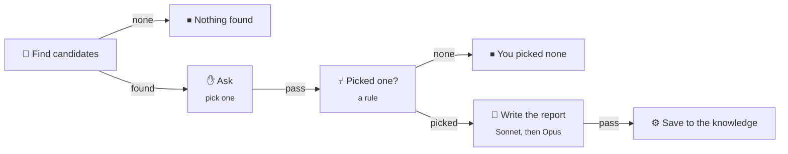

# Flows and nodes

A flow is a graph of steps. Each step is a node. Each edge leaves a node on a named outcome, such as `pass`, `fail`, or `approved`. The engine walks the graph. A model never adds a node or changes the graph during a run, and every loop has a maximum count.

This is the `scout-and-pick` starter. An agent finds candidates for a topic, you pick one, and another agent writes a report on it:

## Node types

<!-- checked:nodes: every node type has one row. bun run docs:reference checks it. -->
| Node | Does |
| --- | --- |
| **Agent** | Runs one agent session with a prompt, and optionally a skill. Ends with an outcome and, if you ask, data that matches a JSON schema. It can ask you a question and continue the same session with your answer. |
| **Command** | Runs a shell command in the project, for example `curl` to call an API, or the tests. Its exit code picks the outcome. |
| **Tool** | Calls one tool of an MCP server with typed arguments. No model in the loop. |
| **Web request** | Sends one request to a web address and gives the answer as data: its status, headers and body. No shell and no project folder. |
| **Decision** | Picks one of its options. A person picks it in a **Gate**, a rule picks it in a **Branch**, or a model picks it. |
| **Value** | Makes data that matches a JSON schema, from a rule, a model, or a person. A person gets an **Ask**: a form in the inbox. |
| **Convert** | Turns CSV, YAML, XML, a feed or a Markdown table into JSON, and JSON back into text. It also turns HTML into plain text. It uses no model. |
| **Wait** | Waits for a duration, a time, a command that passes, a signal, the first of a signal and a command, or a URL that answers. |
| **Subflow** | Runs another flow or a kit, once or once per item in a list. |
| **Join** | Waits for the branches that run at once: all of them, or the first. The first stops the others. |
| **Lease** | Lets one run at a time do the next steps, for example one deploy at a time. Runs on other computers of the Space take turns too. |
| **Service** | Starts a Docker Compose stack, a dev server, or a model server for the next steps, and stops it after. |
| **Since last run** | Remembers what it saw, and finds what is new or changed since the last run. It also watches one value, such as a price that passes a limit. |
| **End** | Ends the run on purpose: done, nothing to do, or failed, with one line that says why. |
<!-- /checked:nodes -->

### Agent

- **Prompt and skill.** With a skill, the agent gets `/<skill> <prompt>`.
- **Outcomes.** An Agent can declare its own outcomes, such as `found` and `noise`, in place of `pass` and `fail`.
- **Output.** The shape of the step's data. See [Data shapes](#data-shapes).
- **Scores.** `{"scores": {"leads": 12}}` in its data scores the run. See [Scores](#scores).
- **Ask a person.** An agent that needs input opens a Gate. Your answer goes back to the same session.
- **Backups.** Other profiles, on other computers, that take the step when its computer is offline. See [Agents and profiles](Agents-and-profiles.md#backups).

### Cascade

A step can climb a **cascade**. It tries the first tier, and moves up when a try does not hold. Each tier has a number of tries. Each try gets the failure of the try before. A new tier starts a new session. The last tier can be you.

The `implement-and-check` starter is one Agent with a cascade. Sonnet tries up to 3 times, then Opus. After each try, the check runs. A try holds only when the check passes.

A Decision or a Value that a model decides can have a cascade too. A model's pick below the confidence you set goes to the next tier: a stronger model, or you.

### Command

- Template values arrive as environment variables, never as shell text. So `sh -c "{{check}}"` runs the input `check` as a command, and a value cannot inject shell code.
- Secrets arrive as environment variables too.
- JSON that the command writes to `$NS_OUTPUT` is its data. `{"outcome": "approved"}` picks the outcome.
- A command that prints JSON can give that as its data. Set **What it prints** to **JSON** (`"stdout": "json"` in the flow file).
- **Data shape** in its **Output** says what that data holds. See [Data shapes](#data-shapes).
- `{"scores": {"found": 4}}` in that data scores the run. See [Scores](#scores).
- `$NS_KNOWLEDGE` is the project's [knowledge](Knowledge.md) folder.

### Web request

A Web request sends one request from the computer of its step, and reads the answer.

- **Address.** A URL such as `https://api.example.com/items`, or a secret that holds the whole URL. Use a secret for a webhook address, because the address is its key. Night Shift never shows it.
- **Query, headers and body.** Each value is a template. The body is JSON, text or a form. In JSON, put each template in quotes: `"{{plan.data.tasks}}"`. A quoted template that is one reference keeps its JSON value.
- **Secrets.** Write `${API_TOKEN}` in the node's own text, for example in the header `Authorization: Bearer ${API_TOKEN}`. The computer of the step fills it in. A value that a template gives is never filled in, so data from a webhook cannot read your secrets. The answer shows each secret value as `•••`.
- **Outcomes.** `pass` on a 2xx answer. `fail` on any other answer, or on an answer that is too large. When the server says it is busy (429) or fails (5xx), the step waits and asks again, as an agent does at a usage limit.
- **Outputs.** `{{fetch.status}}`, `{{fetch.headers.content-type}}` and `{{fetch.body}}`. The body is JSON when the server sends JSON, else text. Later nodes read a field of it: `{{fetch.body.items}}`. Its **Body shape** says what the body of a 2xx answer holds. See [Data shapes](#data-shapes).
- **Limits.** The step waits 30 seconds for an answer, and keeps up to 1 MB of it. You can set up to 10 minutes and 10 MB.

On a Host, a Web request reaches public addresses only. To let it reach the Host itself and its private network, turn on **Web requests reach this network** in the Host settings. No request reaches a link-local or a cloud metadata address.

### Decision

| Who picks | Shows as | How |
| --- | --- | --- |
| A person | **Gate** | You pick an option in the inbox or on the phone. A deadline picks an option for you when nobody answers in time. |
| A rule | **Branch** | It takes the first option whose JSONata rule holds. |
| A model | **Decision** | A [decider](#deciders) picks an option, with its confidence. |

### Deciders

A decider is the model of a Decision or a Value that a model decides. You choose it in a Model Profile on the Agents page.

For most choices, start with a small decision model, such as TypeSafe Jev. It is fast and cheap, because it only picks. In a Decision, it can pick only one of the node's options. It writes no text and adds no step.

A pick below the confidence that you set goes to the next tier of the [cascade](#cascade): a large model, or you. To run a decider on your own server, see [A model on your own server](https://github.com/xiduzo/nightshift/blob/main/docs/deploy/local-models.md).

### Value presets

A Value made by a rule can start from a preset. Under the expression, choose **Start from**: Filter, Pick fields, Sort, Limit, or Remove duplicates. Pick a list of an earlier step and fill in the fields. Night Shift writes the expression and the output for you, and you can change them after. The add-node dialog has the presets too, under **Shape**: each adds a new Value.

The data is a record with one list: `{{small.data.items}}`. The list must come from a step whose output has a shape, such as a Convert node.

### Convert

A Convert node reads text of one format into JSON, or writes JSON as text. One side is always JSON, apart from HTML to text. To go from CSV to YAML, use two Convert nodes.

- **CSV and Markdown tables** give one record per row, with text in each column. A number stays text: `007` stays `007`. Night Shift finds the delimiter of a CSV file, or you set it.
- **Feeds** give the same fields for RSS, Atom and JSON Feed. Each item has `id`, `title`, `link`, `summary`, `content`, `published`, `updated`, `authors` and `categories`. A later step reads `{{news.data.items}}`.
- **XML** gives a record per element. An attribute is `@name`.
- **HTML to text** keeps headings, paragraphs, lists and the address of each link.

The value can have at most 1 MB. Raise the size limit of the node up to 10 MB. A value that does not fit its format ends the step `fail`, and `{{<node>.note}}` says why.

### Wait

A Wait waits for one of these:

- a duration, such as 15 minutes;
- a time, such as `07:00`;
- a command that passes, run every few minutes;
- a signal, from the run page or from a webhook;
- a signal or a command, whichever comes first;
- a URL that answers 2xx, asked every few minutes, for example a status page of a job. The body of the answer is its data.

A Wait ends on its own outcomes. A command, a signal or a URL can pick one. A rule over the answer of a URL reads it as `data`: `data.state = "done"`. Every Wait has a timeout. A signal comes from a webhook schedule, by name and key. See [Runs and schedules](Runs-and-schedules.md#webhooks).

### Subflow

A Subflow runs another flow of the project, or a kit. With a list, it runs the flow once per item. The list can come from a planner's data, such as `{{planner.data.tasks}}`. It can also come from a command such as `gh` or `curl`, or from the files that match a glob. Each item can get its own branch, stacked on the item before, or all items share one branch.

### Lease and Service

A **Lease** takes a named lease of the Space, for example `deploy` or `branch:{{pr.data.head}}`. It ends `held` when the run holds the lease. It ends `busy` when another run holds it after the wait you set. The run keeps the lease until it leaves the node's scope or ends.

A **Service** starts a process for the next steps and stops it when the run leaves its scope. It is ready when a command exits 0, or when a URL answers with a 2xx status. See [Services](https://github.com/xiduzo/nightshift/blob/main/docs/deploy/services.md).

### Since last run

A **Since last run** node remembers what it saw. The next run gets only what is new or changed.

- **A list.** Give it a list, such as `{{feed.data.items}}`, and the key of an item, such as `link`. An item with a key it never saw is new. An item with other fields than last time is changed. **Compare** sets the fields that count.
- **A value.** Give it one value, such as `{{price.data.usd}}`. A rule over `previous` and `current` says when it changed: `current > 100 and previous <= 100`. Without a rule, any change counts.
- **Outcomes.** `new` when anything is new, else `changed`, else `same`. Each one ends the run when no edge leaves on it.
- **Data.** `{{fresh.data.new}}` and `{{fresh.data.changed}}` hold the items. `first_run` is true when it remembered nothing yet.
- **The first run.** On its first run, everything is new. Set **First run** to **Nothing is new** to only remember what is there.
- **Scope.** A scope, such as `{{feed_url}}`, gives each value its own memory. Two Subflows that call the same flow each have their own memory too.
- **Forget what it saw.** The node remembers what it saw when its step ends. A later step that fails does not undo that. To see everything again, select the node and click **Forget what it saw**. The next run is a first run.

It remembers up to 10,000 items, and forgets the oldest first. A quick run remembers nothing.

## Inputs, outputs, and templates

A flow declares inputs and outputs, like a function. The start dialog asks for the inputs.

Steps read earlier values through templates:

- `{{task}}`: an input of the flow.
- `{{verify.log_tail}}`: the end of the log of the step `verify`.
- `{{planner.data.tasks}}`: a field of the data of the step `planner`.
- `{{run.branch}}`: a fact of the run.

Two or more edges on one outcome run their branches at once. A Join waits for them.

A variable with **Keep between runs** starts each run with the value that the last run left. Use it to remember a value between runs. For the items of a list, use a [Since last run](#since-last-run) node.

### Data shapes

Data has a shape: text, a number, yes or no, a choice, a file, a list, or a record with named fields. You set the shape in the **Output** of an Agent, a Value, a Command, or a Tool, and the **Body shape** of a Web request. A Convert node gives the shape of its format. A flow output can have a type too, so the node that calls the flow knows what it holds.

When a template reads a field that the shape does not have, such as `{{planner.data.taks}}`, the editor shows a warning. The run still starts.

You do not have to write a shape. When a node has none, Night Shift takes it from the first run that gives data. The editor marks it **Inferred from a run**.

- **Confirm** keeps the shape as it is. An edit or an applied **Suggest** confirms it too.
- A shape that you wrote or confirmed holds every run. When the data does not fit, an Agent, a Command, a Tool, or a Web request stops with an error. A Value or a Convert ends on `fail`.
- An inferred shape only warns. The run shows the warning and goes on.
- A Tool takes the shape that its MCP server gives for the tool's answer, marked as inferred.
- A kit and a **Quick run** keep no shape.

### Scores

An Agent, a Command or a Value scores the run with `scores` in its data: `{"scores": {"leads": 12, "replies": 3}}`. Each name gets a number of 0 or more. A shape does not have to name `scores`.

- Flow health shows the scores of each flow.
- A name that Night Shift uses itself, such as `useful`, gives a warning and does not count.
- When a cascade moves up to the next try, the try before scores nothing.

## The editor

- **Add a node.** Click the canvas and press **Tab**, or double-click an empty spot of the canvas. Type what you need, such as "http", "approve" or "csv", and pick a node. The buttons on the left of the canvas add nodes too. The first one opens the same search. Drag any other one to place it.
- **Families.** The nodes are in families by their role, each with its own color: **Do** (Agent, Command, Tool, Web request), **Decide** (Gate, Branch), **Shape** (Value, the Value presets, Since last run, Convert), **Hold** (Wait, Lease, Service), and **Compose** (Subflow, Join, End).
- **Kits.** The same search finds the kits, each in its family and marked **Kit**. **My kits** comes last. It lists the flows that another flow already runs, also in the other projects of your Space. Pick a flow of another project, and Night Shift copies it into this project first.
- **Takes a value.** A Branch, a Value, a Value preset, Since last run and Convert take a value. Select a node first, then add one of them. It goes after that node and reads its output. An edge comes from the first outcome of that node, if that outcome has no edge yet.
- **Last output.** After the first run of the flow, each node shows what it gave in the newest run, in one line at its bottom. A node that runs now shows **Running**. A node that the run did not reach shows **Not in the last run**. The **Results** tab of the node shows each output field, with its shape. **Open the run** opens that run at the step. When you change the node after that run, the tab says so. The template variables also show their values from the newest run.
- **Data links.** Select a node to see dotted lines to the nodes it reads and the nodes that read it. The label on a line names what it reads, such as `data.tasks`.
- **Sections.** Put related nodes in a Section, a box on the canvas that you zoom into. A Section can hold other Sections. You can move a Section into a flow of its own.
- **Auto layout** arranges the nodes for you.
- **Undo, redo, cut, copy, and paste** work with the keyboard.
- **Issues** at the bottom of the canvas lists the errors and warnings of the flow.
- **Revisions.** Every save is a revision. You see who saved what, and from which computer. You can restore an earlier revision. When Night Shift takes a shape from a run, that is a revision too: **Shape from a run**.

Night Shift keeps your flows outside your project folder. Your project needs no Night Shift files. To move a flow, open its ⋯ menu in the editor and choose **Export as file**. Then choose **Import flow** on the Flows page of another project. The import asks which of your profiles takes each agent of the flow.

## Build a flow with an agent

An agent helps you in the editor, on your own logins:

- **Chat beside the canvas.** Tell the agent what the flow must do. It proposes changes. The canvas marks each node that it adds, removes, or changes, and each edge that it adds or removes. Choose **Apply** or **Discard**.
- **Suggest.** A prompt, the outcomes, a rule, a command, tool arguments, or output fields: one click gives a suggestion that fits the flow.
- **Ask an agent why.** When a run ends early, the run page asks an agent why. The agent reads the run for you.

You choose the agent that answers: a profile, or an agent and a model.

## Kits

Kits are small flows that ship with Night Shift. A Subflow runs one by its name, for example `kit:feeds/read`. To change a kit, copy it into the project. The copy is a flow of your own.

Night Shift has no app catalog. An app is a command in your flow, such as `gh`, `acli`, or `curl`, a web request, or a tool of the agent. The kits wrap common steps: send a message or an email, read a feed, and work with `git`, `gh`, and `acli`.

<!-- generated:kits: bun run docs:reference writes this table from the code. Do not edit it here. -->
| Kit | Family | Does | Inputs |
| --- | --- | --- | --- |
| `kit:email/send` | Do | Sends a plain text email over SMTP. Save the secrets EMAIL_SMTP_URL (for example smtps://smtp.example.com:465), EMAIL_SMTP_USER and EMAIL_SMTP_PASSWORD. The server must use TLS. Needs curl. | `to`, `subject`, `body`, `from` |
| `kit:feeds/read` | Do | Reads an RSS, Atom or JSON feed and gives the items that are new since the last run. On its first run, it only remembers the items that are there. | `url`, `first_run` |
| `kit:github/create-branch` | Do | Switches to a new branch with the name you give. It starts at the current commit, or at a branch on GitHub. A branch that exists already is switched to as it is. | `name`, `from` |
| `kit:github/finish-pr` | Do | Marks a pull request ready for review, or closes it. Both can leave a comment on it. | `pr`, `action`, `comment` |
| `kit:github/publish-draft-pr` | Do | Pushes the current branch to GitHub and opens a draft pull request for it. A pull request that is open for the branch stays as it is. A branch without new commits ends with nothing to do. | `title`, `body`, `base` |
| `kit:github/wait-for-checks` | Hold | Waits until the checks of a commit on GitHub are done, for at most 3 hours. Failed checks end it as failed. To wake it as soon as GitHub is done, add a webhook schedule for check suites that sends the signal ci-done with the commit as its key: event.body.check_suite.head_sha. Without one, it looks again every 10 minutes. | `ref` |
| `kit:github/watch-pr` | Hold | Waits until a pull request on GitHub is green, red, merged, closed or ejected from the merge queue. It reads the checks, the review and the merge queue every 10 minutes. To wake it as soon as GitHub reports a change, add a webhook schedule that sends the signal pr-changed with the pull request number as its key. | `pr` |
| `kit:jira/assign` | Do | Assigns a Jira work item to a person, or to you. Needs a CLI tool that runs the Atlassian CLI signed in. | `key`, `assignee`, `tool` |
| `kit:jira/move` | Do | Moves a Jira work item to another status, for example In Progress. Needs a CLI tool that runs the Atlassian CLI signed in. | `key`, `status`, `tool` |
| `kit:message/send` | Do | Sends a message to the incoming webhook of a chat or another service. Save its URL as the secret MESSAGE_WEBHOOK_URL, or name another secret in webhook. | `message`, `webhook`, `format`, `field` |
<!-- /generated:kits -->

The knowledge kits are on the [Knowledge](Knowledge.md#sources) page.

### Send a message

`kit:message/send` sends a message to an incoming webhook, such as one of a chat channel. Any service that gives you a webhook URL works.

Save the webhook URL as the secret `MESSAGE_WEBHOOK_URL` on the Secrets page. The URL is a key: anyone with it can post. Night Shift never shows it. For another channel, save another secret, and give its name in `webhook`.

Set `format` and `field` to what the service takes:

| Service | `format` | `field` |
| --- | --- | --- |
| Slack | `json` | `text` |
| Discord | `json` | `content` |
| ntfy | `plain` | not used |

### Read a feed

`kit:feeds/read` reads an RSS, Atom or JSON feed, and gives the items that are new since the last run. When the Subflow is the step `feed`, later steps read them in `{{feed.items}}`. It needs no secret.

On its first run, it only remembers what the feed holds, so the next run gives what is new. Set `first_run` to `new` to get those items too. It remembers each feed on its own.

### Send an email

`kit:email/send` sends a plain text email over SMTP. Save three secrets on the Secrets page:

- `EMAIL_SMTP_URL`: the server, for example `smtps://smtp.example.com:465`. The server must use TLS.
- `EMAIL_SMTP_USER` and `EMAIL_SMTP_PASSWORD`: the login of the mail account. Many providers give you an app password for this.

The email comes from that user, or from `from`. To send to more people, separate the addresses in `to` with commas.

You cannot undo a message or an email that went out. When it goes to other people, put a Gate before it.

## Starter flows

When you add a project, Night Shift saves these flows into it, with the flows they call. You choose which of your agents runs each part. Change them to fit the project.

<!-- generated:starters: bun run docs:reference writes this table from the code. Do not edit it here. -->
| Flow | Does | Inputs |
| --- | --- | --- |
| `implement-and-check` | An agent builds a task, and a check proves it after each try. Sonnet tries up to 3 times, each try with the last failure. Then Opus tries. | `task`, `check` |
| `plan-and-build` | An agent splits your goal into small tasks. Night Shift builds and checks each task on top of the one before. An agent then reviews the result. It comes with `build-task`. | `goal`, `check` |
| `review-learnings` | Asks you about what agents proposed to learn about the project. What you keep goes into its knowledge, and agents read it in later runs. Schedule it, or run it from the Knowledge page. | none |
| `per-file` | An agent applies the same instruction to each file that matches a glob. Night Shift then commits all changes at once. It comes with `edit-file`. | `glob`, `instruction` |
| `watch-logs` | Finds new errors in your logs without a model. An agent looks for the cause, and you decide if an agent fixes it. | `logs`, `pattern` (default `error\|exception\|fatal\|panic`), `check` |
| `scout-and-pick` | An agent finds candidates for a topic, and you pick one. Another agent writes a report on it to the project's knowledge, for agents to read later. | `topic`, `count` (default `3`) |
| `draft-slides` | An agent drafts a slide deck, and you keep it or ask for changes. Night Shift commits the deck you keep. | `source`, `file` (default `slides.md`) |
<!-- /generated:starters -->

To add a starter later, import its file from [packages/flows/src/starters/flows/](https://github.com/xiduzo/nightshift/tree/main/packages/flows/src/starters/flows). A flow that calls another flow needs that flow in the project too.
