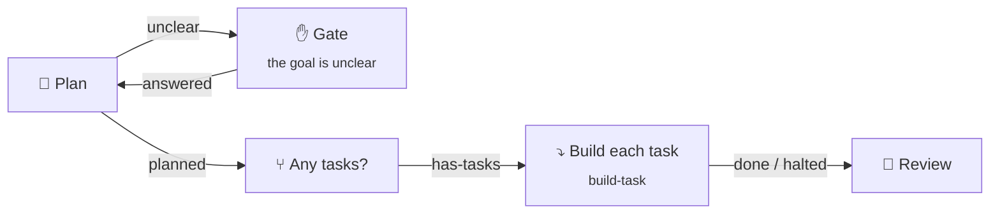

# Flows and nodes

A flow is a graph of steps. Each step is a node. Each edge leaves a node on a named outcome, such as `pass`, `fail`, or `approved`. The engine walks the graph. A model never adds a node or changes the graph during a run, and every loop has a maximum count.

This is the `plan-and-build` starter:

## Node types

<!-- checked:nodes: every node type has one row. bun run docs:reference checks it. -->
| Node | Does |
| --- | --- |
| **Agent** | Runs one coding-agent session with a prompt, and optionally a skill. Ends with an outcome and, if you ask, data that matches a JSON schema. It can ask you a question and continue the same session with your answer. |
| **Command** | Runs a shell command in the project, for example the tests. Its exit code picks the outcome. |
| **Tool** | Calls one tool of an MCP server with typed arguments. No model in the loop. |
| **Decision** | Picks one of its options. A person picks it in a **Gate**, a rule picks it in a **Branch**, or a model picks it. |
| **Value** | Makes data that matches a JSON schema, from a rule, a model, or a person. A person gets an **Ask**: a form in the inbox. |
| **Wait** | Waits for a duration, a time, a command that passes, a signal, or the first of a signal and a command. |
| **Subflow** | Runs another flow or a kit, once or once per item in a list. |
| **Join** | Waits for the branches that run at once: all of them, or the first. The first stops the others. |
| **Lease** | Lets one run at a time do the next steps, for example one deploy at a time. Runs on other computers of the Space take turns too. |
| **Service** | Starts a Docker Compose stack, a dev server, or a model server for the next steps, and stops it after. |
| **End** | Ends the run on purpose: done, nothing to do, or failed, with one line that says why. |
<!-- /checked:nodes -->

### Agent

- **Prompt and skill.** With a skill, the agent gets `/<skill> <prompt>`.
- **Outcomes.** An Agent can declare its own outcomes, such as `approved` and `changes-requested`, in place of `pass` and `fail`.
- **Output.** A JSON schema for the step's data. A step whose data does not match the schema fails.
- **Ask a person.** An agent that needs input opens a Gate. Your answer goes back to the same session.
- **Backups.** Other profiles, on other computers, that take the step when its computer is offline. See [Agents and profiles](Agents-and-profiles.md#backups).

### Cascade

A step can climb a **cascade**. It tries the first tier, and moves up when a try does not hold. Each tier has a number of tries. Each try gets the failure of the try before. A new tier starts a new session. The last tier can be you.

The `implement-and-check` starter is one Agent with a cascade. Sonnet tries up to 3 times, then Opus. After each try, the check runs. A try holds only when the check passes.

A Decision or a Value that a model decides can have a cascade too. A model's pick below the confidence you set goes to the next tier: a stronger model, or you.

### Command

- Template values arrive as environment variables, never as shell text. So `sh -c "{{check}}"` runs the input `check` as a command, and a value cannot inject shell code.
- Secrets arrive as environment variables too.
- JSON that the command writes to `$NS_OUTPUT` is its data. `{"outcome": "approved"}` picks the outcome.
- `{"scores": {"coverage": 81}}` in that data scores the run. Flow health shows the scores of each flow.
- `$NS_KNOWLEDGE` is the project's [knowledge](Knowledge.md) folder.

### Decision

| Who picks | Shows as | How |
| --- | --- | --- |
| A person | **Gate** | You pick an option in the inbox or on the phone. A deadline picks an option for you when nobody answers in time. |
| A rule | **Branch** | It takes the first option whose JSONata rule holds. |
| A model | **Decision** | A model picks an option, with its confidence. |

### Wait

A Wait ends on its own outcomes. A command or a signal can pick one. Every Wait has a timeout. A signal comes from a webhook schedule, by name and key. See [Runs and schedules](Runs-and-schedules.md#webhooks).

### Subflow

A Subflow runs another flow of the project, or a kit. With a list, it runs the flow once per item. The list can come from a planner's data, such as `{{planner.data.tasks}}`, from a command such as `gh`, or from the files that match a glob. Each item can get its own branch, stacked on the item before, or all items share one branch.

### Lease and Service

A **Lease** takes a named lease of the Space, for example `deploy` or `branch:{{pr.data.head}}`. It ends `held` when the run holds the lease. It ends `busy` when another run holds it after the wait you set. The run keeps the lease until it leaves the node's scope or ends.

A **Service** starts a process for the next steps and stops it when the run leaves its scope. It is ready when a command exits 0, or when a URL answers with a 2xx status. See [Services](https://github.com/xiduzo/nightshift/blob/main/docs/deploy/services.md).

## Inputs, outputs, and templates

A flow declares inputs and outputs, like a function. The start dialog asks for the inputs.

Steps read earlier values through templates:

- `{{task}}`: an input of the flow.
- `{{verify.log_tail}}`: the end of the log of the step `verify`.
- `{{planner.data.tasks}}`: a field of the data of the step `planner`.
- `{{run.branch}}`: a fact of the run.

Two or more edges on one outcome run their branches at once. A Join waits for them. A variable can keep its value from one run to the next.

## The editor

- **Sections.** Put related nodes in a Section, a box on the canvas that you zoom into. A Section can hold other Sections. You can move a Section into a flow of its own.
- **Auto layout** arranges the nodes for you.
- **Undo, redo, cut, copy, and paste** work with the keyboard.
- **Issues** at the bottom of the canvas lists the errors and warnings of the flow.
- **Revisions.** Every save is a revision. You see who saved what, and from which computer. You can restore an earlier revision.

Night Shift keeps your flows. A team repository needs no Night Shift files. To move a flow, export it and import it in another project.

## Build a flow with an agent

An agent helps you in the editor, on your own logins:

- **Chat beside the canvas.** Tell the agent what the flow must do. It proposes changes. The canvas marks each node that it adds, removes, or changes, and each edge that it adds or removes. Choose **Apply** or **Discard**.
- **Suggest.** A prompt, the outcomes, a rule, a command, tool arguments, or output fields: one click gives a suggestion that fits the flow.
- **Ask an agent why.** When a run ends early, the run page asks an agent why. The agent reads the run for you.

You choose the agent that answers: a profile, or an agent and a model.

## Kits

Kits are small flows that ship with Night Shift. A Subflow runs one by its name, for example `kit:github/publish-draft-pr`. To change a kit, copy it into the project. The copy is a flow of your own.

Night Shift knows no issue tracker. GitHub, Linear, or Jira is a command in your flow, and the kits wrap the common ones on `git`, `gh`, and `acli`.

<!-- generated:kits: bun run docs:reference writes this table from the code. Do not edit it here. -->
| Kit | Does | Inputs |
| --- | --- | --- |
| `kit:github/create-branch` | Switches to a new branch with the name you give. It starts at the current commit, or at a branch on GitHub. A branch that exists already is switched to as it is. | `name`, `from` |
| `kit:github/finish-pr` | Marks a pull request ready for review, or closes it. Both can leave a comment on it. | `pr`, `action`, `comment` |
| `kit:github/publish-draft-pr` | Pushes the current branch to GitHub and opens a draft pull request for it. A pull request that is open for the branch stays as it is. A branch without new commits ends with nothing to do. | `title`, `body`, `base` |
| `kit:github/wait-for-checks` | Waits until the checks of a commit on GitHub are done, for at most 3 hours. Failed checks end it as failed. To wake it as soon as GitHub is done, add a webhook schedule for check suites that sends the signal ci-done with the commit as its key: event.body.check_suite.head_sha. Without one, it looks again every 10 minutes. | `ref` |
| `kit:github/watch-pr` | Waits until a pull request on GitHub is green, red, merged, closed or ejected from the merge queue. It reads the checks, the review and the merge queue every 10 minutes. To wake it as soon as GitHub reports a change, add a webhook schedule that sends the signal pr-changed with the pull request number as its key. | `pr` |
| `kit:jira/assign` | Assigns a Jira work item to a person, or to you. Needs a CLI tool that runs the Atlassian CLI signed in. | `key`, `assignee`, `tool` |
| `kit:jira/move` | Moves a Jira work item to another status, for example In Progress. Needs a CLI tool that runs the Atlassian CLI signed in. | `key`, `status`, `tool` |
<!-- /generated:kits -->

The knowledge kits are on the [Knowledge](Knowledge.md#sources) page.

## Starter flows

When you add a project, Night Shift saves these flows into it, with the flows they call. Change them to fit the project.

<!-- generated:starters: bun run docs:reference writes this table from the code. Do not edit it here. -->
| Flow | Does | Inputs |
| --- | --- | --- |
| `implement-and-check` | An agent builds a task, and a check proves it after each try. Sonnet tries up to 3 times, each try with the last failure. Then Opus tries. | `task`, `check` |
| `plan-and-build` | An agent splits your goal into small tasks. Night Shift builds and checks each task on top of the one before. An agent then reviews the result. It comes with `build-task`. | `goal`, `check` |
| `review-learnings` | Asks you about what agents proposed to learn about the project. What you keep goes into its knowledge, and agents read it in later runs. Schedule it, or run it from the Knowledge page. | none |
| `per-file` | An agent applies the same instruction to each file that matches a glob. Night Shift then commits all changes at once. It comes with `edit-file`. | `glob`, `instruction` |
<!-- /generated:starters -->

To add a starter later, import its file from [packages/flows/src/starters/flows/](https://github.com/xiduzo/nightshift/tree/main/packages/flows/src/starters/flows). A flow that calls another flow needs that flow in the project too.
