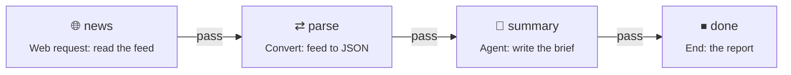

# Your first flow

In this tutorial, you build a flow that reads the news each morning and writes a short brief. It takes about 15 minutes.

You learn how to:

- add nodes and connect them,
- give data from one node to the next,
- end a run with a report,
- run the flow on a schedule.

The flow has four nodes:



## Before you start

- Do the steps in [Get started](Get-started.md). You need an agent and a project.
- Know the words flow, node, outcome, and template. [How Night Shift works](How-Night-Shift-works.md) tells them.

The project can be a project without a folder. This flow writes no files.

## 1. Make the flow

1. Open your project, then its **Flows** page.
2. Choose **New flow**.
3. Type the name `morning-news`, and confirm.

The editor opens. The flow has one Agent node. You use it later.

## 2. Read the feed

A Web request reads a web address and gives the answer as data.

1. Click an empty spot of the canvas and press **Tab**. A search opens.
2. Type `web`, and pick **Web request**.
3. In the panel on the right, click the id under the title. Change it to `news`.
4. Keep **Method** at `GET`.
5. In **URL**, type the address of a news feed, for example `https://feeds.bbci.co.uk/news/world/rss.xml`. Any RSS or Atom feed works.
6. Choose the ▶ button at the top of the panel (**Start the run here**). The run now starts at `news`.

## 3. Turn the feed into a list

A feed is XML text. A Convert node turns it into a list of items that an agent can read.

1. Keep `news` selected.
2. Press **Tab**, type `convert`, and pick **Convert**. The new node goes after `news`, with an edge from its `pass` outcome.
3. Change its id to `parse`.
4. Set **Convert** to **RSS or Atom feed to JSON**.
5. Make sure that **Value** is `{{news.body}}`. This template gives the body of the answer of `news`.

Each item now has a `title`, a `link`, and a `summary`. A later node reads the list as `{{parse.data.items}}`.

## 4. Write the brief

1. Select the Agent node that the flow came with. Change its id to `summary`.
2. In **Profile**, choose one of your profiles.
3. In **Prompt**, type:

   ```text
   These are the news items of today, as JSON:

   {{parse.data.items}}

   Pick the five items that matter most. Write a short brief in Markdown.
   Give each item one line and its link. Do not add an introduction.
   ```

4. Connect `parse` to `summary`. Drag from the `pass` dot of `parse` to `summary`.

When the step ends, `{{summary.output}}` holds the brief.

## 5. End with a report

An End node ends the run. Its report shows on Home, so you can read the brief there.

1. Click an empty spot of the canvas and press **Tab**. Type `end`, and pick **End**.
2. Change its id to `done`.
3. Set **Result** to **Done**.
4. In **Message**, type `The news brief is ready`.
5. Set **Report** to **Write it**. In **Text**, type `{{summary.output}}`.
6. Connect `summary` to `done`. Drag from the `pass` dot of `summary` to `done`.

Look at **Issues** at the bottom of the canvas. When it shows no errors, the flow is ready. The editor saves each change for you.

## 6. Run it

1. Choose **Run** at the top of the editor.
2. Choose **Start**. The run page opens, and shows each step live.

The agent step takes a minute or two. When the run ends, the run page shows the report. Home shows it under **What came out**.

If the run fails, choose **Ask why**. An agent reads the run, and tells you what went wrong and what you can do.

## 7. Run it each morning

1. Go to the **Flows** page.
2. On the card of `morning-news`, open the ⋯ menu and choose **Schedules**.
3. Choose **Add schedule**.
4. Choose **At set times**. Choose **Every day**, and set the time to `07:00`.
5. Choose **Add schedule**.

Night Shift now runs the flow each morning, and the brief waits for you on Home.

A schedule runs only while Night Shift runs. When your computer sleeps at 07:00, the run starts when the computer wakes. After the late window of the schedule (15 minutes by default), Night Shift skips that day. To run schedules on a server that is always on, see [Computers and Hosts](Computers-and-Hosts.md).

## Make it better

Each of these steps teaches one more node.

### Only what is new

A morning brief must not repeat the news of yesterday. A Since last run node remembers the items it saw, and gives only the new ones.

1. Select `parse`. Press **Tab**, type `since`, and pick **Since last run**. Change its id to `fresh`.
2. Set **Watch** to **A list**. Set **List** to `{{parse.data.items}}`, and **Key** to `link`.
3. Connect its `new` outcome to `summary`. Remove the old edge from `parse` to `summary`.
4. In the prompt of `summary`, change `{{parse.data.items}}` to `{{fresh.data.new}}`.

When nothing is new, the node ends on `same`. That outcome has no edge, so the run ends there, and no agent runs. On the first run, every item is new.

### Ask before you send it

To post the brief in a chat channel, use the kit `kit:message/send`. It sends a message to the incoming webhook of Slack, Discord, or ntfy. See [Send a message](Flows-and-nodes.md#send-a-message).

A sent message cannot come back. When other people read the channel, put a Gate before the send:

1. Add a **Gate** after `summary`, with two options: `send` and `skip`.
2. Connect `send` to the Subflow that runs `kit:message/send`.

The Gate shows in your inbox. The message goes out only when you choose `send`.

### Let an agent build it

You can also describe a flow, and let an agent draw it. Open a new flow, and type in the chat beside the canvas: "Each morning, read this feed, and write a brief of the five most important items." Check each proposed change, then choose **Apply**. See [Build a flow with an agent](Flows-and-nodes.md#build-a-flow-with-an-agent).

## Next

- [Flows and nodes](Flows-and-nodes.md) tells every node type.
- [Ideas](Ideas.md) lists flows that nobody has built yet.
- [Gates and the inbox](Gates-and-the-inbox.md) tells how to answer what waits for you.
